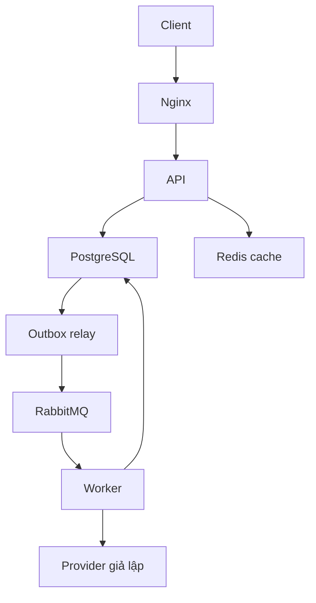

# 00 — Đọc trước: học backend bằng thí nghiệm có bằng chứng

**Docker → Nginx/HTTP → Database → Redis → Message Queues & Event-Driven Architecture**

Bộ này được viết lại từ năm resource Markdown bạn cung cấp, nhằm chuyển từ một danh sách công nghệ và các đoạn lệnh minh họa thành **năm giáo trình thực hành có thể học, chạy, gây lỗi, giải thích và phục hồi**. Mỗi chủ đề chính nằm trong một file riêng. File này là bản đồ: những gì đã được review, học theo thứ tự nào, dùng Runme thế nào, chuẩn bị VPS ra sao, và còn thiếu các năng lực nào để làm backend vững hơn.

Ngày đối chiếu tài liệu chính thức: **17/11/2026**. Các phiên bản được chọn là baseline học tập, không phải lời khẳng định “mới nhất”. Nguồn chính thức nằm trong từng chương để bạn kiểm tra lại khi phiên bản thay đổi.

Một lượt đọc không thể bảo đảm bạn xử lý được mọi dự án. Mục tiêu thực tế của bộ tài liệu là giúp bạn **tự dựng môi trường, chỉ ra được ranh giới bảo đảm của mỗi thành phần, kiểm chứng tính đúng đắn và biết cách điều tra khi kết quả sai**. Khả năng đó có thể mang sang NestJS, Express, Go, Java hoặc một hệ thống khác; bạn không cần nhớ tất cả lệnh.

## 1. Danh sách file và cách chọn điểm bắt đầu

| Thứ tự | File | Năng lực trọng tâm |
|---|---|---|
| 01 | [Docker từ bản chất đến production](01-docker-tu-ban-chat-den-production.md) | Process, image, build, filesystem, network, resource limits, lifecycle, deploy và rollback |
| 02 | [Nginx, HTTP và reverse proxy](02-nginx-http-reverse-proxy-production.md) | Đường đi request, routing, trust headers, DNS, timeout, cache HTTP, streaming, TLS và vận hành edge |
| 03 | [Database, transaction và performance](03-database-transactions-performance.md) | Schema, constraints, MVCC, query plans, indexes, isolation, locks, migrations, pooling, backup và restore |
| 04 | [Redis, caching và concurrency](04-redis-caching-concurrency-production.md) | Data structures, TTL, atomicity, cache races, leases, Streams, persistence, memory và failover |
| 05 | [Message Queues và Event-Driven Architecture](05-message-queues-event-driven.md) | BullMQ, RabbitMQ, retries, inbox/outbox, duplicate-safe effects, replay, reconciliation và vận hành workers |

Các ứng dụng thực hành của năm chương **độc lập về thư mục, Compose project và dữ liệu**. Bạn không cần để PostgreSQL của chương 03 chạy để học chương 05; chương 05 tự tạo database riêng. Kiến thức có quan hệ phụ thuộc, còn tài nguyên chạy được tách để dễ reset và điều tra.

Nếu bạn đã biết một phần, hãy thử rubric cuối chương trước. Chỉ bỏ qua phần mà bạn tự tạo được bằng chứng tương đương. “Tôi từng dùng Redis trong dự án” chưa đồng nghĩa giải thích được vì sao safe unlock vẫn để một stale worker ghi dữ liệu sai.

### Vì sao học theo thứ tự này?

Docker cung cấp môi trường có thể tái tạo và dạy bạn phân biệt process, network và dữ liệu. Nginx cho bạn thấy một request phải đi qua nhiều hop và có thể thất bại ở đâu. Database đứng trước cache và queue vì transaction, constraints và idempotency là nền để bảo vệ nghiệp vụ. Redis được học sau khi bạn đã có source of truth rõ ràng. Queue học cuối để bạn không nhầm việc broker nhận message với việc nghiệp vụ đã hoàn tất.

Đây là lựa chọn sư phạm của bộ giáo trình, không phải thứ tự bắt buộc cho mọi người. Nếu công việc đang yêu cầu sửa RabbitMQ ngay, có thể đọc nhanh chương 05 phần routing và acknowledgements; nhưng trước khi sửa logic tiền hoặc đặt chỗ, quay lại chương 03 về transaction và concurrency.

---

## 2. Review năm resource gốc: vấn đề cần sửa

Các bản gốc có phạm vi rộng và nhiều ý tưởng lab hữu ích. Điểm yếu lớn nhất là **một số ví dụ chưa đủ để chứng minh kết luận**, có chỗ mô phỏng bị mô tả như triển khai thật, và có các khẳng định mạnh hơn bảo đảm thực tế của công nghệ. Viết dài thêm mà giữ các điểm đó sẽ làm bạn nhớ một mô hình sai.

Bảng dưới đây ghi các phát hiện quan trọng và cách bản mới xử lý. Đây là review tài liệu được giao; không phải kết luận về một hệ thống production của bạn.

| Chủ đề | Vấn đề trong bản gốc | Vì sao ảnh hưởng việc học | Hướng xử lý trong bản mới |
|---|---|---|---|
| Docker | Đồng nhất `unhealthy` với tự restart hoặc tự rút traffic | Dễ chẩn đoán sai khi process còn chạy nhưng không phục vụ đúng | Tách liveness/readiness/restart; có fault và quan sát trạng thái riêng |
| Docker | Mã 137 bị dùng như bằng chứng đủ của OOM | `SIGKILL` cũng có thể đến từ thao tác khác | So sánh kill và memory pressure; đọc `OOMKilled`, events và limits |
| Docker | Test chỉ `echo` thành công; DB integration chỉ in config | Không phát hiện lỗi hành vi hoặc mất dữ liệu | Unit tests thật, PostgreSQL adapter thật, migration và restore |
| Docker | Copy native dependencies giữa Alpine và Debian mà thiếu kiểm tra ABI | Build thành công chưa chứng minh binary chạy được | Giữ họ hệ điều hành phù hợp, phân tích libc/platform và kiểm tra artifact |
| Docker | Cleanup theo tên chung, prune rộng; đánh giá quá nhẹ quyền Docker socket | Dễ tác động tài nguyên khác hoặc hiểu sai trust boundary | Project/labels/marker riêng, cleanup có phạm vi, giải thích quyền daemon |
| Nginx | WebSocket chỉ tự trả status 101 trong HTTP handler | Chưa có handshake và trao đổi frame đúng | Backend dùng thư viện WebSocket, client gửi và nhận frame thực |
| Nginx | Gọi deploy “zero downtime” nhưng chỉ gửi request sau khi recreate | Không quan sát được khoảng chuyển phiên bản | Probe liên tục trong lúc đổi upstream, lưu lỗi và thực hiện rollback |
| Nginx | Header IP và dữ liệu cache thiếu trust/privacy policy | Có thể tin IP giả hoặc dùng chung dữ liệu riêng tư | Thử header giả, cache public riêng, bypass auth/cookie, hai user độc lập |
| Nginx | Timeout/retry được xem chủ yếu là tăng cấu hình thời gian | Không nhận ra thao tác phía sau có thể đã thành công | Lab POST timeout nhưng effect đã xảy ra; nối sang idempotency ở DB |
| Nginx | Chứng chỉ thiếu SAN, dùng `curl -k` như kiểm chứng TLS | Bỏ qua bước xác minh mà bài học cần chứng minh | SAN đúng tên, `--cacert`, kiểm tra domain, ACME và renew rehearsal |
| Database | “Có index là nhanh”, “Seq Scan là xấu” và tuning ít bằng chứng | Học mẹo thay vì hiểu planner, phân phối dữ liệu và chi phí | Đọc `EXPLAIN`, actual rows/buffers, selectivity, statistics và workload |
| Database | Isolation giữa PostgreSQL/MySQL bị hiểu như một hợp đồng chung | Cùng tên isolation không đủ để suy ra mọi hành vi ghi | Lab hai session, lịch phối hợp rõ, phần đối chiếu InnoDB riêng |
| Database | Race dựa nhiều vào sleep, ít kiểm tra invariant | Một lần chạy đúng có thể chỉ là may mắn về lịch | Harness có điểm đồng bộ và assertion dữ liệu, thử conflict/deadlock |
| Database | Backup chưa gắn thành công với restore và đối soát | Có file dump không chứng minh khả năng phục hồi | Restore sang DB riêng, kiểm tra dữ liệu/ledger, đo và ghi giới hạn |
| Redis | Password ACL bắt đầu bằng `>` không quote trong shell | Shell hiểu thành redirect, lệnh chạy sai ý định | Quote đúng; thực sự kiểm tra quyền được phép và bị từ chối |
| Redis | Fixed window gọi nhầm sliding window; SCAN chỉ đọc một trang | Sai mô hình rate limit và có thể bỏ sót dữ liệu | Hai thuật toán riêng; SCAN đến cursor 0 và chấp nhận duplicate |
| Redis | Lua/MULTI bị hiểu như có rollback SQL | Error sau một write có thể để lại thay đổi trước đó | Lab partial write; validate trước mutation, giới hạn atomicity rõ |
| Redis | Token unlock và SETNX được diễn giải như an toàn tuyệt đối cho tiền | Lease hết hạn không dừng worker; dedupe trước effect có thể mất việc | Stale-holder/fencing, DB authority, cache khác durable workflow |
| Redis | HA/Cluster chủ yếu có sơ đồ; restore và pending recovery thiếu | Chưa trải nghiệm failure/reclaim/slot constraints | Sentinel, Cluster, restore instance riêng, Streams XAUTOCLAIM |
| Messaging | Ghi Redis DONE trước khi thực hiện effect | Crash ở giữa làm retry bỏ qua nghĩa vụ chưa hoàn thành | Inbox + ledger + mutation trong cùng PostgreSQL transaction |
| Messaging | Publish retry rồi ACK source bằng channel thường | Có khoảng mất message nếu chuyển tiếp chưa được broker xác nhận | Confirm + mandatory return handling; chỉ ACK sau chuyển tiếp được xác nhận |
| Messaging | Outbox bằng mảng RAM gọi là transaction | Không chứng minh durability, rollback hoặc recovery | PostgreSQL outbox thật, leased relay, SKIP LOCKED, crash windows |
| Messaging | Durable/persistent/confirm bị gộp thành “không mất và không trùng” | Không phân biệt routing, lưu trữ, delivery và effect | Tách từng tín hiệu, thử unroutable, duplicate, replay và reconcile |
| Chung | Thiếu prerequisites, output đúng, cleanup, recovery và nguồn phiên bản | Notebook khó chạy lại, lỗi một ô làm các ô sau khó hiểu | Mỗi bài nêu đầu vào, lệnh, bằng chứng, failure scope và cách khôi phục |

Các cơ chế cốt lõi được đối chiếu trong tài liệu chính thức: [Docker restart policies](https://docs.docker.com/engine/containers/start-containers-automatically/), [Nginx WebSocket](https://nginx.org/en/docs/http/websocket.html), [PostgreSQL isolation](https://www.postgresql.org/docs/17/transaction-iso.html), [Redis transactions](https://redis.io/docs/latest/develop/using-commands/transactions/), [Redis distributed locks](https://redis.io/docs/latest/develop/clients/patterns/distributed-locks/) và [RabbitMQ confirms](https://www.rabbitmq.com/docs/confirms). Chi tiết và điều kiện áp dụng nằm trong từng chương.

### Những giới hạn được giữ rõ ràng

Bản mới phân biệt ba mức nội dung: **lab chạy được từ các ô**, **case để phân tích và tự triển khai**, và **chuyên đề kiến trúc chưa dựng thành lab đầy đủ**. Ví dụ PostgreSQL PITR/replication được giải thích và có checklist tiên quyết, nhưng không được gọi là một hệ PITR đã nghiệm thu. Các capstone tổng hợp yêu cầu bạn tự ghép và đưa ra bằng chứng; chúng không phải một production stack đã được vận hành thay bạn.

Các ví dụ payment, ledger, stock và order dùng dữ liệu tổng hợp. Bảo vệ invariant trong một database không tự mở rộng thành bảo đảm cho nhà cung cấp thanh toán, email hoặc dịch vụ bên ngoài. Trạng thái “chưa biết kết quả” được xem là một trạng thái nghiệp vụ cần xử lý.

---

## 3. Runme: biến Markdown thành notebook có thể chạy lại

Cài VS Code và extension Runme của Stateful, mở thư mục chứa sáu file rồi chọn **Open With → Runme Notebook** cho một file `.md`. Dùng Bash; Windows nên chạy Bash trong WSL2 và mở workspace qua WSL. Nếu không dùng Runme, có thể đọc và chạy từng ô Bash trong terminal.

Mỗi ô thực thi có tên ổn định, chẳng hạn `redis-...`, `mq-...`, và metadata `excludeFromRunAll: "true"`. Các ô đều được loại khỏi Run All có chủ đích: một cuốn sách chứa cả tạo lỗi, phục hồi và xóa dữ liệu, nên chạy toàn bộ không phải một thao tác học hợp lý. Cú pháp metadata dựa trên [Runme cell-level configuration](https://docs.runme.dev/configuration/cell-level/); `shell: bash` nằm ở front matter theo [document-level configuration](https://docs.runme.dev/configuration/document-level/).

**Quy trình một bài:**

1. Đọc câu hỏi, dự đoán kết quả và chỉ ra trạng thái dữ liệu trước khi chạy.
2. Kiểm tra nhãn LOCAL/VPS/FAULT/RESET, điều kiện đầu vào và giới hạn tài nguyên.
3. Chạy ô tạo hoặc thay đổi cấu hình; nếu đã tự sửa file được sinh, lưu bản sửa trước.
4. Chạy ô kiểm chứng, đọc cả exit code lẫn dữ liệu/assertions.
5. Gây lỗi nếu bài có phần FAULT, quan sát rồi phục hồi theo bài.
6. Viết lại cơ chế bằng lời của mình; ghi điều thí nghiệm chưa chứng minh.
7. Dừng dịch vụ không còn dùng, giữ lại source/evidence cần học tiếp.

Đừng giả định `export`, hàm shell hoặc `cd` của ô trước tự tồn tại ở ô sau. Các bài dùng file thật và tự chọn thư mục. File/helper được tạo trước là prerequisite có chủ đích; bạn không thể mở thẳng ô restore khi chưa có backup, dù cú pháp ô đó độc lập với terminal state.

Các đoạn code dài tạo application, Compose, SQL hoặc helper bằng heredoc. Khi chạy một ô PREPARE, nó đang tạo nhiều file từ chính Markdown. Đọc đường dẫn đích trước khi bấm. Một ô thất bại không nên được “sửa” bằng việc bỏ `set -e` rồi chạy hết các ô phía sau; hãy tìm dòng lỗi đầu tiên và kiểm tra điều kiện đầu vào.

### Ô kiểm tra ban đầu: chỉ đọc môi trường

Ô dưới không cài phần mềm, không khởi động container và không thay Docker context.

```bash {"name":"course-00-preflight-readonly","excludeFromRunAll":"true"}
set -euo pipefail
printf 'Bash: %s\n' "${BASH_VERSION:?Hãy dùng Bash}"
printf 'Machine: %s\n' "$(uname -sm)"
for tool in docker curl python3; do
  command -v "$tool"
done
docker context show
docker context inspect --format '{{.Endpoints.docker.Host}}'
docker version
docker compose version
docker buildx version
df -h .
```

Nếu `docker version` chỉ in client rồi báo không kết nối server, giải quyết kết nối daemon trước. Nếu context là remote server, xác minh đó đúng là máy học tập; các chương có thể chủ động từ chối context từ xa ở tuyến LOCAL. Đường dẫn bind mount được hiểu tại máy chạy daemon, nên việc trỏ context ra VPS không tương đương copy thư mục laptop lên VPS.

Python 3 phục vụ một số probe/assertions và đọc kết quả; Node được chạy trong container theo từng cuốn. Lần cài dependency đầu tiên cần registry Docker và npm. Proxy doanh nghiệp, kiến trúc CPU và chứng chỉ hệ thống có thể làm bước pull/install khác với laptop cá nhân; lưu thông tin đó vào evidence.

### Nhật ký để không chỉ “chạy ra màu xanh”

Ô tùy chọn này tạo một file ghi nhận phiên học trong thư mục riêng, không sửa các project lab. Nó không tự đưa secrets hay logs production vào file.

```bash {"name":"course-01-create-session-journal","excludeFromRunAll":"true"}
set -euo pipefail
JOURNAL_ROOT="${HOME}/backend-labs/learning-journal"
if [ -e "$JOURNAL_ROOT" ] && [ ! -f "$JOURNAL_ROOT/.course-journal" ]; then
  printf '%s\n' 'Thư mục đã tồn tại nhưng thiếu marker; hãy chọn nơi khác.' >&2
  exit 1
fi
mkdir -p "$JOURNAL_ROOT"
if [ -f "$JOURNAL_ROOT/.course-journal" ]; then
  test "$(cat "$JOURNAL_ROOT/.course-journal")" = 'backend-course-journal/v1'
fi
printf '%s\n' 'backend-course-journal/v1' > "$JOURNAL_ROOT/.course-journal"
SESSION_FILE="$(mktemp "$JOURNAL_ROOT/session-XXXXXX.md")"
cat > "$SESSION_FILE" <<'MD'
# Phiên học

- Ngày, thời gian:
- Chương và tên ô Runme:
- Máy/OS/Docker context:
- Runtime, image digest, lockfile:

## Câu hỏi và dự đoán trước khi chạy

## Kết quả thực tế và đường dẫn evidence

## Điều đúng, điều sai và cơ chế giải thích

## Trạng thái sau lỗi và cách phục hồi

## Giới hạn: bài này chưa chứng minh điều gì?

## Một thay đổi tôi tự thử, kết quả và bước học tiếp
MD
printf 'Journal: %s\n' "$SESSION_FILE"
```

Bằng chứng tốt có input, phiên bản, trạng thái trước/sau và một phép kiểm tra invariant. Một screenshot “container đang chạy” chưa chứng minh API sẵn sàng, backup dùng được hoặc worker không cộng tiền hai lần.

---

## 4. Môi trường, phiên bản và ngân sách tài nguyên

### 4.1. Baseline của bộ sách

| Thành phần | Baseline trong lab | Cần ghi lại khi chạy |
|---|---|---|
| Docker/Compose | Engine/Desktop, Compose v2, Buildx | Version, context, platform; public override Nginx dùng `!override` cần Compose 2.24.4+ |
| Node.js | `node:24-bookworm-slim` | Runtime thực tế, image digest, package lock |
| Nginx | `nginx:1.28-alpine` | `nginx -V`, loaded config, image digest |
| PostgreSQL | `postgres:17-bookworm` | `SELECT version()`, extensions, settings liên quan |
| MySQL tùy chọn | `mysql:8.4`, InnoDB | Version và transaction isolation của session |
| Redis tuyến chính | `redis:7.4-alpine` | Server version, persistence, maxmemory và eviction policy |
| Redis mở rộng | Nhánh Redis 8.2 trong chương 04 | Capability probe trước JSON/Search/Bloom/vector |
| Node clients | `pg@8.16.3`, `redis@5.8.2`, `ws@8.18.3` theo chương | Lockfile và lỗi client tương ứng |
| Queue clients | `bullmq@5.65.1`, `ioredis@5.6.1`, `amqplib@0.10.9` | API behavior theo baseline, không tự đổi major giữa bài |
| RabbitMQ | `rabbitmq:4-management` | Version cụ thể, policies, queue types, digest |
| PgBouncer tùy chọn | Build theo package OS trong chương 03 | Version đã cài, pooling mode, settings thực tế |

Tag Docker có thể thay đổi. Pin version npm trực tiếp chưa khóa toàn bộ dependency gián tiếp trước khi tạo lockfile. Khi đã dựng lab, giữ `package-lock.json`, output version và digest cùng evidence; lần sau dùng tuyến `npm ci`/artifact đã kiểm tra mà chương hướng dẫn. Khóa digest để tái hiện không có nghĩa bỏ cập nhật bảo mật: cập nhật là một thay đổi có kiểm thử và rollback.

Bộ sách không tự chọn một image digest chưa từng pull. Một chuỗi SHA trông “chuyên nghiệp” nhưng không tương ứng artifact đã xác minh sẽ làm notebook kém tin cậy hơn. Hướng dẫn `!override` tham chiếu [Compose merge rules](https://docs.docker.com/reference/compose-file/merge/).

### 4.2. Thư mục, project và cổng

| Chương | Thư mục dưới `$HOME/backend-labs` | Compose project chính | Cổng host mặc định đáng chú ý |
|---|---|---|---|
| Docker | `docker` | `be-docker` | API `127.0.0.1:18101`, một số demo dùng cổng riêng trong sách |
| Nginx | `nginx` | `be-nginx` | HTTP `127.0.0.1:18080`, TLS local `127.0.0.1:18443` |
| Database | `database` | `be-db` | PostgreSQL `127.0.0.1:15432`; tùy chọn MySQL 13306, PgBouncer 16432 |
| Redis | `redis` | `be-redis` | Redis `127.0.0.1:16379`; Sentinel/Cluster dùng project phụ |
| Messaging | `messaging` | `be-mq` | Management UI `127.0.0.1:15673`; Redis/PG/AMQP ở network nội bộ |

Xem bảng này như chỉ dẫn, rồi đọc Compose thực tế trước khi chạy. Tunnel có thể dùng cổng laptop khác cổng VPS. Nếu cổng đã bận, đổi một biến/port theo hướng dẫn và sửa các probes phụ thuộc; đừng kill một process chưa xác định chủ sở hữu.

Nên có khoảng **4–8 GiB RAM khả dụng cho Docker** khi học nhiều service, nhưng đây là ước lượng tổ chức học tập, không phải mức tối thiểu đã benchmark cho mọi máy. Với VPS 1–2 GiB, ưu tiên một project và một nhóm dịch vụ tại một thời điểm; tránh chạy PostgreSQL, RabbitMQ, Sentinel và Cluster cùng lúc. Chừa RAM cho OS, filesystem cache và thao tác fork/backup. Container limit không làm biến mất chi phí của host.

Dung lượng image, build cache, npm cache, volumes và logs tăng theo cách bạn học. Kiểm tra `df` và `docker system df` trước bài tạo dữ liệu hoặc backup. Dọn đúng project bằng phần RESET của từng chương; không dùng một lệnh prune toàn máy chỉ vì một lab báo thiếu đĩa.

### 4.3. Nhãn của một bài

| Nhãn | Bạn đang làm gì? | Điều kiện kết thúc |
|---|---|---|
| PREPARE | Tạo mã/config/helper trong thư mục lab | File đúng, dependency/marker đúng |
| LOCAL | Thực hành trên máy học tập | Assertion đạt, evidence lưu được |
| FAULT | Cố ý gây lỗi có giới hạn | Hiểu triệu chứng, khôi phục, kiểm tra invariant |
| VPS | Thực hành trên server học tập | Xác minh đích SSH, exposure, phục hồi và kiểm tra từ ngoài |
| RESET | Dừng/xóa/khôi phục tài nguyên được gọi tên | Không xóa ngoài phạm vi; dữ liệu cần giữ đã có bản sao |
| CASE/CAPSTONE | Tự phân tích hoặc ghép giải pháp | Có quyết định, code/thử nghiệm và bằng chứng riêng |

Một fault drill có chủ đích không phải hướng dẫn chạy tải lên hệ thống của người khác. Mọi load trong bộ sách được giới hạn trong ứng dụng và tài nguyên của bài. Các lỗi OOM/đĩa đầy chỉ nên làm theo phạm vi được chỉ rõ; không chuyển một lệnh fault local thành lệnh phá host VPS.

---

## 5. Lộ trình học sâu từ đầu đến cuối

Bạn có thể dùng lịch gợi ý dưới đây với khoảng 8–12 giờ mỗi tuần. Số tuần chỉ giúp chia khối công việc, không phải cam kết tốc độ. Nếu chưa quen SQL hoặc JavaScript async, dành thêm thời gian; nếu đã có nền tảng, dùng bài nghiệm thu để đi nhanh hơn.

| Chặng | Khối lượng gợi ý | Nội dung và tiêu chí chuyển chặng |
|---|---|---|
| 0 | 2–3 buổi | Bash, Git cơ bản, HTTP request/response, JavaScript async; chạy preflight và đọc Docker context |
| 1 | 2 tuần | Docker từ setup đến build, PID/signals, health, mounts, DNS; dựng và debug Task API |
| 2 | 1–2 tuần | Docker DB/migration/restore, hardening và deploy rehearsal; rollback đúng artifact |
| 3 | 2 tuần | Nginx routing, headers, DNS, timeout, caching, SSE/WS, TLS và blue/green có probe |
| 4 | 3 tuần | Database schema, MVCC, index/statistics, concurrency; giữ đúng invariants trước tối ưu |
| 5 | 1–2 tuần | Database migrations, pooling, restore, VPS; đối chiếu MySQL nếu công việc cần |
| 6 | 2 tuần | Redis primitives, Lua, cache races, leases, Streams, persistence và memory |
| 7 | 1 tuần | Redis Sentinel/Cluster/Redis 8 tùy mục tiêu; hiểu failure domain và giới hạn |
| 8 | 2–3 tuần | BullMQ, RabbitMQ, inbox/outbox, crash windows, replay/reconcile, VPS |
| 9 | 2 tuần hoặc hơn | Capstone tổng hợp, incident report, review với người khác và sửa điểm yếu |

Đây là lộ trình khoảng **16–20 tuần**, có thể kéo dài hơn nếu làm đủ bài mở rộng. Đừng chạy đua số trang. Một buổi tìm được vì sao request timeout nhưng transaction đã commit có giá trị hơn việc copy xong mười lệnh mà chưa biết tác dụng.

### Ba lượt học cho mỗi chương

**Lượt 1 — Làm cho đúng.** Đi theo thứ tự lần đầu, dựng môi trường, hiểu dữ liệu nằm ở đâu, chạy phần cơ bản và viết được lời giải thích ngắn. Không tối ưu khi chưa giữ đúng invariant.

**Lượt 2 — Làm cho hỏng có kiểm soát.** Chạy các fault/concurrency/recovery labs. Trước mỗi lỗi, viết dự đoán “cái gì có thể mất, cái gì có thể trùng, cái gì chưa biết kết quả”. Sau lỗi, kiểm tra những điều đó bằng query/logs/metrics.

**Lượt 3 — Tự làm không có đáp án ngay bên cạnh.** Chọn capstone, đổi điều kiện, tự viết assertion và runbook. Ví dụ thay một consumer thành ba consumer, giảm memory, tăng thời gian xử lý, đổi cardinality dữ liệu hoặc triển khai lại phiên bản trước. Mỗi lần chỉ đổi một nhóm biến để còn giải thích được kết quả.

### Bài bắt buộc và bài nâng cao

| Chương | Phần nên nắm chắc trước | Phần làm sau khi tuyến chính ổn |
|---|---|---|
| Docker | Image/container, reproducible build, volume, network, signals, health, limits, logs, DB restore, rollback | Multi-platform, supply chain sâu, deployment variations |
| Nginx | URI/location, headers trust, DNS, timeout/retry, cache privacy, TLS, logs | Tuning sâu, capacity variations, ACME public nếu có domain |
| Database | Schema/constraints, transaction/isolation, query plan, composite index, concurrency, migrations, restore | BRIN/partition/PgBouncer sâu, MySQL comparison, PITR/replication architecture |
| Redis | TTL/data types, atomicity, cache-aside races, lease limits, persistence, eviction, ACL | Sentinel, Cluster, JSON/Search/vector, workload-specific tuning |
| Messaging | BullMQ lifecycle/retry, Rabbit routing/confirms/ACK, transactional inbox/outbox, replay/reconcile | Saga alternatives, complex scheduling/flows, capacity and multi-host designs |

“Làm sau” không có nghĩa chạy thẳng ô cuối mà bỏ prerequisites. Nếu một bài cơ bản sinh helper cho bài nâng cao, bạn vẫn cần chạy setup đó. Từng notebook ghi dependency cục bộ; bảng này chỉ giúp phân bổ mức độ tập trung.

### Mười câu kiểm tra nền tảng trước khi sang capstone

1. Một container đang chạy chứng minh điều gì, và không chứng minh điều gì?
2. Khi một HTTP POST timeout, bạn biết chắc những trạng thái nào? Trạng thái nào còn chưa biết?
3. Dữ liệu nào là nguồn sự thật và dữ liệu nào có thể tái tạo?
4. Điều kiện “mỗi đơn chỉ bị trừ một lần” được bảo vệ tại đâu?
5. Nếu process chết giữa hai thao tác, có một commit chung không?
6. Một message được broker xác nhận đã nói gì về consumer và tác dụng phụ?
7. Lock hết hạn có dừng code của worker cũ không?
8. Một backup đã tồn tại cần thêm phép kiểm tra nào trước khi bạn tin vào recovery?
9. Khi tải tăng, hàng đợi nào trong hệ thống có thể tăng trước CPU?
10. Cấu hình/phiên bản nào đang thực sự chạy, và bạn quay lại phiên bản trước bằng gì?

Không cần đáp án giống hệt sách. Cần giải thích đúng cơ chế, nêu điều kiện áp dụng và đưa ra ví dụ phản chứng.


---

## 6. Dùng VPS đang có: tiến từng bước có thể quay lại

Bạn có VPS là một lợi thế lớn để học DNS, HTTPS, quyền file, resource pressure và deploy thực tế. Cấu hình CPU/RAM/OS, domain, dịch vụ đang chạy và cách backup hiện tại chưa được cung cấp, nên giáo trình không giả định VPS trống hoặc tự thay cấu hình hệ thống của bạn.

### 6.1. Bốn giai đoạn triển khai

| Giai đoạn | Mục tiêu | Điều kiện chuyển tiếp |
|---|---|---|
| A. Local | Chạy tuyến cơ bản và restore/rollback ở máy cá nhân | Biết artifacts, volumes, ports và cách reset |
| B. VPS private | Copy đúng file/artifact, bind loopback, truy cập bằng SSH tunnel | Xác minh identity máy, quyền SSH, tài nguyên, logs và restart |
| C. Public demo | Nginx + domain thử + TLS, chỉ route đã chọn | DNS đúng, renewal được thử, không lộ fault/admin/DB/broker |
| D. Rehearsal vận hành | Deploy phiên bản mới, rollback, backup ngoài host và restore | Có evidence, thời gian thực tế và giới hạn RPO/RTO |

Các lệnh chi tiết nằm ở chương tương ứng. Docker tập trung artifact và rollback; Nginx có tuyến tunnel và tuyến domain HTTPS; Database có DB riêng và tunnel; Redis có preflight/restore/failover; Messaging có credentials riêng, internal network và management tunnel.

VPS đã chạy ứng dụng quan trọng nên dùng một môi trường staging riêng nếu có thể. Nếu dùng chung host, cần biết RAM/đĩa/ports của các service hiện hữu và chạy lần lượt. Project Compose riêng không cô lập sự cố hết đĩa, thiếu RAM hoặc mất host.

### 6.2. Trước khi chạy ô có nhãn VPS

Kiểm tra địa chỉ SSH và hostname của máy; xem tài nguyên còn lại, cổng đã lắng nghe, Docker context và Compose project. Xác nhận bạn có cách đăng nhập lại nếu terminal mất kết nối. Nếu một bước cần mở cổng public, xem cả firewall của nhà cung cấp và đường publish của Docker. Docker có cách tích hợp firewall riêng; không suy rằng một rule UFW đơn lẻ đã mô tả toàn bộ exposure. Tham chiếu [Docker và firewall](https://docs.docker.com/engine/network/packet-filtering-firewalls/).

Đừng dùng password demo trong một endpoint public hoặc tái sử dụng secret từ production vào lab. Secret dùng cho bài học phải riêng, không nằm trong image layer hoặc evidence chia sẻ. Nếu cần chụp log để hỏi lỗi, bỏ connection string, token, private key, dữ liệu cá nhân và giá trị credential trước.

Không chuyển ngay mọi workload lên VPS. Một mô hình học tốt là laptop giữ notebook/evidence, VPS chạy một project tại một thời điểm, dữ liệu đều là synthetic. Khi học xong phần private, mới mở tuyến public đã giới hạn của Nginx.

### 6.3. Một VPS không phải nhiều failure domains

Ba Redis Sentinel hoặc ba RabbitMQ/Redis nodes cùng một VPS có ích để học protocol, bầu chọn, routing và reconnect. Chúng cùng mất khi host, nguồn điện, disk hoặc mạng của host mất. Lab đó không chứng minh khả năng chống mất một máy.

Tương tự, backup đặt trong một volume khác nhưng cùng ổ đĩa có thể giúp xử lý lỗi logic nhỏ, nhưng chưa bảo vệ khỏi mất cả máy. Bạn phải thực hành copy bản sao ra ngoài failure domain, kiểm tra quyền đọc/encryption cần thiết, rồi restore vào môi trường tách biệt. RPO là mức mất dữ liệu được chấp nhận; RTO là thời gian khôi phục mục tiêu. Hai giá trị cần đo và thỏa thuận theo nghiệp vụ, không được suy ra chỉ từ tên một cơ chế persistence.

### 6.4. Khi có sự cố trong lúc học

Dừng việc tạo tải mới, giữ thông tin lỗi đầu tiên và xác định phạm vi. Xem service nào không ready, process nào restart, disk/RAM có cạn không và request có tới được từng hop không. Chạy phần recovery của đúng bài; sau đó kiểm tra invariant. “Container lên lại” chỉ là một phần của phục hồi.

Nếu không biết một volume hoặc container thuộc ai, không xóa. Nếu cấu hình đã thay đổi ngoài bài học, lưu diff trước khi chạy lại ô generate. Khi cần bắt đầu lại, dùng RESET có phạm vi của chương và giữ evidence để lần chạy trước vẫn có ích.

---

## 7. Capstone tổng hợp: một backend có thể giải thích và phục hồi

Năm cuốn có capstone riêng. Sau đó, dùng bài tổng hợp dưới đây để kết nối kiến thức thành một hệ thống nhỏ. Đây là **đề bài tự triển khai**, không phải lời tuyên bố bộ sách đã kèm một repository tổng hợp chạy một lệnh.

### 7.1. Bối cảnh nghiệp vụ

Xây dựng một dịch vụ catalog và đơn hàng có cộng điểm thưởng. Client xem sản phẩm, tạo đơn với idempotency key và theo dõi trạng thái xử lý. Giá trị nghiệp vụ nằm trong PostgreSQL. Redis cache catalog có thời hạn và quy tắc invalidation. Outbox chuyển nghĩa vụ xử lý sang broker. Worker cộng điểm bằng inbox/ledger để duplicate delivery không tạo hiệu ứng trùng. Một provider giả lập cho phép trả timeout sau khi đã ghi nhận yêu cầu.

Nginx phục vụ HTTP/TLS, truyền request identity và giới hạn tài nguyên phù hợp. Docker đóng gói application và worker, giữ config/secrets/data tách biệt. Nếu dùng BullMQ cho một job phụ như xuất báo cáo, tách Redis dành cho queue khỏi Redis cache có eviction. Không cần dùng mọi tính năng của mọi công cụ trong cùng một hệ thống.



Sơ đồ mô tả luồng xử lý, không biểu thị transaction xuyên tất cả các hộp. Order + outbox có một transaction database. Inbox + ledger + cộng điểm có một transaction khác. Publish, ACK, cache và provider nằm ở các ranh giới cần xử lý failure riêng.

### 7.2. Hợp đồng cần viết trước code

Chọn đơn vị tiền, phạm vi tenant/user, định danh order/event/operation, thời hạn idempotency và policy khi cùng key đi với payload khác. Ghi rõ endpoint nào trả “accepted”, endpoint nào trả kết quả đã hoàn thành. Xác định độ stale tối đa của catalog và cách xử lý khi cache không sẵn sàng.

Với provider, phân biệt thất bại chắc chắn, thành công chắc chắn và unknown outcome. Nếu request timeout sau khi provider có thể đã xử lý, retry bằng định danh nào và reconciliation dựa vào dữ liệu nào? Không dùng timeout như bằng chứng thao tác chưa xảy ra.

Thiết kế trạng thái có đường đi cuối rõ: completed, failed có lý do, pending cần retry, quarantined cần người xử lý hoặc unknown cần đối soát. Trạng thái nào cũng cần timestamp và chủ sở hữu hành động kế tiếp. “Retry forever” không phải một trạng thái vận hành tốt.

### 7.3. Ma trận nghiệm thu

| Tình huống | Điều cần giữ đúng | Bằng chứng tối thiểu |
|---|---|---|
| Hai request cùng key, cùng payload | Một nghĩa vụ nghiệp vụ, response nhất quán theo hợp đồng | Unique constraints, số order/ledger, kết quả hai request |
| Cùng key, payload khác | Từ chối xung đột theo contract | Status/error + không có mutation ngoài ý muốn |
| Hai người mua item cuối cùng | Không vượt tồn kho đã định nghĩa | Lịch concurrent test + query kiểm tra stock/reservations |
| API timeout sau DB commit | Client có cách tra kết quả/retry không lặp effect | Correlation ID, idempotency record và kết quả lần thử lại |
| Relay chết sau publish confirm | Event có thể được gửi lại nhưng effect không lặp | Outbox state, delivery evidence, ledger count |
| Consumer chết sau commit trước ACK | Redelivery giữ invariant | Inbox/ledger sau khôi phục, ACK/delivery logs |
| Redis cache mất | Catalog có policy fallback giới hạn, DB không bị đẩy tải vô hạn | Error budget/load bound, DB query count và latency |
| Cache cũ quay lại sau invalidate | Staleness nằm trong contract hoặc được phát hiện | Timeline/version và assertion ở lab cache race |
| Message schema sai | Không gây vòng retry nóng và không biến mất không dấu vết | Quarantine reason, original ID, replay audit |
| Broker ngừng tạm thời | Outbox giữ nghĩa vụ và backlog được xử lý sau khôi phục | Due age, count trước/sau, reconcile không còn gap |
| Deploy cấu hình/version lỗi | Phát hiện lỗi và rollback artifact đúng | Probe trong lúc deploy, image/release identity và timeline |
| Restore từ backup | Schema/dữ liệu/invariants nhất quán ở đích riêng | Restore log, business queries, dữ liệu thiếu được giải thích |
| Client giả X-Forwarded-For | App không tin IP ngoài trust boundary đã chọn | Request đầu vào và IP app quan sát |
| User A/B qua cache | Không dùng chung dữ liệu riêng tư | Request auth/cookie khác nhau và assertions nội dung |
| Worker shutdown giữa việc | Ngừng nhận mới, drain hoặc trả quyền xử lý theo policy | Signal timeline, in-flight count và trạng thái cuối |

Một test pass chỉ chứng minh trường hợp đã chạy trong điều kiện đó. Mở rộng test bằng cách đổi thời điểm crash, số worker, thứ tự message, thời gian lease và cách mất kết nối. Điều quan trọng là biết mình đang mở rộng failure model nào.

### 7.4. Hồ sơ bàn giao của capstone

Giữ README chạy từ máy sạch, sơ đồ component và transaction boundary, version/digest/lockfile, migrations, cấu hình không có secret, scripts kiểm chứng và evidence đã lọc. Viết một runbook cho outage DB, một cho backlog queue và một cho rollback release. Mỗi runbook cần dấu hiệu nhận biết, câu lệnh chỉ đọc đầu tiên, quyết định hành động, cách kiểm tra phục hồi và tình huống cần dừng/escalate.

Thêm một incident report ngắn: impact, timeline, nguyên nhân, yếu tố góp phần, cách khôi phục, thay đổi ngăn lặp và bằng chứng sau thay đổi. Tránh chỉ ghi “restart thì hết”. Người review cần biết tại sao lần sau hệ thống hoặc quy trình sẽ xử lý tốt hơn.

### 7.5. Rubric để tự đánh giá

Chấm từng trục từ 0 đến 3: 0 chưa làm, 1 làm theo hướng dẫn, 2 tự giải thích và tái hiện được, 3 xử lý được một biến thể chưa có sẵn.

| Trục | Mức 3 cần thể hiện |
|---|---|
| Mô hình tư duy | Giải thích ranh giới bảo đảm, đưa ra phản ví dụ cho kết luận quá mạnh |
| Tính đúng dữ liệu | Dùng constraints/transaction/idempotency và test concurrency phù hợp |
| Debug | Tìm được hop/lớp gây lỗi bằng bằng chứng, không đoán từ một log |
| Phục hồi | Restore, replay hoặc rollback có kiểm tra invariant sau cùng |
| Vận hành | Giới hạn tài nguyên, logs/metrics có ích, secret/exposure đúng phạm vi |
| Tái lập và bàn giao | Người khác chạy được từ tài liệu và hiểu các giới hạn |

Mốc gợi ý là **ít nhất 2 ở mọi trục**, không phải điểm cao ở một trục bù cho dữ liệu sai ở trục khác. Đây là rubric học tập do bộ sách đề xuất, không phải chứng nhận nghề nghiệp.

---

## 8. Những kiến thức nên học thêm, theo mức ưu tiên

Năm chủ đề hiện tại tạo nền tốt về runtime, request path, dữ liệu, cache và async workflows. Để làm backend toàn diện, bạn còn cần ngôn ngữ/runtime, API contracts, security, testing, observability và delivery. Không nên gom tất cả thành một file khổng lồ hoặc học đồng loạt.

Bảng dưới là **danh sách notebook nên làm ở giai đoạn tiếp theo**. Các tên file là đề xuất để bạn giữ cấu trúc “một chủ đề, một file”; chúng chưa phải các file nằm trong gói hiện tại. Thứ tự thể hiện ưu tiên học, không phải phiên bản của công nghệ.

| Ưu tiên | Chủ đề và tên file đề xuất | Học lúc nào | Bài nghiệm thu nên làm |
|---|---|---|---|
| P0 | Linux, Bash, process và networking — `06-linux-networking-debugging.md` | Song song Docker/Nginx | Đi từng hop DNS→TCP→TLS→HTTP; phân biệt permission, route, listener, resource limit |
| P0 | Node.js runtime và TypeScript — `07-nodejs-typescript-runtime.md` | Song song toàn bộ | Đo event-loop delay, xử lý cancellation/deadline, streams backpressure, memory leak và graceful shutdown |
| P0 | HTTP API design và resilience — `08-api-contracts-resilience.md` | Sau Nginx, cùng Database | Thiết kế pagination, errors, idempotency, retry budget, deadlines, webhook signatures/versioning |
| P0 | Authentication, authorization và API security — `09-auth-api-security.md` | Trước public dữ liệu/nghiệp vụ thật | Multi-tenant object authorization, session/token rotation, abuse limits, SSRF và kiểm thử quyền |
| P0 | Testing backend — `10-testing-integration-contract-load.md` | Bắt đầu từ Database | Integration test DB/broker thật, deterministic concurrency, contract tests, bounded load và fault tests |
| P1 | Observability, SLI/SLO và incident response — `11-observability-sre.md` | Sau Nginx, phát triển cùng MQ | Trace một request tới job, dashboard theo user impact, alert theo mục tiêu và incident report |
| P1 | CI/CD và software supply chain — `12-cicd-artifacts-deployment.md` | Sau Docker | Build một artifact, kiểm thử rồi promote, secrets nhỏ quyền, deploy/rollback cùng migration compatibility |
| P1 | Modeling và application architecture — `13-domain-modular-monolith.md` | Sau transaction nền tảng | Module boundaries, use cases, transaction ownership, dependency direction, ADR và refactor có tests |
| P1 | Object storage và file workflows — `14-object-storage-file-processing.md` | Khi làm upload/export/import | Signed upload, validation, streaming, idempotent processing, cleanup và lifecycle |
| P1 | Infrastructure as Code và cloud nền tảng — `15-iac-cloud-operations.md` | Sau khi vận hành VPS bằng tay | Dựng lại staging từ code, IAM nhỏ quyền, private networking, secrets, backup và drift review |
| P2 | Distributed systems sâu — `16-distributed-systems-failure-models.md` | Sau inbox/outbox, Sentinel | Time/ordering, quorum, partitions, consistency tradeoffs, lease/fencing và fault model |
| P2 | Kafka, CDC và data pipelines — `17-kafka-cdc-replay.md` | Khi có yêu cầu log/replay/projection | Consumer offsets, replay, partition ordering, schema evolution, CDC/outbox và backfill |
| P2 | Kubernetes và platform operations — `18-kubernetes-operations.md` | Sau khi hiểu Compose và deploy/recovery | Readiness/liveness, requests/limits, rollout, storage, ingress/network policy và mất node |
| P2 | Search và indexing chuyên sâu — `19-search-indexing-relevance.md` | Khi product có nhu cầu search thật | Sync projection từ DB, refresh/rebuild index, relevance evaluation, pagination và permission filters |

**P0** là nền nên bổ sung sớm. **P1** giúp biến một ứng dụng chạy được thành một ứng dụng có thể phát triển và vận hành cùng đội. **P2** học khi đã hiểu bài toán hoặc dự án cần; không cần Kubernetes/Kafka chỉ để chứng minh mình biết nhiều công cụ.

### 8.1. Vì sao các phần P0 đáng ưu tiên?

Ở Linux/networking, khả năng biết request đang mắc ở DNS, TCP, TLS, proxy hay app giúp bạn giảm đáng kể số giả thuyết phải thử. Chương Docker/Nginx đã mở đầu nhưng chưa thay thế một giáo trình networking riêng. [HTTP Semantics RFC 9110](https://datatracker.ietf.org/doc/html/rfc9110) là nguồn chuẩn để tra method, status, intermediaries và idempotency của HTTP.

Ở Node.js, async I/O không làm công việc CPU nặng tự biến mất. Học event loop, worker pool, streams, cancellation và profiling sẽ giúp bạn hiểu cả API chậm lẫn BullMQ stalled jobs. Nguồn khởi đầu: [Node.js — Don't Block the Event Loop](https://nodejs.org/en/learn/asynchronous-work/dont-block-the-event-loop). TypeScript giúp diễn đạt contract nhưng không thay runtime validation cho dữ liệu từ network, database cũ hoặc message schema khác.

Security cần gắn với nghiệp vụ: user có quyền với object này không, tenant có bị truy cập chéo không, webhook có xác minh raw body và timestamp không, token bị lộ có thu hồi được không. TLS không giải quyết những câu hỏi đó. Dùng [OWASP API Security Top 10](https://owasp.org/API-Security/editions/2023/en/0x11-t10/) để lập nhóm rủi ro và viết test cụ thể, thay vì chỉ thêm một middleware rồi gọi là an toàn.

Testing phải kiểm tra một thuộc tính có giá trị. Một test mock repository trả số dư “đúng” không chứng minh SQL transaction giữ invariant. [Testcontainers cho Node.js](https://testcontainers.com/guides/getting-started-with-testcontainers-for-nodejs/) là hướng học phù hợp để chạy integration tests với service thật trong container. Bạn vẫn cần lựa chọn dữ liệu, lịch concurrency và assertion; chỉ thay mock bằng container chưa tạo ra một test tốt.

### 8.2. Vì sao observability và delivery phải thành môn riêng?

Chương Nginx/Redis/MQ đã có logs, timing và runbooks. Một hệ thống thật cần liên kết telemetry qua request/job/event, kiểm soát cardinality và chi phí, xác định SLI theo trải nghiệm người dùng, rồi chọn alert hành động được. [OpenTelemetry signals](https://opentelemetry.io/docs/concepts/signals/) cung cấp mô hình traces/metrics/logs; [Google SRE Workbook](https://sre.google/workbook/table-of-contents/) có các chương về SLO, alerting, incident response và quản lý tải. Lộ trình học này là đề xuất của bộ sách, không phải một lời hứa rằng cài collector sẽ có observability tốt.

Với CI/CD, điều cần giữ là danh tính artifact và quy trình thay đổi: version đã test có đúng version lên VPS không, migration có tương thích cả phiên bản cũ và mới không, quyền của workflow có quá rộng không, secrets có bị log không? Tham chiếu [GitHub Actions secure use](https://docs.github.com/en/actions/reference/security/secure-use). Chọn một công cụ CI để học sâu workflow này trước; kiến thức chuyển sang công cụ khác được.

### 8.3. Khi nào nên học Kafka, CDC hoặc Kubernetes?

Nếu bạn cần nhiều consumer độc lập đọc lại lịch sử dài, xây projection mới từ log hoặc tích hợp thay đổi dữ liệu, Kafka/CDC đáng học. Đầu tiên phải nêu retention, ordering theo key, replay policy, schema compatibility và nguồn sự thật. [Debezium documentation](https://debezium.io/documentation/reference/stable/) là nguồn chính thức cho nhánh CDC; việc chọn nó cần dựa trên engine và yêu cầu vận hành thực tế.

Kubernetes có nhiều cơ chế quản lý workloads và desired state; nó cũng thêm thành phần cần hiểu và vận hành. Đọc [Kubernetes overview](https://kubernetes.io/docs/concepts/overview/) sau khi bạn đã giải thích được lifecycle, health, network, limits, storage và rollout bằng Docker/Compose. Một bài học tốt là chuyển capstone đã hiểu sang Kubernetes và chỉ ra điều gì thay đổi, điều gì vẫn là trách nhiệm của application.

---

## 9. Trạng thái kiểm chứng của bộ tài liệu

### Đã làm trong môi trường biên soạn

Đã đọc năm nguồn được cung cấp, viết lại năm notebook, đối chiếu cơ chế với tài liệu chính thức và rà soát chéo các phần có nhiều failure windows: transaction/idempotency/outbox, lifecycle/restore/deploy, cache concurrency, DNS/reload/TLS.

Đã kiểm tra cấu trúc Markdown, metadata JSON của ô, tên ô không trùng, thuộc tính tránh Run All, cú pháp Bash và mã JavaScript được trích từ heredoc. Các payload Python, JSON và YAML được parse khi có trong notebook. Cú pháp YAML có custom tag của Compose được parse bằng loader tương ứng; điều này chưa thay thế `docker compose config`.

Các unit tests domain độc lập của chương Docker đã chạy bằng Node trong môi trường biên soạn. Đây là tests thật cho phần không phụ thuộc Docker/PostgreSQL; không được suy rộng thành việc toàn ứng dụng hoặc mọi lab đã chạy thành công.

Helper kích hoạt cấu hình Nginx cũng được chạy qua ba kịch bản với Docker giả lập: candidate hợp lệ, candidate sai cần rollback, và lệnh reload trả thành công nhưng generation chưa thay đổi. Cả ba kiểm tra luồng điều khiển/khôi phục của script; chúng không kiểm tra parser Nginx hoặc một lần reload thật.

Bảng thống kê cuối cùng được ghi ở phần “Thống kê bản phát hành” bên dưới. Số ô đo lượng thao tác được đóng gói, không phải thước đo độc lập của chất lượng học.

### Chưa chạy được tại đây

Môi trường biên soạn không có Docker daemon, Runme runtime, PostgreSQL/MySQL, Redis, RabbitMQ hoặc Nginx service để thực thi toàn tuyến. Vì vậy chưa có xác nhận thực nghiệm cho image pull/build, `npm ci` trong image, Compose runtime, SQL execution, topology/policies của broker, protocol/failover, benchmark, restore bằng service thật hoặc deploy vào VPS của bạn.

Không có số đo throughput hay “không mất request” nào được lấy từ một lần chạy tưởng tượng. Các phần “kết quả mong đợi” là hợp đồng để bạn kiểm chứng trên baseline. Khi runtime khác tài liệu, lưu versions/input/logs và tìm nguyên nhân; không bỏ assertion chỉ để có kết quả pass.

### Cách nghiệm thu trên máy của bạn

Bắt đầu với setup + một happy path + một fault/recovery của từng chương. Chạy lần lượt, giữ actual version/digest. Sau đó mở rộng đến backup/restore và các capstone. Với workload timing, chấp nhận khoảng biến thiên được giải thích và kiểm tra trạng thái thay vì phụ thuộc một con số giây cố định.

Trước khi dùng một pattern trong dự án thật, thay dữ liệu lab bằng một mô hình synthetic giống workload, thêm authentication/authorization, xác định secret/network policy và chạy integration/load/failure tests theo yêu cầu dự án. Những bước này là việc biến bài học thành triển khai phù hợp môi trường của bạn.

---

## 10. Kế hoạch cho buổi đầu tiên

Dành một buổi 60–90 phút cho file 00 và phần đầu chương Docker. Kiểm tra shell, context và daemon; tạo project có marker; sinh Task API; đọc contract của `/live` và `/ready`; chạy tests và build theo các ô của chương. Nếu thời gian hết, dừng tại checkpoint với evidence đã lưu.

Ở buổi thứ hai, chọn một thay đổi đơn giản: sửa một response, rebuild, so sánh image/container, rồi giải thích vì sao `restart` và recreate có kết quả khác nhau khi cấu hình thay đổi. Tự viết dự đoán trước khi chạy.

Sau mỗi chương, trả lời rubric bằng bằng chứng. Sau toàn bộ tuyến chính, quay lại mười câu nền tảng ở phần 5 và làm capstone tổng hợp. Cách học này giúp bạn tích lũy khả năng lý giải và xử lý sự cố, thay vì chỉ tích lũy thêm các lệnh đã từng chạy.

## Thống kê bản phát hành

| Notebook chính | Ô Bash có tên | Số dòng Markdown |
|---|---:|---:|
| 01 — Docker | 66 | 2.739 |
| 02 — Nginx | 32 | 1.841 |
| 03 — Database | 47 | 3.001 |
| 04 — Redis | 40 | 1.868 |
| 05 — Message Queues | 47 | 3.545 |
| **Tổng năm notebook chính** | **232** | **12.994** |

File hướng dẫn này bổ sung 2 ô, thành **234 ô Bash** trong bộ sáu Markdown. Số dòng là thống kê file nguồn, không quy đổi thành trang in. Mỗi ô có thể tạo nhiều file hoặc thực hiện nhiều bước; số ô không đồng nghĩa số case production độc lập.

Lượt kiểm tra tự động cuối: **234 ô Bash**, **12 shell script được sinh**, **84 đoạn JavaScript được trích**, **15 đoạn Python**, **5 payload JSON** và **17 payload YAML** đều qua kiểm tra cú pháp/parse tương ứng. Tên ô không trùng, metadata hợp lệ và liên kết tương đối giữa các notebook tồn tại. Bộ kiểm tra không khẳng định đã phân tích mọi chuỗi lệnh nội tuyến hoặc ngữ nghĩa runtime.

Kiểm thử thực thi riêng: **4/4 Node domain tests** và **3/3 kịch bản mock cho helper Nginx** đạt. Các giới hạn về Docker, database, broker, Runme và VPS đã ghi ở phần 9 vẫn áp dụng đầy đủ.


