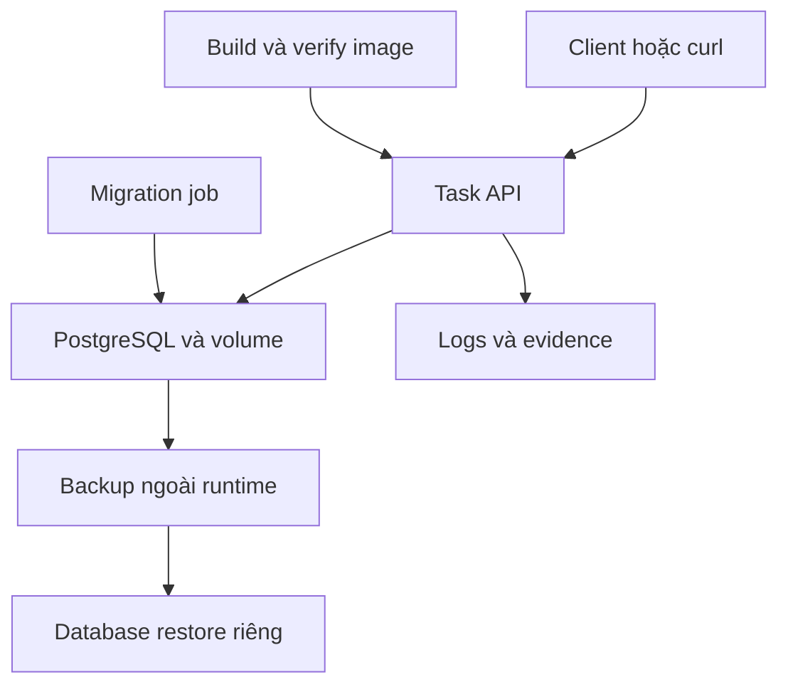

# Docker cho backend engineer: từ tiến trình Linux đến vận hành trên VPS

**Giáo trình thực hành độc lập · Runme Markdown · Đối chiếu tài liệu ngày 17/11/2026**

Bạn học Docker để trả lời được những câu hỏi khi hệ thống có vấn đề: tiến trình nào đang chạy, cấu hình nào thực sự được áp dụng, dữ liệu nằm ở đâu, đường đi của một kết nối là gì, giới hạn tài nguyên có hiệu lực không, và làm thế nào quay lại phiên bản trước mà không làm mất dữ liệu. Biết gõ `docker compose up` chỉ là điểm bắt đầu.

Cuốn này thay thế cách học bằng những lời hứa như “cô lập hoàn toàn”, “không thể bị tấn công”, “không bao giờ mất dữ liệu” bằng **giả thuyết, thí nghiệm, bằng chứng và cách khôi phục**. Container vẫn tiêu thụ CPU, RAM, đĩa, mạng của máy. Docker daemon có quyền lớn. Thư mục được bind mount có thể bị sửa. Một lệnh đúng cú pháp nhưng chạy nhầm Docker context vẫn có thể tác động lên máy khác. Vì vậy, hãy học trên máy cá nhân hoặc VPS chuyên dùng cho thực hành, đọc phạm vi mỗi ô trước khi chạy.

Ứng dụng xuyên suốt là **Task API viết bằng Node.js 24**, có repository trong RAM và adapter PostgreSQL, health/readiness riêng, idempotency key, migration, log JSON và graceful shutdown. Đây là ứng dụng Node.js tối giản, không gọi nhầm thành NestJS. Dùng JavaScript ESM giúp tập trung vào Docker; cuối sách chỉ ra cách chuyển cấu trúc sang NestJS hoặc một backend theo Clean Architecture. Tất cả mã nguồn, cấu hình và script đều được sinh từ chính file Markdown này. Bạn không cần tải một repository phụ.

## Cách dùng với Runme

Mở file trong VS Code, cài extension Runme của Stateful, rồi chọn **Open With → Runme Notebook**. Ô lệnh chạy bằng Bash. Thuộc tính JSON `name` đặt tên ổn định cho ô; `excludeFromRunAll: "true"` giúp tránh chạy đồng loạt cả tạo lỗi, khôi phục và VPS. Tài liệu cấu hình chính thức: [cấp ô](https://docs.runme.dev/configuration/cell-level/) và [cấp tài liệu](https://docs.runme.dev/configuration/document-level/).

**Không dùng Run All cho giáo trình này.** Mỗi ô đều chọn lại thư mục `${HOME}/backend-labs/docker`; không giả định biến shell, hàm hay `cd` của ô trước còn tồn tại. Các file đã tạo và trạng thái Docker là điều kiện tiên quyết có chủ đích. Một ô ghi “sau Lab 07” nghĩa là cần tài nguyên của Lab 07, không phải cần cùng phiên terminal. Nếu không dùng Runme, copy nội dung từng ô vào Bash vẫn theo cùng quy trình.

| Nhãn | Ý nghĩa | Nơi chạy |
|---|---|---|
| **PREPARE** | Tạo file mẫu hoặc ghi lại thông tin nền | Laptop hoặc môi trường thực hành ghi rõ |
| **LOCAL** | Chạy hoặc kiểm tra lab Docker cục bộ | Máy cá nhân; Docker context qua socket cục bộ |
| **FAULT** | Cố ý tạo lỗi trong container riêng của bài | Chỉ môi trường thực hành; đọc giới hạn bên cạnh |
| **RESET** | Dừng, xóa hoặc khôi phục đúng tài nguyên lab | Cùng máy đã tạo lab |
| **VPS** | Hướng dẫn thao tác trên VPS dành riêng cho học tập | Chỉ sau preflight và xác minh SSH |

Các đoạn `text` là mô tả, kết quả minh họa hoặc lệnh cần điều chỉnh; không phải ô thực thi. Ví dụ output dùng dấu `<...>` là phần biến thiên, không phải số đo đã thu được. Thành công được xác định bằng assertion hoặc trạng thái được giải thích, không bằng một dòng `echo` tự tuyên bố.

## Lộ trình và chuẩn đầu ra

| Chặng | Nội dung | Bằng chứng cần tự tạo |
|---|---|---|
| 1 | Môi trường, tiến trình, image, filesystem | Biết host của daemon; phân biệt image ID và container ID |
| 2 | Build context, cache, multi-stage, secret | Build bằng lockfile; không đưa secret vào image |
| 3 | PID 1, tín hiệu, health, CPU/RAM | Phân biệt 137 do kill và OOM; request đang chạy được drain |
| 4 | Mount, volume, DNS, ports, Compose | Dữ liệu tồn tại khi recreate; dịch vụ gọi nhau bằng tên |
| 5 | PostgreSQL, migration, restore, failure drill | Khôi phục dump sang database riêng và kiểm tra bản ghi |
| 6 | Hardening, logging, sự cố đĩa, supply chain | Báo cáo nguyên nhân có bằng chứng; release có danh tính |
| 7 | VPS, chuyển artifact, deploy, rollback | Chạy đúng image ID/digest, kiểm tra ứng dụng và rollback |
| 8 | Capstone, rubric, bài tập và chuyển giao | Người khác làm lại được từ tài liệu của bạn |

Đề xuất học theo phiên 60–90 phút, mỗi phiên kết thúc bằng một checkpoint. Không cần chạy toàn bộ một ngày. Tốc độ build và pull phụ thuộc mạng, cache, CPU, nền tảng và registry; giáo trình không gắn kết quả học với một mốc “build trong một giây”.

---

# 1. Mô hình tư duy: Docker quản lý cái gì?

## 1.1 Image, container, daemon và registry

**Image** là tập hợp nội dung filesystem cùng cấu hình chạy: command, environment mặc định, user, working directory, metadata. Một image được nhận diện bằng digest của nội dung; tag như `node:24-bookworm-slim` là tên có thể được cập nhật. **Container** bổ sung cấu hình runtime, lớp ghi riêng, kết nối mạng, mounts và trạng thái tiến trình. Container có thể đang chạy, đã dừng hoặc mới được tạo. “Container chỉ tồn tại trên RAM” là sai: cấu hình và writable layer có thể còn trên đĩa khi nó đã dừng.

CLI `docker` gửi yêu cầu đến Docker Engine. Daemon có thể nằm trên Linux laptop, trong máy ảo Docker Desktop hoặc trên một server từ xa. Đường dẫn bind mount được hiểu ở **máy chạy daemon**, không tự động là filesystem của máy bạn đang gõ lệnh. Registry giữ và phân phối artifact image; registry không giữ database của ứng dụng đang chạy trừ khi bạn tự đóng gói dữ liệu vào image, điều thường không phù hợp với dữ liệu thay đổi.

Hãy phân biệt bốn danh tính khi điều tra: tên service Compose, tên hoặc ID container, image ID container đã dùng, và tag/digest mà cấu hình hiện tại yêu cầu. Tag đã đổi không làm container đang chạy tự đổi nội dung. Bạn phải tạo container mới từ artifact mong muốn. Đổi một file Compose rồi chạy `restart` cũng không đồng nghĩa áp dụng mọi cấu hình mới; recreate mới là thao tác áp dụng cấu hình create-time.

## 1.2 Namespaces cho góc nhìn, cgroups cho ngân sách

Trên Linux, namespaces phân chia các góc nhìn như cây PID, network interfaces, hostname, mounts và một số định danh hệ thống. Cgroups quản lý tài nguyên của nhóm tiến trình. Một process có thể thấy mình là PID 1 trong namespace của container nhưng mang PID khác trên host. Giới hạn CPU là hạn mức thời gian sử dụng CPU; không phải luôn cấp hẳn một lõi vật lý riêng. Giới hạn RAM có thể khiến kernel xử lý thiếu bộ nhớ; không phải lời bảo đảm toàn bộ host không bao giờ OOM.

Container Linux chia sẻ kernel của host Linux. Docker Desktop cung cấp môi trường Linux qua lớp ảo hóa; vì vậy `uname` trong container không phải kernel macOS hoặc Windows. Cùng image không bảo đảm cùng latency: CPU architecture, I/O, scheduler, filesystem và network path vẫn ảnh hưởng. Bảo vệ container còn phụ thuộc seccomp, capabilities, user namespaces, quyền daemon và cấu hình mounts. Đọc khung bảo mật của [Docker Engine](https://docs.docker.com/engine/security/) để nối những thành phần này lại; đừng suy từ “không nhìn thấy process khác” thành “không có cách nào tác động ra ngoài”.

## 1.3 Điều kiện máy học

Cần Bash, Docker Engine hoặc Docker Desktop đang chạy, plugin Compose v2, Buildx và `curl`. Trên Linux, quyền truy cập Docker socket là quyền mạnh; nhóm `docker` không phải một nhóm người dùng vô hại. Nếu công ty dùng rootless Docker, giữ mô hình đó và ghi nhận khác biệt về cgroup, network, quyền mount. Không thay toàn bộ daemon config để làm lab chạy.

Trên macOS dùng Terminal Bash hoặc Runme shell Bash. Đường dẫn dưới `$HOME` cần được Docker Desktop chia sẻ. `id -u` có thể khác UID 1000 của user `node`; helper cài dependency chạy bằng UID hiện tại để tránh tạo file root trên host. Trên Windows dùng WSL2, lưu lab trong filesystem Linux của WSL, mở VS Code qua WSL; không copy nguyên lệnh Bash sang PowerShell. Các thí nghiệm cgroup yêu cầu Linux containers. Khi Desktop cấp ít RAM, phần RAM này là ngân sách của VM, ngoài hạn mức từng container.

## Lab 01 — PREPARE: tạo vùng làm việc có nhận diện

Ô này chỉ tạo thư mục và marker. Nếu đã có thư mục cùng tên không mang marker của giáo trình, nó dừng thay vì ghi đè. Bạn có thể giữ thư mục đó và chọn một home thực hành khác. Các ô tạo mã nguồn về sau ghi lại file mẫu của chính lab, nên lưu riêng thay đổi tự làm trước khi chạy lại PREPARE.

```bash {"name":"docker-01-prepare-directory","excludeFromRunAll":"true"}
set -euo pipefail
LAB_DIR="${HOME}/backend-labs/docker"
if [ -d "$LAB_DIR" ] && [ ! -f "$LAB_DIR/.course-owner" ]; then
  printf '%s\n' 'Thư mục đã có nhưng thiếu marker; dừng để tránh ghi đè.' >&2
  exit 1
fi
mkdir -p "$LAB_DIR"
cd "$LAB_DIR"
if [ -f .course-owner ]; then
  test "$(cat .course-owner)" = 'backend-labs/docker/v1'
fi
printf '%s\n' 'backend-labs/docker/v1' > .course-owner
mkdir -p app/src app/test app/migrations bin evidence backups demos secrets release vps
chmod 700 secrets
printf 'LAB=%s\n' "$PWD"
```

## Lab 02 — LOCAL: preflight chỉ đọc và helper có phạm vi

Đọc tên context và endpoint trước khi tạo tài nguyên. Các lab LOCAL từ chối endpoint SSH/TCP và biến `DOCKER_HOST` trỏ từ xa. Điều này giảm nguy cơ chọn nhầm server nhưng không phải một cơ chế sandbox: một socket cục bộ vẫn có thể là proxy tùy cấu hình của bạn. Kiểm tra đường dẫn và người quản lý Docker của máy.

```bash {"name":"docker-02-preflight-and-helpers","excludeFromRunAll":"true"}
set -euo pipefail
cd "${HOME}/backend-labs/docker"
test "$(cat .course-owner)" = 'backend-labs/docker/v1'
command -v docker
command -v curl
docker context show
docker context inspect --format '{{.Endpoints.docker.Host}}'
docker version
docker compose version
docker buildx version
cat > bin/guard-local <<'SH'
#!/usr/bin/env bash
set -euo pipefail
cd "${HOME}/backend-labs/docker"
test "$(cat .course-owner)" = 'backend-labs/docker/v1'
case "${DOCKER_HOST:-}" in
  ''|unix://*) ;;
  *) printf '%s\n' 'LOCAL từ chối DOCKER_HOST không phải unix socket.' >&2; exit 1 ;;
esac
endpoint="$(docker context inspect --format '{{.Endpoints.docker.Host}}')"
case "$endpoint" in
  unix://*) ;;
  *) printf 'LOCAL từ chối context endpoint: %s\n' "$endpoint" >&2; exit 1 ;;
esac
docker info --format '{{.OSType}}' | { read -r os; test "$os" = linux; }
SH
cat > bin/wait-http <<'SH'
#!/usr/bin/env bash
set -euo pipefail
url="${1:?URL required}"
for attempt in $(seq 1 40); do
  if curl --fail --silent --show-error --max-time 2 "$url" >/dev/null 2>&1; then
    printf 'READY %s\n' "$url"
    exit 0
  fi
  sleep 0.5
done
printf 'TIMEOUT %s\n' "$url" >&2
curl --fail --show-error --max-time 2 "$url"
exit 1
SH
cat > bin/remove-owned <<'SH'
#!/usr/bin/env bash
set -euo pipefail
cd "${HOME}/backend-labs/docker"
./bin/guard-local
kind="${1:?container image network volume required}"
shift
case "$kind" in
  container|image) template='{{index .Config.Labels "com.backend-labs.course"}}' ;;
  network|volume) template='{{index .Labels "com.backend-labs.course"}}' ;;
  *) exit 2 ;;
esac
for name in "$@"; do
  case "$name" in be-docker*) ;; *) printf 'Refuse name: %s\n' "$name" >&2; exit 2 ;; esac
  if docker "$kind" inspect "$name" >/dev/null 2>&1; then
    owner="$(docker "$kind" inspect --format "$template" "$name")"
    test "$owner" = docker || { printf 'Refuse unowned: %s\n' "$name" >&2; exit 1; }
    if [ "$kind" = container ]; then docker container rm -f "$name";
    else docker "$kind" rm "$name"; fi
  fi
done
SH
chmod +x bin/guard-local bin/wait-http bin/remove-owned
./bin/guard-local
docker info --format 'Server={{.ServerVersion}} OS={{.OSType}} Arch={{.Architecture}} Cgroup={{.CgroupVersion}}'
docker system df
{
  date -u '+%Y-%m-%dT%H:%M:%SZ'
  docker context show
  docker version
  docker compose version
} > evidence/environment.txt
```

`docker system df` chỉ đọc mức sử dụng Docker; không phải tổng dung lượng filesystem host. Không sửa quyền socket thành world-writable nếu gặp “permission denied”. Trên máy do tổ chức quản lý, dùng đường truy cập đã được cấp. Nếu Docker chưa có, cài theo trang chính thức phù hợp hệ điều hành; phần VPS cuối sách có preflight và tuyến cài Ubuntu dành riêng cho máy thực hành.

**Checkpoint 1:** Giải thích được Docker daemon đang ở đâu, tác động của `--mount src=...`, vì sao LOCAL từ chối context SSH, và vì sao vẫn phải biết ai sở hữu socket. Lưu lại tên context cùng ngày kiểm tra để bài báo cáo có môi trường tái hiện.

---

# 2. Ứng dụng mẫu có hành vi quan sát được

## 2.1 Hợp đồng của Task API

Ứng dụng có ba phần đơn giản: domain kiểm tra đầu vào, repository lưu Task, HTTP adapter chuyển HTTP thành lời gọi nghiệp vụ. Docker không xuất hiện trong domain. Environment, kết nối DB và tín hiệu hệ điều hành nằm ở phần bootstrap/infrastructure. Bản RAM phù hợp lab vòng đời; bản PostgreSQL phục vụ bài dữ liệu và migration. Bản RAM mất dữ liệu khi process kết thúc, dù bạn chỉ `restart` container. Đây là khác biệt giữa state trong RAM và file trong writable layer.

| Endpoint | Hành vi | Dùng để học |
|---|---|---|
| `GET /` | Release, hostname, PID và loại store | Đối chiếu artifact đang phục vụ |
| `GET /live` | HTTP process còn trả lời | Liveness không phụ thuộc DB |
| `GET /ready` | Chưa drain, chưa bị chặn, schema DB dùng được | Readiness và migration |
| `POST /tasks` | Tạo Task với `Idempotency-Key` | Retry và dữ liệu bền vững |
| `GET /tasks` | Danh sách tối đa 100 Task | Kiểm tra sau restart/restore |
| `GET /work?ms=3000` | Request chậm có giới hạn 5 giây | Graceful shutdown |
| `GET /metrics` | Counter JSON của process | Quan sát, không phải Prometheus format |
| `POST /fault/ready/off` hoặc `/on` | Đổi readiness khi bật lab faults | `unhealthy` không tự restart |
| `POST /fault/crash` | Thoát có chủ đích mã 42 | Restart policy và logs |

Các endpoint lỗi chỉ hoạt động khi `ALLOW_FAULTS=1`, được publish trên loopback ở local. Cấu hình VPS tắt chúng. Đây vẫn là code học tập, chưa có authentication, authorization, rate limit, TLS hay chính sách retention. Đừng đưa nguyên API này ra Internet hoặc gắn dữ liệu thật vào nó.

## Lab 03 — PREPARE: sinh đầy đủ mã nguồn và kiểm thử thật

Ô này tạo toàn bộ source. Test kiểm tra các quy tắc nghiệp vụ và idempotency của repository RAM; không giả làm integration test PostgreSQL. Các bài PostgreSQL về sau tự kiểm chứng qua SQL và HTTP. Khi áp dụng vào dự án thật, thêm test authorization, transaction, concurrency, schema upgrade và adapter tương ứng.

```bash {"name":"docker-03-generate-application","excludeFromRunAll":"true"}
set -euo pipefail
cd "${HOME}/backend-labs/docker"
test "$(cat .course-owner)" = 'backend-labs/docker/v1'
cat > app/package.json <<'JSON'
{
  "name": "be-docker-task-api",
  "version": "1.0.0",
  "private": true,
  "type": "module",
  "engines": { "node": ">=24 <25" },
  "scripts": {
    "start": "node src/server.mjs",
    "test": "node --test test/*.test.mjs",
    "migrate": "node src/migrate.mjs"
  },
  "dependencies": { "pg": "8.16.3" }
}
JSON
cat > app/src/domain.mjs <<'JS'
export class AppError extends Error {
  constructor(status, code) { super(code); this.status = status; this.code = code; }
}
export function validateTask(input, key) {
  if (!input || typeof input.label !== 'string') throw new AppError(400, 'INVALID_LABEL');
  const label = input.label.trim();
  if (label.length < 1 || label.length > 120) throw new AppError(400, 'INVALID_LABEL');
  if (typeof key !== 'string' || !/^[A-Za-z0-9_-]{8,80}$/.test(key)) {
    throw new AppError(400, 'INVALID_IDEMPOTENCY_KEY');
  }
  return { label, key };
}
JS
cat > app/src/memory-repository.mjs <<'JS'
import { randomUUID } from 'node:crypto';
import { AppError } from './domain.mjs';
export class MemoryRepository {
  rows = new Map();
  async ready() { return true; }
  async create({ label, key }) {
    const old = this.rows.get(key);
    if (old) {
      if (old.label !== label) throw new AppError(409, 'KEY_REUSED_WITH_DIFFERENT_PAYLOAD');
      return old;
    }
    if (this.rows.size >= 1000) throw new AppError(503, 'LAB_MEMORY_STORE_FULL');
    const row = { id: randomUUID(), label, idempotency_key: key, created_at: new Date().toISOString() };
    this.rows.set(key, row);
    return row;
  }
  async list() { return [...this.rows.values()].slice(-100).reverse(); }
  async close() {}
}
JS
cat > app/src/postgres-repository.mjs <<'JS'
import { readFileSync } from 'node:fs';
import { randomUUID } from 'node:crypto';
import pg from 'pg';
import { AppError } from './domain.mjs';
export function makePool() {
  const passwordFile = process.env.DATABASE_PASSWORD_FILE;
  if (!passwordFile) throw new Error('DATABASE_PASSWORD_FILE_REQUIRED');
  return new pg.Pool({
    host: process.env.DATABASE_HOST,
    port: Number(process.env.DATABASE_PORT || 5432),
    user: process.env.DATABASE_USER || 'lab',
    database: process.env.DATABASE_NAME || 'tasks',
    password: readFileSync(passwordFile, 'utf8').trim(),
    max: 5,
    connectionTimeoutMillis: 1500,
    idleTimeoutMillis: 10000,
    statement_timeout: 2000,
    application_name: 'be-docker-task-api'
  });
}
export class PostgresRepository {
  constructor(pool) { this.pool = pool; }
  async ready() {
    const result = await this.pool.query('SELECT version FROM schema_migrations WHERE version = 1');
    return result.rowCount === 1;
  }
  async create({ label, key }) {
    const { rows } = await this.pool.query(
      `INSERT INTO tasks(id, label, idempotency_key) VALUES ($1, $2, $3)
       ON CONFLICT(idempotency_key) DO UPDATE SET idempotency_key = EXCLUDED.idempotency_key
       RETURNING id, label, idempotency_key, created_at`,
      [randomUUID(), label, key]
    );
    if (rows[0].label !== label) throw new AppError(409, 'KEY_REUSED_WITH_DIFFERENT_PAYLOAD');
    return rows[0];
  }
  async list() {
    const { rows } = await this.pool.query('SELECT id, label, idempotency_key, created_at FROM tasks ORDER BY created_at DESC LIMIT 100');
    return rows;
  }
  async close() { await this.pool.end(); }
}
JS
cat > app/src/server.mjs <<'JS'
import http from 'node:http';
import os from 'node:os';
import { randomUUID } from 'node:crypto';
import { setTimeout as delay } from 'node:timers/promises';
import { AppError, validateTask } from './domain.mjs';
import { MemoryRepository } from './memory-repository.mjs';
import { PostgresRepository, makePool } from './postgres-repository.mjs';
const release = process.env.RELEASE || 'v1';
const store = process.env.DATABASE_HOST ? 'postgres' : 'memory';
const repository = store === 'postgres' ? new PostgresRepository(makePool()) : new MemoryRepository();
const log = (event, fields = {}) => console.log(JSON.stringify({ time: new Date().toISOString(), event, release, ...fields }));
repository.pool?.on('error', error => log('database_idle_error', { code: error.code || 'UNKNOWN' }));
let draining = false;
let forcedUnready = false;
let active = 0;
let requests = 0;
let failures = 0;
function json(res, status, body) {
  res.writeHead(status, { 'content-type': 'application/json', 'cache-control': 'no-store' });
  res.end(JSON.stringify(body));
}
async function body(req) {
  const chunks = [];
  let size = 0;
  for await (const chunk of req) {
    size += chunk.length;
    if (size > 4096) throw new AppError(413, 'BODY_TOO_LARGE');
    chunks.push(chunk);
  }
  try { return JSON.parse(Buffer.concat(chunks).toString('utf8')); }
  catch { throw new AppError(400, 'INVALID_JSON'); }
}
const server = http.createServer(async (req, res) => {
  const started = performance.now();
  const candidate = String(req.headers['x-request-id'] || '');
  const requestId = /^[A-Za-z0-9_-]{1,80}$/.test(candidate) ? candidate : randomUUID();
  res.setHeader('x-request-id', requestId);
  requests += 1; active += 1;
  res.once('close', () => { active -= 1; });
  res.once('finish', () => log('http', {
    requestId, method: req.method, path: req.url?.split('?')[0],
    status: res.statusCode, durationMs: Math.round(performance.now() - started)
  }));
  try {
    const url = new URL(req.url || '/', 'http://localhost');
    if (req.method === 'GET' && url.pathname === '/live') return json(res, 200, { live: true });
    if (req.method === 'GET' && url.pathname === '/ready') {
      let ready = false;
      try { ready = !draining && !forcedUnready && await repository.ready(); } catch {}
      return json(res, ready ? 200 : 503, { ready, draining, store });
    }
    if (req.method === 'POST' && url.pathname.startsWith('/fault/')) {
      if (process.env.ALLOW_FAULTS !== '1') throw new AppError(404, 'NOT_FOUND');
      if (url.pathname === '/fault/ready/off') { forcedUnready = true; return json(res, 200, { forcedUnready }); }
      if (url.pathname === '/fault/ready/on') { forcedUnready = false; return json(res, 200, { forcedUnready }); }
      if (url.pathname === '/fault/crash') {
        json(res, 202, { exiting: 42 });
        setTimeout(() => process.exit(42), 100);
        return;
      }
    }
    if (draining) throw new AppError(503, 'DRAINING');
    if (req.method === 'GET' && url.pathname === '/') {
      return json(res, 200, { service: 'task-api', release, build: process.env.BUILD_LABEL || 'dev', hostname: os.hostname(), pid: process.pid, store });
    }
    if (req.method === 'GET' && url.pathname === '/metrics') {
      return json(res, 200, { requests, failures, active, uptimeSeconds: Math.floor(process.uptime()) });
    }
    if (req.method === 'GET' && url.pathname === '/work') {
      const ms = Math.max(0, Math.min(5000, Number(url.searchParams.get('ms')) || 0));
      log('work_started', { requestId, ms });
      await delay(ms);
      return json(res, 200, { completed: true, ms, release });
    }
    if (req.method === 'GET' && url.pathname === '/tasks') return json(res, 200, await repository.list());
    if (req.method === 'POST' && url.pathname === '/tasks') {
      const input = validateTask(await body(req), req.headers['idempotency-key']);
      return json(res, 201, await repository.create(input));
    }
    throw new AppError(404, 'NOT_FOUND');
  } catch (error) {
    failures += 1;
    const status = error instanceof AppError ? error.status : 503;
    const code = error instanceof AppError ? error.code : 'DEPENDENCY_UNAVAILABLE';
    log('request_failed', { requestId, code });
    if (!res.headersSent) json(res, status, { error: code, requestId });
    else res.end();
  }
});
server.headersTimeout = 10000;
server.requestTimeout = 15000;
server.keepAliveTimeout = 2000;
server.listen(Number(process.env.PORT || 3000), process.env.BIND_HOST || '0.0.0.0', () => {
  log('started', { pid: process.pid, hostname: os.hostname(), store });
});
function shutdown(signal) {
  if (draining) return;
  draining = true;
  log('draining', { signal, active });
  const deadline = setTimeout(() => { log('shutdown_timeout'); process.exit(1); }, 8000);
  server.close(async error => {
    try { await repository.close(); }
    catch { error = new Error('repository_close_failed'); }
    clearTimeout(deadline);
    log('stopped', { ok: !error });
    process.exitCode = error ? 1 : 0;
  });
  server.closeIdleConnections();
}
process.on('SIGTERM', () => shutdown('SIGTERM'));
process.on('SIGINT', () => shutdown('SIGINT'));
JS
cat > app/migrations/001-create-tasks.sql <<'SQL'
CREATE TABLE IF NOT EXISTS schema_migrations (
  version integer PRIMARY KEY,
  applied_at timestamptz NOT NULL DEFAULT now()
);
CREATE TABLE IF NOT EXISTS tasks (
  id uuid PRIMARY KEY,
  label text NOT NULL CHECK (char_length(label) BETWEEN 1 AND 120),
  idempotency_key text NOT NULL UNIQUE,
  created_at timestamptz NOT NULL DEFAULT now()
);
INSERT INTO schema_migrations(version) VALUES (1) ON CONFLICT DO NOTHING;
SQL
cat > app/src/migrate.mjs <<'JS'
import { readFile } from 'node:fs/promises';
import { makePool } from './postgres-repository.mjs';
const pool = makePool();
const client = await pool.connect();
try {
  await client.query('BEGIN');
  await client.query('SET LOCAL statement_timeout = 10000');
  await client.query('SELECT pg_advisory_xact_lock(18101)');
  const sql = await readFile(new URL('../migrations/001-create-tasks.sql', import.meta.url), 'utf8');
  await client.query(sql);
  await client.query('COMMIT');
  console.log(JSON.stringify({ event: 'migration_applied', version: 1 }));
} catch (error) {
  await client.query('ROLLBACK');
  console.error(JSON.stringify({ event: 'migration_failed', code: error.code || 'UNKNOWN' }));
  process.exitCode = 1;
} finally { client.release(); await pool.end(); }
JS
cat > app/test/domain.test.mjs <<'JS'
import test from 'node:test';
import assert from 'node:assert/strict';
import { validateTask } from '../src/domain.mjs';
import { MemoryRepository } from '../src/memory-repository.mjs';
test('trim label and keep a valid idempotency key', () => {
  assert.deepEqual(validateTask({ label: '  learn Docker  ' }, 'lab-task-0001'),
    { label: 'learn Docker', key: 'lab-task-0001' });
});
test('reject empty, oversized label and malformed key', () => {
  for (const label of ['', ' ', 'x'.repeat(121)]) assert.throws(() => validateTask({ label }, 'lab-task-0001'));
  assert.throws(() => validateTask({ label: 'valid' }, 'x'));
});
test('same key and payload return same identity once', async () => {
  const repository = new MemoryRepository();
  const input = { label: 'practice', key: 'lab-task-0002' };
  const first = await repository.create(input);
  const second = await repository.create(input);
  assert.equal(first.id, second.id);
  assert.equal((await repository.list()).length, 1);
});
test('same key with changed payload is a conflict', async () => {
  const repository = new MemoryRepository();
  await repository.create({ label: 'first', key: 'lab-task-0003' });
  await assert.rejects(repository.create({ label: 'second', key: 'lab-task-0003' }), { status: 409 });
});
JS
cat > app/.dockerignore <<'TXT'
node_modules
.git
.env
.env.*
secrets
*.log
coverage
TXT
printf '%s\n' 'Source và 4 test nghiệp vụ đã được tạo; chưa tuyên bố build hay integration test thành công.'
```

## Lab 04 — LOCAL: tạo lockfile một lần, cài bằng `npm ci`

`package.json` nêu dependency trực tiếp; lockfile khóa cây dependency được giải quyết. Có file `package.json` chưa đủ để dùng `npm ci`. Ô dưới sinh `package-lock.json` qua Node container, rồi các build sau dùng `npm ci`. Cần mạng tới registry npm. Với một khóa học được tái hiện tuyệt đối qua thời gian, lưu lockfile đã tạo cùng source và base digest của lần học; chạy lại bước giải dependency nhiều tháng sau là một đầu vào mới.

```bash {"name":"docker-04-lockfile","excludeFromRunAll":"true"}
set -euo pipefail
cd "${HOME}/backend-labs/docker"
./bin/guard-local
docker image pull node:24-bookworm-slim
docker image inspect node:24-bookworm-slim --format '{{index .RepoDigests 0}}' > evidence/node-base-digest.txt
docker run --rm --label com.backend-labs.course=docker \
  --user "$(id -u):$(id -g)" -e HOME=/tmp -e npm_config_cache=/tmp/npm \
  --mount "type=bind,src=$PWD/app,dst=/app" -w /app \
  node:24-bookworm-slim npm install --package-lock-only --ignore-scripts --no-audit --no-fund
test -s app/package-lock.json
docker run --rm --label com.backend-labs.course=docker \
  --mount "type=bind,src=$PWD/app,dst=/app,readonly" -w /app \
  node:24-bookworm-slim node --test test/domain.test.mjs
```

Đọc [hợp đồng của `npm ci`](https://docs.npmjs.com/cli/v11/commands/npm-ci/): dependency manifest và lockfile phải khớp; cài đặt dùng cây đã khóa. `--ignore-scripts` được dùng trong ứng dụng mẫu vì dependency đã chọn không cần install script riêng. Đừng mang tùy chọn này sang mọi dự án một cách máy móc: native addon hoặc code generation có thể cần bước build đã kiểm soát.

**Kỳ vọng:** Có lockfile không rỗng; 4 test kết thúc thành công. Nếu DNS hoặc proxy làm npm lỗi, giữ nguyên log, sửa kết nối rồi chạy lại; không thêm `|| true` để biến lỗi dependency thành “đã cài xong”. Chưa có Docker image ứng dụng ở bước này.

---

# 3. Build là một phần của thiết kế hệ thống

## 3.1 Build context khác vị trí Dockerfile

Build context là tập đầu vào mà builder được phép đọc theo cấu hình build. Với `docker build -f app/Dockerfile app`, các đường dẫn `COPY` bắt đầu từ `app`, không phải từ thư mục bạn đang đứng và cũng không mặc nhiên từ vị trí tùy ý của Dockerfile. Đặt Dockerfile sâu hơn không làm nó được phép đọc ngược tất cả file của máy. `.dockerignore` giảm đầu vào thừa và nguy cơ đưa secret vào context, nhưng không thay cho việc biết chính xác mình copy gì.

Một backend monorepo có thể cần context ở root để lấy package chung. Điều đó không có nghĩa nên `COPY . .` toàn bộ repository vào runtime. Tách vùng build, dependency manifest và output cần chạy; kiểm tra cả file `.env`, private key, dữ liệu test có thông tin thật và thư mục artifact. Nếu CI build bằng remote builder, context còn là dữ liệu rời khỏi máy lập trình viên.

## 3.2 Cache là tái sử dụng phép tính, không phải đảm bảo cập nhật

Một layer cache hợp lệ theo đầu vào không có nghĩa dependency bên ngoài đang mới. Câu lệnh tải package có thể được cache vì command không đổi, trong khi registry hoặc kho hệ điều hành đã có bản vá. Ngược lại, đổi một comment source không nên buộc cài toàn bộ npm dependency. Đặt manifest và lockfile trước bước copy source tạo được ranh giới thay đổi hợp lý.

Giữ hai quy trình riêng: **build lặp lại nhanh** cho cùng đầu vào và **cập nhật đầu vào có chủ đích** để nhận bản vá. Dùng digest giúp truy vết nhưng không tự cập nhật bảo mật. Kế hoạch rebuild cần kiểm tra release mới, thay digest/lockfile có review, chạy kiểm thử, rồi phát hành artifact mới. Tham khảo [build best practices](https://docs.docker.com/build/building/best-practices/); các thí nghiệm dưới đo hành vi cache trên chính máy của bạn.

## Lab 05 — PREPARE: Dockerfile multi-stage cùng họ Debian

Các stage dùng cùng `NODE_IMAGE`. Stage `verified` chạy test thật; stage runtime chỉ copy source cần chạy, migrations và dependency. Ứng dụng JavaScript không cần TypeScript compiler, nhưng multi-stage vẫn giúp tách vùng kiểm thử khỏi artifact runtime. Với TypeScript, thêm compiler/devDependencies vào stage build, chạy build rồi copy `dist`; không đưa compiler vào runtime chỉ để chạy một file đã biên dịch.

```bash {"name":"docker-05-generate-dockerfile","excludeFromRunAll":"true"}
set -euo pipefail
cd "${HOME}/backend-labs/docker"
cat > app/Dockerfile <<'DOCKERFILE'
# syntax=docker/dockerfile:1
ARG NODE_IMAGE=node:24-bookworm-slim
FROM ${NODE_IMAGE} AS dependencies
WORKDIR /app
COPY package.json package-lock.json ./
RUN --mount=type=cache,target=/root/.npm npm ci --omit=dev --ignore-scripts --no-audit --no-fund

FROM dependencies AS verified
COPY src ./src
COPY test ./test
COPY migrations ./migrations
RUN npm test && node --check src/server.mjs

FROM ${NODE_IMAGE} AS runtime
ARG BUILD_LABEL=v1
WORKDIR /app
ENV NODE_ENV=production PORT=3000 BUILD_LABEL=${BUILD_LABEL}
LABEL com.backend-labs.course="docker" org.opencontainers.image.version="${BUILD_LABEL}"
COPY --from=dependencies --chown=node:node /app/node_modules ./node_modules
COPY --from=verified --chown=node:node /app/src ./src
COPY --from=verified --chown=node:node /app/migrations ./migrations
COPY --chown=node:node package.json ./package.json
USER node
EXPOSE 3000
STOPSIGNAL SIGTERM
HEALTHCHECK --interval=3s --timeout=3s --start-period=5s --retries=3 \
  CMD ["node", "-e", "fetch('http://127.0.0.1:3000/ready',{signal:AbortSignal.timeout(2000)}).then(r=>process.exit(r.ok?0:1)).catch(()=>process.exit(1))"]
CMD ["node", "src/server.mjs"]
DOCKERFILE
cat > compose.yaml <<'YAML'
name: be-docker
services:
  api:
    image: be-docker-api:v1
    build:
      context: ./app
      dockerfile: Dockerfile
    init: true
    user: "1000:1000"
    environment:
      NODE_ENV: production
      RELEASE: v1
      ALLOW_FAULTS: "1"
    ports:
      - "127.0.0.1:18101:3000"
    read_only: true
    tmpfs:
      - /tmp:rw,noexec,nosuid,size=16m,mode=1777
    cap_drop: [ALL]
    security_opt: ["no-new-privileges:true"]
    mem_limit: 256m
    cpus: 1.0
    pids_limit: 64
    stop_grace_period: 12s
    restart: "no"
    labels:
      com.backend-labs.course: docker
    logging:
      driver: local
      options:
        max-size: "5m"
        max-file: "3"
networks:
  default:
    labels:
      com.backend-labs.course: docker
YAML
printf '%s\n' 'Đã tạo Dockerfile và compose.yaml.'
```

## Lab 06 — LOCAL: build, chạy, kiểm chứng artifact

```bash {"name":"docker-06-build-and-run","excludeFromRunAll":"true"}
set -euo pipefail
cd "${HOME}/backend-labs/docker"
./bin/guard-local
test -s app/package-lock.json
NODE_IMAGE="$(cat evidence/node-base-digest.txt)"
case "$NODE_IMAGE" in *@sha256:*) ;; *) exit 1 ;; esac
docker build --progress=plain --build-arg "NODE_IMAGE=$NODE_IMAGE" \
  -t be-docker-api:v1 ./app 2>&1 | tee evidence/build-v1.log
docker image inspect be-docker-api:v1 --format '{{.Id}}' > evidence/api-v1-image-id.txt
docker compose -p be-docker -f compose.yaml config --quiet
docker compose -p be-docker -f compose.yaml up -d --no-build
./bin/wait-http http://127.0.0.1:18101/ready
curl --fail --silent --show-error http://127.0.0.1:18101/
printf '\n'
API_ID="$(docker compose -p be-docker -f compose.yaml ps -q api)"
test "$(docker inspect --format '{{.Image}}' "$API_ID")" = "$(cat evidence/api-v1-image-id.txt)"
docker compose -p be-docker -f compose.yaml ps
```

Đã kiểm chứng HTTP, Compose cấu hình hợp lệ và container dùng đúng image ID. Chưa kiểm chứng backup, TLS hay HA. Đọc `pid` ở `/`: khi `init: true`, Node không nhất thiết là PID 1, vì một init nhỏ đứng trước để forward signal và reap child processes. Điều quan trọng là chuỗi tín hiệu có hoạt động, không phải ép mọi process ứng dụng có PID 1 bằng mọi giá.

## Lab 07 — LOCAL: cùng Dockerfile, hai context khác nhau

```bash {"name":"docker-07-build-context","excludeFromRunAll":"true"}
set -euo pipefail
cd "${HOME}/backend-labs/docker"
./bin/guard-local
mkdir -p demos/context/root/child
printf '%s\n' 'outer' > demos/context/root/outside.txt
printf '%s\n' 'inner' > demos/context/root/child/inside.txt
cat > demos/context/root/child/Dockerfile <<'DOCKERFILE'
FROM node:24-bookworm-slim
LABEL com.backend-labs.course="docker"
WORKDIR /sample
COPY . .
CMD ["node", "-e", "console.log(require('fs').readdirSync('/sample'))"]
DOCKERFILE
docker build -t be-docker-context:small -f demos/context/root/child/Dockerfile demos/context/root/child
docker build -t be-docker-context:large -f demos/context/root/child/Dockerfile demos/context/root
docker run --rm --label com.backend-labs.course=docker be-docker-context:small \
  node -e "const fs=require('fs');if(fs.existsSync('/sample/outside.txt'))process.exit(1);console.log(fs.readdirSync('/sample'))"
docker run --rm --label com.backend-labs.course=docker be-docker-context:large \
  node -e "const fs=require('fs');if(!fs.existsSync('/sample/outside.txt'))process.exit(1);console.log(fs.readdirSync('/sample'))"
```

**Đọc kết quả:** Image small không có `outside.txt`; image large có nó và thư mục child. Đây là bài kiểm tra nội dung thực, không chỉ là nhìn kích thước image. Trong monorepo, nếu `COPY ../shared` không hoạt động, sửa thiết kế context hoặc dùng named contexts phù hợp; không cấp mount toàn bộ home để vượt qua lỗi.

## Lab 08 — LOCAL: quan sát cache mà không bịa thời gian

Ô này append một comment vào source lab, build cùng base digest đã ghi. `npm ci` phải có khả năng dùng layer cache khi manifest/lockfile không đổi; bước copy source và kiểm thử cần được đánh giá lại. Output có thể khác giữa BuildKit version và cache đã có. So sánh dòng `CACHED` và graph build; không kết luận một lần đo là benchmark.

```bash {"name":"docker-08-cache-observation","excludeFromRunAll":"true"}
set -euo pipefail
cd "${HOME}/backend-labs/docker"
./bin/guard-local
printf '\n// cache-lab-observation\n' >> app/src/domain.mjs
NODE_IMAGE="$(cat evidence/node-base-digest.txt)"
docker build --progress=plain --build-arg "NODE_IMAGE=$NODE_IMAGE" \
  -t be-docker-api:cache ./app 2>&1 | tee evidence/build-cache.log
docker history be-docker-api:cache
docker image inspect be-docker-api:v1 be-docker-api:cache --format '{{.Id}} size={{.Size}}'
```

Nếu lần nào `npm ci` cũng chạy lại, kiểm tra có thay lockfile, build arg, platform, Dockerfile hoặc base digest không. Nếu cache quá “tốt” khiến bản vá không vào image, hỏi lại đầu vào nào đã đổi; `--no-cache` không tự sửa pin dependency sai. Cache mount của npm là cache tải gói, khác với layer chứa `node_modules`. Xóa container không xóa mọi build cache; đây là một nguồn sử dụng đĩa riêng cần quan sát.

## Lab 09 — LOCAL: secret ở build-time và dấu vết layer

Thí nghiệm dùng **secret giả**, không dùng token thật. Một secret build mount chỉ xuất hiện trong instruction được cấp; nếu bạn tự copy nó ra output, in ra log hoặc gửi qua mạng, cơ chế mount không cứu được. Không truyền mật khẩu bằng `ARG TOKEN=...` rồi xóa ở instruction sau: history, metadata, layer hoặc cache có thể giữ dấu vết.

```bash {"name":"docker-09-build-secret","excludeFromRunAll":"true"}
set -euo pipefail
cd "${HOME}/backend-labs/docker"
./bin/guard-local
mkdir -p demos/build-secret
printf '%s\n' 'THIS_IS_A_FAKE_LAB_SECRET' > secrets/build-token.txt
chmod 600 secrets/build-token.txt
cat > demos/build-secret/Dockerfile <<'DOCKERFILE'
# syntax=docker/dockerfile:1
FROM node:24-bookworm-slim
LABEL com.backend-labs.course="docker"
RUN --mount=type=secret,id=lab_token,required=true \
  test -s /run/secrets/lab_token && printf '%s\n' 'authenticated-step-completed' > /proof.txt
CMD ["cat", "/proof.txt"]
DOCKERFILE
docker build --secret id=lab_token,src=secrets/build-token.txt \
  -t be-docker-secret:good demos/build-secret
docker run --rm --label com.backend-labs.course=docker be-docker-secret:good \
  sh -c 'test ! -e /run/secrets/lab_token && test -s /proof.txt'
docker history --no-trunc be-docker-secret:good > evidence/secret-build-history.txt
if grep -F 'THIS_IS_A_FAKE_LAB_SECRET' evidence/secret-build-history.txt; then
  printf '%s\n' 'Secret giả xuất hiện trong history: cần điều tra.' >&2
  exit 1
fi
printf '%s\n' 'Mount không có trong container mới; history không chứa chuỗi secret giả được kiểm tra.'
```

Phép tìm chuỗi dùng `grep -F` để không diễn giải secret giả thành biểu thức chính quy. Kết quả chỉ xác nhận hai quan sát đã nêu, **không phải chứng minh tổng quát image không chứa bí mật**. Review Dockerfile, context, build logs và các artifact đầu ra vẫn cần thiết. Xem [Build secrets](https://docs.docker.com/build/building/secrets/).

## 3.3 Multi-stage, native addon và distroless

Một runtime gọn giúp giảm thứ phải phân phối và quản lý. Nó không khiến lỗi ứng dụng hết nguy hiểm. Nếu kẻ tấn công có thể chạy JavaScript trong Node, thiếu `curl` không ngăn họ dùng HTTP client, đọc file được cấp quyền hoặc gửi dữ liệu ra mạng. Non-root, read-only và ít package là các lớp giảm quyền và khả năng hành động, không phải lời hứa bất khả xâm phạm.

Đặc biệt, không copy mù quáng `node_modules` từ Alpine sang Debian/distroless. Alpine dùng musl; Debian dùng glibc. Native module phụ thuộc CPU architecture, libc, Node ABI hoặc Node-API và thư viện runtime. Thư viện thuần JavaScript có thể che giấu lỗi này trong demo; thêm `sharp`, driver native hoặc module mã hóa sẽ làm giả định sai lộ ra. Chọn cùng họ OS/architecture cho build và runtime, hoặc xây dựng/test rõ ràng cho target. Tài liệu [Node official images](https://github.com/nodejs/docker-node) mô tả khác biệt libc và các biến thể image.

Distroless là tùy chọn có đánh đổi về debug và công cụ runtime. Trước khi đổi, lập danh sách file và shared library thực sự cần, quyết định cách lấy evidence khi app chết, và thử healthcheck không dựa vào shell. Không bắt đầu bằng mục tiêu “image dưới 90MB”; bắt đầu bằng một release đúng, truy vết được, chạy đúng trên nền tảng đích.

**Checkpoint 2:** Từ một image hãy chỉ ra base digest, lockfile, cách chạy test, phần source runtime và phần không được copy. Giải thích được vì sao `RUN`, `CMD`, `ENTRYPOINT` nằm ở những thời điểm khác nhau; `ENTRYPOINT` vẫn có thể được override bằng `--entrypoint`, không phải một khóa bảo mật.

# 4. Vòng đời, PID 1 và tín hiệu: ứng dụng phải hợp tác

## 4.1 Container dừng khi chương trình chính kết thúc

Docker không theo dõi “web server có làm đúng nghiệp vụ không” chỉ bằng trạng thái `Running`. Nó theo dõi tiến trình chính của container. Nếu tiến trình ấy thoát, container chuyển trạng thái; nếu nó còn sống nhưng event loop bị khóa, container vẫn có thể `Running` trong khi HTTP không trả lời. Restart policy phản ứng với việc process/container thoát theo chính sách, không tự chữa mọi trạng thái không khỏe.

`docker create` tạo cấu hình và filesystem container mà chưa chạy command. `start` chạy command của container đã có. `stop` gửi stop signal cấu hình, mặc định thường là SIGTERM trên Linux, rồi có thể SIGKILL sau timeout. `kill` mặc định gửi SIGKILL nhưng cũng nhận lựa chọn tín hiệu. `rm` xóa container; không phải một dạng restart. `pause` dừng scheduling các process, không chạy cleanup logic. Có database hoặc kết nối đang phục vụ thì những khác biệt này ảnh hưởng trực tiếp đến client.

Shell form thêm một shell vào cây tiến trình; khả năng forward signal tùy shell và script. Không nên khẳng định mọi shell “nuốt tín hiệu” giống nhau, nhưng wrapper không dùng `exec` là rủi ro có thật. Đọc cây process và thử stop. Init nhỏ như `init: true` giúp reap child và forward signal; nó không tự biết cách hoàn tất transaction hay drain queue của ứng dụng.

## Lab 10 — LOCAL: nhìn PID, namespace và giới hạn thực tế

```bash {"name":"docker-10-process-inspection","excludeFromRunAll":"true"}
set -euo pipefail
cd "${HOME}/backend-labs/docker"
./bin/guard-local
API_ID="$(docker compose -p be-docker -f compose.yaml ps -q api)"
test -n "$API_ID"
docker top "$API_ID"
docker exec "$API_ID" sh -c 'cat /proc/1/comm; readlink /proc/self/ns/pid; readlink /proc/self/ns/net; uname -srm'
docker inspect "$API_ID" --format 'HostPID={{.State.Pid}} User={{.Config.User}} Init={{.HostConfig.Init}} Memory={{.HostConfig.Memory}} NanoCPUs={{.HostConfig.NanoCpus}} PidsLimit={{.HostConfig.PidsLimit}}'
docker stats --no-stream "$API_ID"
```

**Kỳ vọng:** Cấu hình memory tương ứng 256 MiB, CPU khoảng một CPU theo quota, `PidsLimit` 64. Tên init có thể khác theo Engine; đừng viết assertion phụ thuộc tên binary cụ thể. HostPID thuộc host Linux của daemon; trên Desktop đừng tìm PID đó trong Activity Monitor rồi kết luận Docker sai. Kiểm tra byte ở `.HostConfig.Memory` xác nhận cấu hình đã được tạo, còn mức sử dụng thực tế và hành vi khi vượt giới hạn là thí nghiệm khác.

**Bài tập:** Khi `docker top` có init và Node, request `/` in PID 7, có phải image bị lỗi? Không. PID được cấp theo namespace và các process phát sinh trước đó; hợp đồng cần kiểm chứng là Node đang phục vụ, tín hiệu đến đúng nơi và child processes được xử lý.

## Lab 11 — LOCAL: writable layer sống qua stop/start, mất khi remove

Lab dùng container riêng `be-docker-layer`. Ô tự dọn container cùng tên **chỉ nếu label ownership đúng**. File mẫu không nằm trong DB hay bind mount. `docker diff` quan sát filesystem của container, không đại diện tất cả thay đổi trong volumes.

```bash {"name":"docker-11-writable-layer","excludeFromRunAll":"true"}
set -euo pipefail
cd "${HOME}/backend-labs/docker"
./bin/guard-local
./bin/remove-owned container be-docker-layer
docker run -d --name be-docker-layer --label com.backend-labs.course=docker \
  --memory 64m --pids-limit 32 node:24-bookworm-slim sleep 300
docker exec be-docker-layer sh -c 'printf "%s\n" persisted-through-stop > /tmp/layer-proof.txt'
docker diff be-docker-layer
docker stop --time 3 be-docker-layer
docker start be-docker-layer
docker exec be-docker-layer sh -c 'test "$(cat /tmp/layer-proof.txt)" = persisted-through-stop'
./bin/remove-owned container be-docker-layer
docker run --rm --label com.backend-labs.course=docker node:24-bookworm-slim \
  sh -c 'test ! -e /tmp/layer-proof.txt'
printf '%s\n' 'Stop/start giữ lớp ghi của cùng container; container mới từ image gốc không có file mẫu.'
```

**Suy luận đúng:** Dữ liệu trong writable layer không tự biến mất mỗi lần restart. Tuy vậy, orchestration thường recreate container khi deploy nên đây là nơi không thích hợp để giữ dữ liệu cần bền vững. Một app “chạy ổn qua nhiều restart” vẫn có thể mất file ngay lần deploy sau. Tách định nghĩa durability khỏi trải nghiệm tình cờ của một môi trường dev.

## Lab 12 — LOCAL: save/load là chuyển image, không phải backup ứng dụng

Không cần xóa image đang dùng để chứng minh `load`. Lưu rồi nạp lại cùng artifact là đủ để kiểm tra luồng. File tar chứa image, không chứa named volume PostgreSQL, trạng thái RAM, file bind mount hay credential của registry. Nên ghi checksum để phát hiện file truyền bị sai; checksum không chứng minh người phát hành đáng tin.

```bash {"name":"docker-12-image-save-load","excludeFromRunAll":"true"}
set -euo pipefail
cd "${HOME}/backend-labs/docker"
./bin/guard-local
docker image save -o release/api-v1.tar be-docker-api:v1
docker run --rm --label com.backend-labs.course=docker \
  --mount "type=bind,src=$PWD/release,dst=/artifact,readonly" node:24-bookworm-slim \
  sha256sum /artifact/api-v1.tar > evidence/api-v1-tar-sha256.txt
docker image load -i release/api-v1.tar
test "$(docker image inspect be-docker-api:v1 --format '{{.Id}}')" = "$(cat evidence/api-v1-image-id.txt)"
ls -lh release/api-v1.tar
```

`docker commit` có thể giúp ghi nhận filesystem cho điều tra hoặc bài học, nhưng không thay Dockerfile có version control. Nó không tự đưa mounts vào image, không mô tả rõ quy trình tạo ra thay đổi, và có thể đóng gói file nhạy cảm. Trong production, ưu tiên tái tạo image từ source có review; nếu cần snapshot điều tra, giới hạn quyền, retention và phạm vi chứa dữ liệu thật.

## Lab 13 — LOCAL: graceful shutdown khi một request đang chạy

**Điều kiện:** API RAM từ Lab 06 đang chạy, chưa chuyển sang bộ Compose PostgreSQL. Ô gửi `/work`, chờ **log `work_started` của đúng request** rồi mới stop. Như vậy tránh kết luận sai do stop xảy ra trước khi request tới app. Timeout drain của app 8 giây, request tối đa 5 giây, stop grace 12 giây. Đây là cấu hình bài học, chưa phải ngân sách cho mọi backend.

```bash {"name":"docker-13-graceful-drain","excludeFromRunAll":"true"}
set -euo pipefail
cd "${HOME}/backend-labs/docker"
./bin/guard-local
docker compose -p be-docker -f compose.yaml up -d --no-build
./bin/wait-http http://127.0.0.1:18101/ready
REQUEST_ID="drain-$(date +%s)"
curl --fail --silent --show-error --max-time 10 \
  -H "X-Request-Id: $REQUEST_ID" 'http://127.0.0.1:18101/work?ms=3000' > evidence/drain-response.json &
CURL_PID=$!
STARTED=0
for attempt in $(seq 1 30); do
  if docker compose -p be-docker -f compose.yaml logs --no-color api | grep 'work_started' | grep -F "$REQUEST_ID" >/dev/null; then
    STARTED=1; break
  fi
  sleep 0.1
done
test "$STARTED" = 1
docker compose -p be-docker -f compose.yaml stop -t 12 api
wait "$CURL_PID"
grep '"completed":true' evidence/drain-response.json
API_ID="$(docker compose -p be-docker -f compose.yaml ps -aq api)"
test "$(docker inspect --format '{{.State.ExitCode}}' "$API_ID")" = 0
docker compose -p be-docker -f compose.yaml logs --tail 20 api
docker compose -p be-docker -f compose.yaml up -d --no-build
./bin/wait-http http://127.0.0.1:18101/ready
```

Một request hoàn tất không chứng minh mọi giao dịch sẽ hoàn tất. Transaction với đối tác ngoài, message đang xử lý hoặc stream dài cần chính sách riêng. Graceful shutdown giảm gián đoạn có kiểm soát; idempotency, transaction và reconciliation mới xử lý các tình huống mạng đứt hoặc process bị kill không có cơ hội cleanup. Tắt máy đẹp không phải cơ chế bảo đảm thanh toán “đúng một lần”.

## Lab 14 — FAULT: `unhealthy` không tự restart

**Phạm vi:** Chỉ đổi cờ readiness trong Task API local, process vẫn sống. Restart policy ở Compose đang là `no`; ngay cả `unless-stopped` cũng không tự restart chỉ vì health status đổi. Docker healthcheck cung cấp tín hiệu; một controller hoặc công cụ ngoài phải thực sự tiêu thụ tín hiệu ấy nếu bạn muốn hành động. Nginx Open Source không tự đọc trạng thái Docker healthcheck khi bạn chỉ cấu hình upstream tĩnh.

```bash {"name":"docker-14-unhealthy-without-restart","excludeFromRunAll":"true"}
set -euo pipefail
cd "${HOME}/backend-labs/docker"
./bin/guard-local
API_ID="$(docker compose -p be-docker -f compose.yaml ps -q api)"
test -n "$API_ID"
BEFORE="$(docker inspect --format '{{.State.StartedAt}}' "$API_ID")"
curl --fail --silent --show-error -X POST http://127.0.0.1:18101/fault/ready/off
HEALTH=''
for attempt in $(seq 1 40); do
  HEALTH="$(docker inspect --format '{{.State.Health.Status}}' "$API_ID")"
  [ "$HEALTH" = unhealthy ] && break
  sleep 0.5
done
test "$HEALTH" = unhealthy
test "$(docker inspect --format '{{.State.Running}}' "$API_ID")" = true
test "$(docker inspect --format '{{.State.StartedAt}}' "$API_ID")" = "$BEFORE"
curl --fail --silent --show-error http://127.0.0.1:18101/live
printf '\n'
docker inspect "$API_ID" --format '{{json .State.Health}}'
```

**Đọc bằng chứng:** Có thể gọi `/live` 200 trong khi `/ready` 503 và health status `unhealthy`; `StartedAt` không đổi. Một probe quá nông chỉ kiểm tra process đang sống; một probe quá sâu có thể làm cả cụm rút khỏi phục vụ khi một dependency không cần cho mọi route tạm lỗi. Thiết kế readiness theo chức năng mà instance cam kết phục vụ. Đặt timeout và tải probe phù hợp; healthcheck tự tạo request và log, nó cũng tiêu thụ tài nguyên.

### RESET: phục hồi readiness và xác nhận healthy

```bash {"name":"docker-14-reset-readiness","excludeFromRunAll":"true"}
set -euo pipefail
cd "${HOME}/backend-labs/docker"
./bin/guard-local
curl --fail --silent --show-error -X POST http://127.0.0.1:18101/fault/ready/on
./bin/wait-http http://127.0.0.1:18101/ready
API_ID="$(docker compose -p be-docker -f compose.yaml ps -q api)"
for attempt in $(seq 1 30); do
  [ "$(docker inspect --format '{{.State.Health.Status}}' "$API_ID")" = healthy ] && break
  sleep 0.5
done
test "$(docker inspect --format '{{.State.Health.Status}}' "$API_ID")" = healthy
```

## Lab 15 — FAULT: mã 137 do SIGKILL, không phải OOM

**Phạm vi:** Container `be-docker-kill` chỉ chạy `sleep`, không nhận traffic và không giữ dữ liệu. Đừng thay tên bằng container database thật. Kernel không cho ứng dụng xử lý SIGKILL; vì vậy log cleanup có thể hoàn toàn vắng mặt.

```bash {"name":"docker-15-sigkill-137","excludeFromRunAll":"true"}
set -euo pipefail
cd "${HOME}/backend-labs/docker"
./bin/guard-local
./bin/remove-owned container be-docker-kill
docker run -d --name be-docker-kill --label com.backend-labs.course=docker \
  --memory 64m --pids-limit 16 node:24-bookworm-slim sleep 300
docker kill --signal KILL be-docker-kill
EXIT_CODE="$(docker wait be-docker-kill)"
test "$EXIT_CODE" = 137
test "$(docker inspect --format '{{.State.OOMKilled}}' be-docker-kill)" = false
docker inspect be-docker-kill --format 'Exit={{.State.ExitCode}} OOM={{.State.OOMKilled}} Error={{.State.Error}}'
./bin/remove-owned container be-docker-kill
```

Mã 137 thường được hiểu theo quy ước 128 + SIGKILL số 9. Nó có thể đến từ thao tác kill, stop timeout, OOM hoặc tác nhân khác. 143 liên quan SIGTERM theo cùng quy ước, không tự chứng minh dữ liệu đã mất hoặc shutdown thất bại. Mã 0 có thể là job hoàn tất đúng, nhưng cũng có thể là server thoát sớm do command sai. Kết luận cần ghép mã thoát, log, event, thời điểm và kỳ vọng của loại workload. Tham khảo ý nghĩa filter mã thoát trong [Docker container ls](https://docs.docker.com/reference/cli/docker/container/ls/).

## Lab 16 — FAULT: OOM trong giới hạn 96 MiB

**Phạm vi và điều kiện:** Chỉ chạy khi máy có ít nhất vài trăm MiB RAM trống, trên máy học. Container giới hạn RAM 96 MiB và memory+swap bằng 96 MiB; script có trần 256 MiB yêu cầu cấp phát. Không dùng `--oom-kill-disable`, không tạo stress ở host. Nếu Engine không hỗ trợ hoặc không áp dụng giới hạn, dừng bài, xem cgroup preflight; đừng bỏ giới hạn chỉ để thí nghiệm “thành công”.

```bash {"name":"docker-16-memory-oom","excludeFromRunAll":"true"}
set -euo pipefail
cd "${HOME}/backend-labs/docker"
./bin/guard-local
./bin/remove-owned container be-docker-oom
cat > demos/oom.cjs <<'JS'
const held = [];
let total = 0;
const timer = setInterval(() => {
  held.push(Buffer.alloc(8 * 1024 * 1024, 7));
  total += 8;
  console.log(JSON.stringify({ requestedMiB: total, rss: process.memoryUsage().rss }));
  if (total >= 256) { clearInterval(timer); process.exitCode = 3; }
}, 100);
JS
docker run -d --name be-docker-oom --label com.backend-labs.course=docker \
  --memory 96m --memory-swap 96m --cpus 0.5 --pids-limit 32 \
  --mount "type=bind,src=$PWD/demos/oom.cjs,dst=/oom.cjs,readonly" \
  node:24-bookworm-slim node /oom.cjs
for attempt in $(seq 1 60); do
  [ "$(docker inspect --format '{{.State.Running}}' be-docker-oom)" = false ] && break
  sleep 0.5
done
docker inspect be-docker-oom --format 'Exit={{.State.ExitCode}} OOM={{.State.OOMKilled}} Memory={{.HostConfig.Memory}} SwapTotal={{.HostConfig.MemorySwap}}'
docker logs --tail 8 be-docker-oom
if [ "$(docker inspect --format '{{.State.OOMKilled}}' be-docker-oom)" != true ]; then
  printf '%s\n' 'Chưa chứng minh OOM. Giữ evidence và kiểm tra cgroup/Engine; không tăng stress host.' >&2
  exit 1
fi
printf '%s\n' 'Đã quan sát cờ OOMKilled trong thí nghiệm này.'
```

### RESET: xóa riêng container OOM

```bash {"name":"docker-16-reset-oom","excludeFromRunAll":"true"}
set -euo pipefail
cd "${HOME}/backend-labs/docker"
./bin/remove-owned container be-docker-oom
```

Không coi `--max-old-space-size` của Node là giới hạn RAM toàn process. V8 heap chỉ là một phần: Buffer, native memory, stack, code, library và nhiều overhead khác cũng dùng RAM. Trong backend thật, một batch đọc quá nhiều hàng, file upload giữ trong RAM, pool quá lớn hoặc response serialization đều có thể tăng RSS. Thêm memory chỉ làm lỗi chậm xuất hiện nếu vẫn giữ dữ liệu không cần thiết. Xem [Resource constraints](https://docs.docker.com/engine/containers/resource_constraints/) để hiểu memory, swap và CPU; đặc biệt `--memory-swap` là tổng RAM và swap, không phải riêng dung lượng swap.

## Lab 17 — LOCAL: CPU quota không phải CPU usage cố định

Lab tính toán trong 5 giây với quota 0.25 CPU và memory 64 MiB. Kết quả vòng lặp chỉ để quan sát trên máy hiện tại; không so sánh tuyệt đối với laptop khác. Một workload idle vẫn dùng gần 0 CPU dù được phép dùng 1 CPU. Quota thấp có thể tăng latency của cả request và healthcheck; điều đó khác OOM.

```bash {"name":"docker-17-cpu-quota","excludeFromRunAll":"true"}
set -euo pipefail
cd "${HOME}/backend-labs/docker"
./bin/guard-local
./bin/remove-owned container be-docker-cpu
docker run -d --name be-docker-cpu --label com.backend-labs.course=docker \
  --cpus 0.25 --memory 64m --pids-limit 16 node:24-bookworm-slim \
  node -e 'const end=Date.now()+5000;let n=0;while(Date.now()<end)n++;console.log(JSON.stringify({iterations:n}))'
docker stats --no-stream be-docker-cpu
docker wait be-docker-cpu
docker inspect be-docker-cpu --format 'NanoCPUs={{.HostConfig.NanoCpus}} Exit={{.State.ExitCode}}'
docker logs be-docker-cpu
./bin/remove-owned container be-docker-cpu
```

**Checkpoint 3:** Trình bày được ít nhất hai nguyên nhân khác nhau cùng tạo 137; giữ log của graceful test và health fault; giải thích vì sao tăng `healthcheck.timeout` không tự sửa CPU starvation. Với một sự cố thật, giữ dữ liệu trước khi recreate vì trạng thái OOM, health history và writable layer có thể bị mất cùng container cũ.

---

# 5. Dữ liệu: sống ngoài container vẫn chưa đủ

## 5.1 Chọn nơi đặt state dựa trên vòng đời

Dữ liệu có nhiều vòng đời: cache vài giây, file upload đang xử lý vài phút, task/đơn hàng nhiều năm, secret có kỳ xoay vòng, và artifact release cần giữ đến hết cửa sổ rollback. Đặt tất cả vào cùng một volume làm quyền truy cập, backup và cleanup khó kiểm soát. Hãy bắt đầu từ câu hỏi “cái gì được phép mất, ai được ghi, cần phục hồi về thời điểm nào”.

| Loại lưu trữ | Vòng đời và ownership | Rủi ro phải tự quản lý |
|---|---|---|
| Writable layer | Thuộc container; giữ qua stop/start cùng container | Mất khi remove/recreate; không phù hợp dữ liệu cần giữ |
| Bind mount | Đường dẫn cụ thể trên host daemon | Quyền host, đường dẫn, ghi nhầm, lệ thuộc máy |
| Named volume | Đối tượng Docker riêng, gắn theo tên | Đĩa host vẫn có thể hỏng; volume có thể bị xóa |
| Anonymous volume | Volume tên phát sinh; có thể khó gắn lại đúng | Rò rỉ tài nguyên hoặc vô tình không dùng lại dữ liệu |
| tmpfs | Mount tạm dùng bộ nhớ | Giới hạn RAM, hết chỗ, khả năng swap theo host |
| Object storage bên ngoài | Dịch vụ có hợp đồng riêng | Credentials, retention, chi phí, consistency, restore |

Bind mount không chỉ dành cho development; nó có thể phù hợp cấu hình được quản lý trên host. Named volume không phải loại lưu trữ “bắt buộc” cho mọi database; nhiều triển khai dùng managed DB hoặc block storage với quy trình riêng. Quy tắc quan trọng là dữ liệu có vòng đời độc lập với image/container và có quy trình backup/restore đáng tin.

Một mount vào `/app` có thể **che** file image vốn có tại đó. File không bị xóa khỏi image; process trong container nhìn thấy nội dung mount. Khi mount volume rỗng, có cơ chế copy nội dung sẵn tại destination trong một số trường hợp; `volume-nocopy` thay đổi hành vi đó. Đừng dùng sự copy khởi tạo ấy làm migration database. Xem [Volumes](https://docs.docker.com/engine/storage/volumes/) để biết lifecycle và các tùy chọn mount.

## Lab 18 — LOCAL: named volume qua hai container

```bash {"name":"docker-18-named-volume","excludeFromRunAll":"true"}
set -euo pipefail
cd "${HOME}/backend-labs/docker"
./bin/guard-local
if docker volume inspect be-docker-files >/dev/null 2>&1; then
  test "$(docker volume inspect --format '{{index .Labels "com.backend-labs.course"}}' be-docker-files)" = docker
else
  docker volume create --label com.backend-labs.course=docker be-docker-files
fi
docker run --rm --label com.backend-labs.course=docker \
  --mount type=volume,src=be-docker-files,dst=/data \
  node:24-bookworm-slim sh -c 'printf "%s\n" task-volume-proof > /data/proof.txt'
docker run --rm --label com.backend-labs.course=docker \
  --mount type=volume,src=be-docker-files,dst=/data,readonly \
  node:24-bookworm-slim sh -c 'test "$(cat /data/proof.txt)" = task-volume-proof; ls -l /data'
docker volume inspect be-docker-files
```

Hai process thuộc hai container khác nhau nhìn thấy cùng dữ liệu. Volume còn sau khi cả hai container tự xóa. Trên Docker Desktop, `Mountpoint` có thể thuộc VM Linux; đừng chỉnh trực tiếp thư mục quản lý nội bộ của Docker để “sửa nhanh”. Dùng công cụ database hoặc utility container có mount rõ ràng. Nếu backend cần UID khác, chuẩn bị ownership của thư mục dữ liệu theo image/service; không dùng `chmod -R 777` như một lời giải chung.

## Lab 19 — LOCAL: `readonly` hạn chế người ghi, không tạo snapshot

```bash {"name":"docker-19-bind-readonly","excludeFromRunAll":"true"}
set -euo pipefail
cd "${HOME}/backend-labs/docker"
./bin/guard-local
mkdir -p demos/shared
printf '%s\n' 'version-1' > demos/shared/config.txt
./bin/remove-owned container be-docker-reader
docker run -d --name be-docker-reader --label com.backend-labs.course=docker \
  --mount "type=bind,src=$PWD/demos/shared,dst=/shared,readonly" \
  --memory 64m node:24-bookworm-slim sleep 300
if docker exec be-docker-reader sh -c 'printf bad > /shared/forbidden.txt'; then
  printf '%s\n' 'Ghi vào readonly bất ngờ thành công.' >&2; exit 1
fi
printf '%s\n' 'version-2-from-host' > demos/shared/config.txt
docker exec be-docker-reader sh -c 'test "$(cat /shared/config.txt)" = version-2-from-host'
./bin/remove-owned container be-docker-reader
```

**Hệ quả vận hành:** Mount config read-only ngăn container tự sửa file, nhưng host có thể thay đổi file. Ứng dụng có reload hay không phụ thuộc cách nó đọc config; đọc một lần lúc khởi động không tự biến thành dynamic configuration. Đối với secret, việc thay file cũng không bảo đảm process đã bỏ giá trị cũ trong RAM. Cần quy trình rotation có xác nhận phiên bản mới được dùng.

## Lab 20 — LOCAL: backup và restore file tĩnh sang volume khác

Đây là **volume file tĩnh của Lab 18**, không phải dữ liệu PostgreSQL đang chạy. Không có writer hoạt động trong lúc tar. Bài học cốt lõi là backup chỉ có ý nghĩa khi restore được vào nơi riêng và kiểm tra nội dung. Không restore đè volume gốc chỉ để xem có chạy hay không.

```bash {"name":"docker-20-file-volume-restore","excludeFromRunAll":"true"}
set -euo pipefail
cd "${HOME}/backend-labs/docker"
./bin/guard-local
test "$(docker volume inspect --format '{{index .Labels "com.backend-labs.course"}}' be-docker-files)" = docker
docker run --rm --label com.backend-labs.course=docker \
  --mount type=volume,src=be-docker-files,dst=/source,readonly \
  node:24-bookworm-slim tar -C /source -czf - . > backups/static-files.tar.gz
test -s backups/static-files.tar.gz
./bin/remove-owned volume be-docker-files-restore
docker volume create --label com.backend-labs.course=docker be-docker-files-restore
docker run --rm -i --label com.backend-labs.course=docker \
  --mount type=volume,src=be-docker-files-restore,dst=/restore \
  node:24-bookworm-slim tar -C /restore -xzf - < backups/static-files.tar.gz
docker run --rm --label com.backend-labs.course=docker \
  --mount type=volume,src=be-docker-files-restore,dst=/restore,readonly \
  node:24-bookworm-slim sh -c 'test "$(cat /restore/proof.txt)" = task-volume-proof'
printf '%s\n' 'Đã đọc và kiểm tra dữ liệu trong volume restore riêng.'
```

Tại sao không tar live PostgreSQL volume như tar file này? Database có buffer, WAL, nhiều file đang thay đổi và yêu cầu consistency. Một tar kéo dài qua nhiều thời điểm có thể chứa tổ hợp file không tạo thành trạng thái hợp lệ. Backup filesystem PostgreSQL cần server dừng hoặc cơ chế snapshot/physical backup đáp ứng quy tắc database. Tài liệu [PostgreSQL filesystem backup](https://www.postgresql.org/docs/17/backup-file.html) nêu rõ điều kiện; chương PostgreSQL phía sau dùng `pg_dump` và kiểm thử restore.

## Lab 21 — FAULT: hết chỗ trong tmpfs 1 MiB, không làm đầy host

**Phạm vi:** Một mount `/scratch` giới hạn 1 MiB trong container riêng. Không tạo file lớn trên filesystem host, không tăng đến đầy `/var/lib/docker`. Lỗi `ENOSPC` có thể đến từ filesystem, inode hoặc quota; ở thí nghiệm này nguyên nhân chủ ý là mount nhỏ. Kiểm tra bằng evidence thay vì áp suy luận này cho mọi sự cố ENOSPC.

```bash {"name":"docker-21-bounded-disk-full","excludeFromRunAll":"true"}
set -euo pipefail
cd "${HOME}/backend-labs/docker"
./bin/guard-local
docker run --rm --label com.backend-labs.course=docker \
  --read-only --memory 64m --pids-limit 16 \
  --tmpfs /scratch:rw,noexec,nosuid,size=1m,mode=1777 \
  node:24-bookworm-slim node -e '
const fs=require("fs");
try { fs.writeFileSync("/scratch/full.bin",Buffer.alloc(2*1024*1024,1)); process.exit(2); }
catch(error){ if(error.code!=="ENOSPC")throw error; console.log(JSON.stringify({expected:error.code})); }
fs.rmSync("/scratch/full.bin",{force:true});
fs.writeFileSync("/scratch/after.txt","recovered");
if(fs.readFileSync("/scratch/after.txt","utf8")!=="recovered")process.exit(3);
console.log("write-after-cleanup-ok");'
```

Thí nghiệm tự kết thúc và container tự xóa. Nếu app thật ghi file tạm mà không giới hạn kích thước, tmpfs lớn vẫn có thể làm tăng memory pressure. tmpfs không có nghĩa dữ liệu “không bao giờ chạm đĩa”: host có swap có thể thay đổi điều đó. Tham khảo [tmpfs mounts](https://docs.docker.com/engine/storage/tmpfs/). Đối với dữ liệu nhạy cảm, cần xét cả swap, crash dump, host access và lifecycle của process.

## 5.2 `VOLUME` và khác biệt builder

Tài liệu cũ thường minh họa `VOLUME /data` rồi `RUN echo ... >/data/file` và khẳng định file luôn biến mất. Đây là kết luận phụ thuộc builder: legacy builder bỏ thay đổi ấy; BuildKit giữ chúng. Không dùng một ví dụ legacy làm quy luật cho Docker hiện tại. Xem mục volume trong [Dockerfile reference](https://docs.docker.com/reference/dockerfile/#volume).

Image database có thể khai báo sẵn volume; do đó “không truyền `-v` thì chắc chắn mọi dữ liệu nằm trong writable layer” cũng không đúng với mọi image. Phải inspect `.Config.Volumes` và `.Mounts` của container thực tế. Dù dữ liệu còn trong anonymous volume, container mới không nhất thiết dùng lại đúng volume đó; tìm lại dữ liệu và xác nhận tính nhất quán là hai việc khác nhau. Cách tránh mơ hồ là đặt tên volume có chủ đích, ghi mapping và có backup độc lập.

**Checkpoint 4:** Chỉ ra file nào sống trong RAM, writable layer, volume và backup file của bài. Thực hiện restore vào volume mới, đọc đúng nội dung, rồi giải thích vì sao kết quả đó không đủ chứng minh quy trình backup database đang chạy.

# 6. Networking: theo dấu từng hop của một request

## 6.1 Ba câu hỏi trước khi sửa cấu hình mạng

Khi API không tới được DB, hỏi theo thứ tự: **Tên được phân giải thành địa chỉ nào? Có kết nối TCP tới đúng port không? Giao thức và quyền ứng dụng có chấp nhận không?** `ping` thành công không chứng minh PostgreSQL chấp nhận credential; DNS thất bại không phải bằng chứng server database đã chết. Một timeout khác với connection refused, khác với TLS error và khác với HTTP 401.

Trong container, `localhost` trỏ về network namespace của chính container đó. API và DB là hai service riêng thì `localhost:5432` ở API không trỏ sang DB. Trên user-defined bridge, Docker cung cấp DNS theo container name/network alias; Compose thêm service name trong mạng dự án. Dùng tên service cùng port bên trong container: `db:5432`. Không dùng port publish trên host như `db:18104` nếu DB thực tế nghe 5432 trong mạng nội bộ.

Port có ba lớp ý nghĩa cần tách ra. Application bind quyết định process nghe trên địa chỉ nào trong namespace; `EXPOSE` là metadata; publish `127.0.0.1:18101:3000` ánh xạ địa chỉ/port host tới port container. `EXPOSE` không bắt process lắng nghe và không tự mở host port. `0.0.0.0` trong container là tất cả interface của container; không đồng nghĩa toàn Internet được phép truy cập, vì còn network và publish phía host.

| Nơi gọi | Đích trong bài | Địa chỉ đúng |
|---|---|---|
| Laptop gọi API published | Host loopback chuyển tới container | `http://127.0.0.1:18101` |
| Client container cùng network gọi API | DNS alias/service + container port | `http://api:3000` hoặc alias của lab |
| API gọi PostgreSQL | Service DB trong network chung | `db:5432` |
| Healthcheck nằm trong API | Chính process API | `http://127.0.0.1:3000/ready` |
| Laptop qua SSH tunnel tới VPS | Local forward chuyển tới VPS loopback | Port local của tunnel được chọn |

User-defined bridge và default bridge có đặc điểm phân giải tên khác nhau; [Bridge network driver](https://docs.docker.com/engine/network/drivers/bridge/) mô tả phạm vi này. Không hardcode IP container để tránh học DNS. Khi container được thay, IP có thể đổi; connection đang mở không tự chuyển sang process mới chỉ nhờ tên DNS. Client cần phát hiện kết nối lỗi, kết nối lại có timeout, và xử lý retry theo tính chất nghiệp vụ.

## Lab 22 — LOCAL: service không publish port vẫn gọi được trong network

```bash {"name":"docker-22-custom-network-dns","excludeFromRunAll":"true"}
set -euo pipefail
cd "${HOME}/backend-labs/docker"
./bin/guard-local
if docker network inspect be-docker-mesh >/dev/null 2>&1; then
  test "$(docker network inspect --format '{{index .Labels "com.backend-labs.course"}}' be-docker-mesh)" = docker
else
  docker network create --label com.backend-labs.course=docker be-docker-mesh
fi
./bin/remove-owned container be-docker-peer
docker run -d --name be-docker-peer --label com.backend-labs.course=docker \
  --network be-docker-mesh --network-alias task-peer --memory 128m --pids-limit 32 \
  be-docker-api:v1
docker run --rm --label com.backend-labs.course=docker --network be-docker-mesh \
  node:24-bookworm-slim node --input-type=module -e '
import dns from "node:dns/promises";
console.log(await dns.lookup("task-peer", {all:true}));
let ok=false;
for(let i=0;i<30;i++){
  try{const r=await fetch("http://task-peer:3000/ready",{signal:AbortSignal.timeout(1000)});if(r.ok){ok=true;break;}}catch{}
  await new Promise(resolve=>setTimeout(resolve,200));
}
if(!ok)process.exit(1);
console.log(await(await fetch("http://task-peer:3000/")).json());'
test -z "$(docker port be-docker-peer)"
printf '%s\n' 'Không có host port publish; client cùng network vẫn gọi được API.'
```

**Chuyển sang dự án thật:** Database không cần publish cổng chỉ để API truy cập. Bỏ `ports` giúp giảm bề mặt từ ngoài host, nhưng không thay authentication, authorization hay mạng có phạm vi phù hợp. Mọi container được cấp chung network vẫn cần được xem là một nhóm có khả năng tiếp cận nhau theo cấu hình mạng. Một API đã bị xâm nhập có credential DB thì chỉ tách DB khỏi Internet chưa giải quyết hết rủi ro.

## Lab 23 — FAULT: `localhost` sai nơi và application bind sai

Phần đầu cố gọi loopback trong **client container mới**, nơi không có server. Phần sau chạy một server bind `127.0.0.1` bên trong namespace rồi publish ra host. Đây là hai lỗi khác nhau thường bị gọi chung là “Docker networking lỗi”. Cổng host dùng riêng 18103; nếu bị chiếm, dừng và chọn cổng khác nhất quán, không kill process lạ.

```bash {"name":"docker-23-localhost-and-bind-fault","excludeFromRunAll":"true"}
set -euo pipefail
cd "${HOME}/backend-labs/docker"
./bin/guard-local
docker run --rm --label com.backend-labs.course=docker --network be-docker-mesh \
  node:24-bookworm-slim node --input-type=module -e '
try{await fetch("http://127.0.0.1:3000/",{signal:AbortSignal.timeout(1000)});process.exit(2);}
catch(e){console.log("client-loopback-failed-as-expected",e.cause?.code||e.name);}
const response=await fetch("http://task-peer:3000/ready",{signal:AbortSignal.timeout(2000)});
if(!response.ok)process.exit(3);console.log("service-name-succeeded");'
./bin/remove-owned container be-docker-bind
docker run -d --name be-docker-bind --label com.backend-labs.course=docker \
  -e BIND_HOST=127.0.0.1 -p 127.0.0.1:18103:3000 --memory 128m \
  be-docker-api:v1
for attempt in $(seq 1 20); do
  if docker exec be-docker-bind node -e 'fetch("http://127.0.0.1:3000/live").then(r=>process.exit(r.ok?0:1)).catch(()=>process.exit(1))'; then break; fi
  sleep 0.2
done
docker exec be-docker-bind node -e 'fetch("http://127.0.0.1:3000/live").then(r=>process.exit(r.ok?0:1)).catch(()=>process.exit(1))'
if curl --fail --silent --max-time 2 http://127.0.0.1:18103/live; then
  printf '%s\n' 'Publish bất ngờ tới được listener loopback; kiểm tra môi trường networking trước khi kết luận.' >&2
  exit 1
fi
```

### RESET: bind vào interface container phù hợp rồi kiểm tra lại

```bash {"name":"docker-23-reset-bind","excludeFromRunAll":"true"}
set -euo pipefail
cd "${HOME}/backend-labs/docker"
./bin/guard-local
./bin/remove-owned container be-docker-bind
docker run -d --name be-docker-bind --label com.backend-labs.course=docker \
  -e BIND_HOST=0.0.0.0 -p 127.0.0.1:18103:3000 --memory 128m \
  be-docker-api:v1
./bin/wait-http http://127.0.0.1:18103/ready
./bin/remove-owned container be-docker-bind
```

Nếu một healthcheck bên trong container thành công mà client ngoài vẫn thất bại, đừng lập tức tăng retry. So sánh **đường đi khác nhau** của hai phép kiểm tra: interface bind, host publish, firewall, reverse proxy, TLS, Host header. Bài này cho một ví dụ cụ thể: probe loopback thành công nhưng traffic vào qua interface container thất bại.

## 6.2 DNS alias không phải load balancer theo request

Nhiều container có thể dùng một alias và DNS có thể trả về nhiều địa chỉ. Từ đó không suy ra request thứ nhất tới A, thứ hai tới B, thứ ba tới C. Resolver cache, TTL, connection pool, HTTP keep-alive và cách chọn địa chỉ của client ảnh hưởng phân phối. DNS cũng không tự cung cấp chính sách health ở mức nghiệp vụ hay graceful traffic shift như một reverse proxy được cấu hình đúng.

Muốn cân bằng tải phải xác định lớp làm việc đó: reverse proxy, client library, service mesh hoặc load balancer của nền tảng. Muốn rolling update phải xác định ai kiểm tra readiness, ai chuyển traffic, ai drain kết nối, ai xử lý WebSocket/stream. Docker network alias giúp đặt tên ổn định cho một tập endpoint, không phải bằng chứng về tính sẵn sàng của cả hệ thống.

Network `none` loại bỏ đường mạng ngoài thông thường nhưng không biến container thành sandbox tuyệt đối: vẫn còn mounts, kernel, stdout và quyền được cấp. Network `host` thay đổi mức cô lập network và xung đột port; tính năng trên Desktop phụ thuộc cấu hình/phiên bản. Không chuyển sang host network để che một lỗi service DNS; nó thay bài toán thay vì giải thích nguyên nhân.

## 6.3 Docker publish và firewall host

Publish không ghi host IP thường lắng nghe trên các địa chỉ host theo cấu hình Docker. Trong giáo trình mọi port học đều bind `127.0.0.1`. Docker tạo quy tắc packet filtering/NAT; trên Linux, traffic published port có thể đi theo đường không bị quy tắc UFW thông thường chặn như bạn dự tính. Không kết luận “UFW đang deny nên DB published chắc chắn kín”. Đọc [port publishing](https://docs.docker.com/engine/network/port-publishing/) cùng [packet filtering and firewalls](https://docs.docker.com/engine/network/packet-filtering-firewalls/).

Điểm kiểm chứng tốt là xem effective bindings, kiểm tra từ network namespace đúng và, khi có quyền trên máy học, thử từ một máy ngoài. Đừng tự sửa iptables/nftables của host trong các lab này. Không disable Docker firewall integration hoặc flush rules để “mở đường”. Cần hiểu backend firewall hiện dùng và đường SSH trước khi sửa bất kỳ quy tắc truy cập nào trên VPS.

**Checkpoint 5:** Vẽ hoặc mô tả đường đi laptop → host port → container interface → process. Tách được DNS, TCP, HTTP và authentication. Trả lời vì sao `EXPOSE 3000`, app bind `127.0.0.1` và `-p 127.0.0.1:18101:3000` là ba cấu hình khác nhau.

---

# 7. Docker Compose: cấu hình mong muốn và cấu hình hiệu lực

## 7.1 Compose không phải một cluster tự chữa lành

Compose mô tả services, networks, volumes, secrets và liên hệ của chúng. CLI áp dụng mô tả lên Docker Engine theo lệnh bạn chạy. Với một VPS, nó giúp tái lập cấu hình và phối hợp vòng đời của nhiều container. Nó không tự cung cấp nhiều host, failover dữ liệu, khả năng chịu mất cả VPS hoặc chiến lược deployment không gián đoạn.

Dùng `-p be-docker` trong mọi lệnh để project name không phụ thuộc tên thư mục. Tránh `container_name` không cần thiết: Compose tự tạo danh tính cho service và việc đặt tên cứng có thể làm scaling khó hơn. Image tag local của khóa học có prefix `be-docker`; labels giúp cleanup xác minh ownership. Prefix chỉ là quy ước, label cũng do người tạo đặt được; chúng giảm nhầm lẫn chứ không là kiểm soát quyền giữa các tenant.

`up -d` tạo hoặc cập nhật container cần thay. `stop` giữ container. `start` chạy container đã dừng. `restart` khởi động lại container hiện có. `down` dừng và xóa resources thuộc mô tả/project theo phạm vi lệnh; nếu thêm `-v`, bạn còn yêu cầu xóa những volumes mà lệnh quản lý. Không gộp reset môi trường development với xóa database trong một nút “clean” không giải thích.

## Lab 24 — LOCAL: inspect cấu hình hiệu lực thay vì nhìn file nguồn

```bash {"name":"docker-24-effective-compose","excludeFromRunAll":"true"}
set -euo pipefail
cd "${HOME}/backend-labs/docker"
./bin/guard-local
docker compose -p be-docker -f compose.yaml config --format json > evidence/compose-effective.json
docker run --rm --label com.backend-labs.course=docker \
  --mount "type=bind,src=$PWD/evidence,dst=/evidence,readonly" \
  node:24-bookworm-slim node -e '
const c=require("/evidence/compose-effective.json");
const a=c.services.api;
if(c.name!=="be-docker"||a.ports.some(p=>p.host_ip!=="127.0.0.1"))process.exit(1);
if(!a.read_only||a.user!=="1000:1000"||!a.cap_drop.includes("ALL"))process.exit(2);
console.log(JSON.stringify({project:c.name,ports:a.ports,user:a.user,readOnly:a.read_only}));'
docker compose -p be-docker -f compose.yaml ps -a
```

Config output có thể chứa environment hoặc secret path; không đăng nguyên file của một dự án thật lên issue công khai. Trong lab chỉ có dữ liệu giả. Render config giúp kiểm tra interpolation và merge trước khi chạy; runtime inspect giúp kiểm tra container thực sự được tạo từ cấu hình ấy. Cả hai cùng cần vì một file đúng vẫn có thể chưa được áp dụng.

## Lab 25 — PREPARE/LOCAL: merge mapping khác merge danh sách

Không có quy tắc đơn giản “mọi list đều append”. Environment được hợp theo key, mount được đối chiếu theo destination, ports có uniqueness theo trường liên quan; một số scalar/command có quy tắc riêng. Các tag `!reset`/`!override` có yêu cầu phiên bản. Bài này chỉ dùng merge phổ biến và kiểm tra JSON kết quả, không chạy service.

```bash {"name":"docker-25-compose-merge","excludeFromRunAll":"true"}
set -euo pipefail
cd "${HOME}/backend-labs/docker"
./bin/guard-local
mkdir -p demos/merge/source-a demos/merge/source-b
cat > demos/merge/base.yaml <<'YAML'
services:
  api:
    image: be-docker-api:v1
    environment:
      SHARED: base
      KEEP: yes-base
    ports:
      - "127.0.0.1:18112:3000"
    volumes:
      - ./source-a:/app/demo:ro
YAML
cat > demos/merge/override.yaml <<'YAML'
services:
  api:
    environment:
      SHARED: override
    ports:
      - "127.0.0.1:18113:3000"
    volumes:
      - ./source-b:/app/demo:ro
YAML
docker compose -p be-docker -f demos/merge/base.yaml -f demos/merge/override.yaml \
  config --format json > evidence/merge.json
docker run --rm --label com.backend-labs.course=docker \
  --mount "type=bind,src=$PWD/evidence,dst=/evidence,readonly" node:24-bookworm-slim node -e '
const a=require("/evidence/merge.json").services.api;
if(a.environment.SHARED!=="override"||a.environment.KEEP!=="yes-base")process.exit(1);
if(a.ports.length!==2)process.exit(2);
if(a.volumes.length!==1||!a.volumes[0].source.endsWith("source-b"))process.exit(3);
console.log(JSON.stringify(a,null,2));'
```

**Hệ quả:** Nếu base chứa port public rồi prod override thêm port loopback, kết quả có thể vẫn giữ port public. Không suy rằng “file prod” tự làm mọi thứ an toàn. Base của khóa học chứa binding loopback được dùng chung có chủ đích; production artifact cuối sách dùng cấu hình độc lập nhỏ để giảm nguy cơ mang dev setting sang. Tài liệu chính thức [Merge Compose files](https://docs.docker.com/compose/how-tos/multiple-compose-files/merge/) là nơi đối chiếu khi thêm loại trường mới.

Default discovery có thể đọc `compose.yaml` và `compose.override.yaml`. Dùng `-f` rõ ràng giúp biết chính xác chuỗi file áp dụng. Relative paths trong nhiều file cần được hiểu theo base file/project directory; đặt override sâu hơn không tự chuyển mọi đường dẫn về thư mục override. Sau khi đổi cấu trúc repository, luôn xem đường dẫn thực trong `config`.

## Lab 26 — PREPARE/LOCAL: profile cho công cụ tạm, không publish trang quản trị

```bash {"name":"docker-26-compose-profile","excludeFromRunAll":"true"}
set -euo pipefail
cd "${HOME}/backend-labs/docker"
./bin/guard-local
cat > compose.tools.yaml <<'YAML'
services:
  inspect-net:
    image: node:24-bookworm-slim
    profiles: [tools]
    read_only: true
    user: "1000:1000"
    mem_limit: 128m
    labels:
      com.backend-labs.course: docker
    command:
      - node
      - -e
      - "fetch('http://api:3000/ready',{signal:AbortSignal.timeout(2000)}).then(async r=>{console.log(await r.text());process.exit(r.ok?0:1)}).catch(()=>process.exit(1))"
YAML
docker compose -p be-docker -f compose.yaml -f compose.tools.yaml config --profiles
docker compose -p be-docker -f compose.yaml up -d --no-build
./bin/wait-http http://127.0.0.1:18101/ready
docker compose -p be-docker -f compose.yaml -f compose.tools.yaml run --rm --no-deps inspect-net
```

Gọi trực tiếp một service profile bằng `run` là một cách kích hoạt có chủ đích; profile không phải security boundary. Nếu ai có quyền Docker, việc profile đang tắt không ngăn họ chạy service đó. Với Adminer, pgAdmin hoặc dashboard logs, còn cần authentication, scope dữ liệu và đường truy cập. Chọn một utility job không có published port ở bài này giúp học profile mà không thêm một bảng điều khiển dễ bị lộ. Xem [Using profiles](https://docs.docker.com/compose/how-tos/profiles/).

## Lab 27 — PREPARE/LOCAL: dev mount hẹp, dependency ở trong image

Thay vì mount cả repository đè `/app`, chỉ mount `app/src` vào `/app/src`. Dependency trong image giữ nguyên nền tảng Linux và lockfile đã build. Khi thay dependency, build lại image hoặc chạy quy trình cài đã định nghĩa; đừng nghĩ thay `package.json` tự cập nhật `node_modules` trong mọi volume cũ. Một anonymous volume giữ dependency cũ có thể làm lỗi ABI tồn tại qua nhiều lần đổi image.

```bash {"name":"docker-27-development-watch","excludeFromRunAll":"true"}
set -euo pipefail
cd "${HOME}/backend-labs/docker"
./bin/guard-local
cat > compose.dev.yaml <<'YAML'
services:
  api:
    environment:
      NODE_ENV: development
    command: ["node", "--watch", "src/server.mjs"]
    volumes:
      - ./app/src:/app/src:ro
YAML
docker compose -p be-docker -f compose.yaml -f compose.dev.yaml config --quiet
docker compose -p be-docker -f compose.yaml -f compose.dev.yaml up -d --no-build
./bin/wait-http http://127.0.0.1:18101/ready
curl --fail --silent --show-error http://127.0.0.1:18101/ > evidence/dev-before.json
printf '\n// watch-lab-change\n' >> app/src/server.mjs
for attempt in $(seq 1 30); do
  if curl --fail --silent --max-time 2 http://127.0.0.1:18101/ > evidence/dev-after.json; then
    if docker run --rm --label com.backend-labs.course=docker \
      --mount "type=bind,src=$PWD/evidence,dst=/evidence,readonly" node:24-bookworm-slim node -e \
      'process.exit(require("/evidence/dev-before.json").pid===require("/evidence/dev-after.json").pid?1:0)'; then break; fi
  fi
  sleep 0.5
done
docker run --rm --label com.backend-labs.course=docker \
  --mount "type=bind,src=$PWD/evidence,dst=/evidence,readonly" node:24-bookworm-slim node -e \
  'process.exit(require("/evidence/dev-before.json").pid===require("/evidence/dev-after.json").pid?1:0)'
docker compose -p be-docker -f compose.yaml -f compose.dev.yaml logs --tail 15 api
```

**Kỳ vọng:** PID Node phục vụ thay đổi sau khi watch reload, trong khi container không cần recreate. Nếu file watching không phát hiện thay đổi trên filesystem chia sẻ, kiểm tra Desktop/WSL mount và watcher; không khẳng định mọi mount mọi OS có latency giống nhau. Lab chỉ yêu cầu quan sát rõ trên môi trường đang dùng.

### RESET: quay về runtime bình thường trước bài DB

```bash {"name":"docker-27-reset-development","excludeFromRunAll":"true"}
set -euo pipefail
cd "${HOME}/backend-labs/docker"
./bin/guard-local
docker compose -p be-docker -f compose.yaml up -d --no-build --force-recreate api
./bin/wait-http http://127.0.0.1:18101/ready
```

## 7.2 Startup dependency không thay runtime resilience

`depends_on` dạng ngắn sắp thứ tự start; nó không đợi ứng dụng dependency thực sự sẵn sàng. Điều kiện `service_healthy` chờ healthcheck ở thời điểm khởi động, còn `service_completed_successfully` có thể dùng cho job hoàn tất trước service. Đây là công cụ điều phối startup, không phải một bảo đảm rằng dependency không hỏng sau đó. Xem [startup/shutdown order](https://docs.docker.com/compose/how-tos/startup-order/).

API cần timeout khi kết nối, timeout query, pool có giới hạn và xử lý reconnect. Retry phải có budget và chỉ lặp thao tác an toàn hoặc có idempotency. Tăng số lần retry vô hạn có thể biến lỗi DB thành đống request chờ trong RAM. Một service có dependency bị lỗi vẫn có thể trả `/live`; route sử dụng DB phải trả lỗi có giới hạn, không treo vô tận. Thiết kế này giúp vận hành phân biệt process chết với dependency tạm không dùng được.

**Checkpoint 6:** Render config từ base+override và giải thích chính xác từng port, mount, environment. Chứng minh vì sao `restart` không phải lệnh triển khai cấu hình mới. Khi đọc `depends_on`, nói được điều gì nó có thể xác nhận và điều gì vẫn thuộc trách nhiệm của application.

---

# 8. PostgreSQL trong Compose: dữ liệu thật, migration thật, restore thật

## 8.1 Phạm vi của chương dữ liệu

Chương này dùng PostgreSQL major 17 bản Debian Bookworm để giữ layout dữ liệu ổn định cho bài. Đây là baseline được chọn, không tuyên bố là major mới nhất. Các major image khác có thể đổi layout hoặc entrypoint; đọc release note trước khi thay tag. Database học không có dữ liệu khách hàng, chỉ dùng password giả trong thư mục `secrets` riêng. Một VPS thật chứa dữ liệu cần các chính sách credentials, encryption, backup và quản trị vượt phạm vi demo.

API chạy quyền thường; PostgreSQL image có quá trình chuẩn bị filesystem và đổi user riêng. Không copy toàn bộ `cap_drop`, read-only, user của API sang DB rồi kết luận image hỏng khi init thất bại. Gia cố phải gắn với nhu cầu thực tế của từng service. Trước tiên xác nhận DB viết được vào đúng volume, có memory budget và log rotation; sau đó giảm quyền có kiểm thử.

Secret của local Compose từ file là một cơ chế cấp file cho service được chỉ định. Nó **không tự mã hóa file trên host**, không biến máy này thành secret manager phân tán, và không ngăn người có quyền daemon đọc dữ liệu. Không đặt mật khẩu thật vào image hoặc notebook. Tài liệu [Compose secrets](https://docs.docker.com/compose/how-tos/use-secrets/) giải thích cách cấp secret; giới hạn ownership/file permission cần xét theo cơ chế bind mount trên local Compose.

## Lab 28 — PREPARE: cấu hình DB, secret và job migration

```bash {"name":"docker-28-postgres-compose","excludeFromRunAll":"true"}
set -euo pipefail
cd "${HOME}/backend-labs/docker"
test "$(cat .course-owner)" = 'backend-labs/docker/v1'
mkdir -p secrets
chmod 700 secrets
if [ ! -f secrets/db-password.txt ]; then
  printf '%s\n' 'lab-only-password-do-not-reuse' > secrets/db-password.txt
fi
chmod 444 secrets/db-password.txt
cat > compose.db.yaml <<'YAML'
services:
  api:
    environment:
      DATABASE_HOST: db
      DATABASE_NAME: tasks
      DATABASE_USER: lab
      DATABASE_PASSWORD_FILE: /run/secrets/db_password
    secrets: [db_password]
    depends_on:
      db:
        condition: service_healthy
  db:
    image: postgres:17-bookworm
    environment:
      POSTGRES_USER: lab
      POSTGRES_DB: tasks
      POSTGRES_PASSWORD_FILE: /run/secrets/db_password
    secrets: [db_password]
    volumes:
      - pgdata:/var/lib/postgresql/data
    mem_limit: 384m
    cpus: 1.0
    pids_limit: 128
    stop_grace_period: 30s
    restart: "no"
    healthcheck:
      test: ["CMD-SHELL", "pg_isready -U lab -d tasks"]
      interval: 2s
      timeout: 2s
      start_period: 10s
      retries: 20
    labels:
      com.backend-labs.course: docker
    logging:
      driver: local
      options:
        max-size: "5m"
        max-file: "3"
  migrate:
    image: be-docker-api:v1
    profiles: [tools]
    init: true
    read_only: true
    user: "1000:1000"
    environment:
      DATABASE_HOST: db
      DATABASE_NAME: tasks
      DATABASE_USER: lab
      DATABASE_PASSWORD_FILE: /run/secrets/db_password
    secrets: [db_password]
    command: ["node", "src/migrate.mjs"]
    mem_limit: 128m
    labels:
      com.backend-labs.course: docker
    depends_on:
      db:
        condition: service_healthy
secrets:
  db_password:
    file: ./secrets/db-password.txt
volumes:
  pgdata:
    labels:
      com.backend-labs.course: docker
YAML
printf '%s\n' 'Password giả trong thư mục host 0700; file mount đọc được bởi UID service. Không in nội dung secret.'
```

Vì file secret cần đọc được trong hai container chạy UID khác nhau, bài dùng permission file 0444 bên trong thư mục host 0700. Đây là lựa chọn cho secret giả của lab; đừng coi nó là mẫu policy cho mọi host multi-user. Với secret thật, thiết kế owner/group, cách cấp file và kiểm thử theo runtime bạn dùng. Không hardcode `uid`/`gid` của Compose secret rồi mặc nhiên tin local file mount đã được remap.

## Lab 29 — LOCAL: DB healthy nhưng schema chưa sẵn sàng

**Điều kiện:** Có RAM cho API + DB và không có dữ liệu thật trong project này. Nếu volume đã có từ lần học trước, bài không xóa nó. Khi schema đã tồn tại, phần chứng minh “chưa migration” được bỏ qua có giải thích; phần migration lặp lại vẫn được chạy.

```bash {"name":"docker-29-startup-and-migration","excludeFromRunAll":"true"}
set -euo pipefail
cd "${HOME}/backend-labs/docker"
./bin/guard-local
docker compose -p be-docker -f compose.yaml -f compose.db.yaml config --quiet
docker compose -p be-docker -f compose.yaml -f compose.db.yaml up -d --no-build db
DB_ID="$(docker compose -p be-docker -f compose.yaml -f compose.db.yaml ps -q db)"
for attempt in $(seq 1 60); do
  [ "$(docker inspect --format '{{.State.Health.Status}}' "$DB_ID")" = healthy ] && break
  sleep 0.5
done
test "$(docker inspect --format '{{.State.Health.Status}}' "$DB_ID")" = healthy
docker compose -p be-docker -f compose.yaml -f compose.db.yaml up -d --no-build api
SCHEMA_MISSING="$(docker compose -p be-docker -f compose.yaml -f compose.db.yaml exec -T db \
  psql -U lab -d tasks -Atc "SELECT to_regclass('public.schema_migrations') IS NULL")"
if [ "$SCHEMA_MISSING" = t ]; then
  ./bin/wait-http http://127.0.0.1:18101/live
  STATUS="$(curl --silent --show-error --output evidence/pre-migration-ready.json --write-out '%{http_code}' http://127.0.0.1:18101/ready)"
  test "$STATUS" = 503
  printf '%s\n' 'DB nhận kết nối, nhưng readiness API chưa đạt vì thiếu schema.'
else
  printf '%s\n' 'Schema đã có từ lần trước; giữ dữ liệu, không mô phỏng trạng thái trắng bằng cách xóa DB.'
fi
docker compose -p be-docker -f compose.yaml -f compose.db.yaml run --rm migrate
docker compose -p be-docker -f compose.yaml -f compose.db.yaml run --rm migrate
./bin/wait-http http://127.0.0.1:18101/ready
test "$(docker compose -p be-docker -f compose.yaml -f compose.db.yaml exec -T db \
  psql -U lab -d tasks -Atc 'SELECT count(*) FROM schema_migrations WHERE version=1')" = 1
```

Migration mẫu có transaction và advisory lock để tránh hai job cùng sửa schema trong bài. Nó dùng `IF NOT EXISTS` và một version đơn giản; không phải migration framework hoàn chỉnh. `IF NOT EXISTS` không kiểm tra rằng bảng đã tồn tại có đúng cột, index và constraint mong muốn. Trong hệ thống thật cần lịch sử migration bất biến, checksum, lock/timeout, kế hoạch thay đổi schema và quy trình xử lý chạy dở.

Không chạy migration vô điều kiện trong entrypoint của mọi replica rồi hy vọng các replica tự phối hợp. Tách migration thành job có log, quyền tối thiểu cần thiết và gate rõ ràng. `pg_isready` là tín hiệu DB nhận kết nối, chưa xác nhận mọi query nghiệp vụ, credential của API hay version schema. Bài cố ý cho thấy health của dependency và readiness của application có thể khác nhau.

## Lab 30 — LOCAL: idempotency và dữ liệu qua recreate

```bash {"name":"docker-30-data-and-recreate","excludeFromRunAll":"true"}
set -euo pipefail
cd "${HOME}/backend-labs/docker"
./bin/guard-local
for attempt in 1 2; do
  curl --fail --silent --show-error -X POST http://127.0.0.1:18101/tasks \
    -H 'Content-Type: application/json' -H 'Idempotency-Key: docker-task-0001' \
    --data '{"label":"Learn durable Docker state"}' > "evidence/task-create-$attempt.json"
done
docker run --rm --label com.backend-labs.course=docker \
  --mount "type=bind,src=$PWD/evidence,dst=/evidence,readonly" node:24-bookworm-slim node -e '
const a=require("/evidence/task-create-1.json"),b=require("/evidence/task-create-2.json");
if(a.id!==b.id)process.exit(1);console.log({sameTaskId:a.id});'
test "$(docker compose -p be-docker -f compose.yaml -f compose.db.yaml exec -T db \
  psql -U lab -d tasks -Atc "SELECT count(*) FROM tasks WHERE idempotency_key='docker-task-0001'")" = 1
docker compose -p be-docker -f compose.yaml -f compose.db.yaml up -d --no-build --force-recreate api
./bin/wait-http http://127.0.0.1:18101/ready
curl --fail --silent --show-error http://127.0.0.1:18101/tasks
printf '\n'
STATUS="$(curl --silent --show-error --output evidence/idempotency-conflict.json --write-out '%{http_code}' \
  -X POST http://127.0.0.1:18101/tasks -H 'Content-Type: application/json' \
  -H 'Idempotency-Key: docker-task-0001' --data '{"label":"Different payload"}')"
test "$STATUS" = 409
```

Unique constraint trong DB là phần quan trọng khi nhiều instance cùng nhận retry; một Map ở RAM chỉ xử lý trong một process và mất sau restart. Câu `ON CONFLICT DO UPDATE` của lab vẫn là một UPDATE dù gán key về cùng giá trị; nó có thể tạo WAL và kích hoạt UPDATE trigger. Bảng mẫu không có trigger; khi áp dụng vào bảng có audit hoặc side effect, thiết kế lại đường duplicate cho đúng hợp đồng thay vì sao chép nguyên mẫu. Tuy nhiên bài này mới minh họa một record đơn giản. Một nghiệp vụ thanh toán phải định nghĩa key scope theo khách hàng/operation, hash payload, trạng thái xử lý, expiration, lỗi giữa DB và nhà cung cấp, và reconciliation. Container runtime không giải quyết thay thiết kế nghiệp vụ.

### LOCAL: recreate riêng DB, giữ volume

```bash {"name":"docker-30-recreate-database","excludeFromRunAll":"true"}
set -euo pipefail
cd "${HOME}/backend-labs/docker"
./bin/guard-local
docker compose -p be-docker -f compose.yaml -f compose.db.yaml up -d --no-build --force-recreate db
./bin/wait-http http://127.0.0.1:18101/ready
test "$(docker compose -p be-docker -f compose.yaml -f compose.db.yaml exec -T db \
  psql -U lab -d tasks -Atc "SELECT count(*) FROM tasks WHERE idempotency_key='docker-task-0001'")" = 1
```

Bài có khoảng thời gian DB không sẵn sàng; trên production đây là tác động cần lên lịch và đánh giá. Không dùng kết quả “record còn sau recreate” để kết luận đã có HA. Volume và container vẫn nằm trên cùng một host; mất ổ đĩa hoặc mất VPS có thể làm cả dịch vụ lẫn dữ liệu không truy cập được.

## Lab 31 — FAULT: DB dừng, API sống nhưng không ready

```bash {"name":"docker-31-database-outage","excludeFromRunAll":"true"}
set -euo pipefail
cd "${HOME}/backend-labs/docker"
./bin/guard-local
docker compose -p be-docker -f compose.yaml -f compose.db.yaml stop -t 30 db
curl --fail --silent --show-error --max-time 3 http://127.0.0.1:18101/live
READY_STATUS="$(curl --silent --show-error --max-time 5 --output evidence/db-down-ready.json --write-out '%{http_code}' http://127.0.0.1:18101/ready)"
TASKS_STATUS="$(curl --silent --show-error --max-time 5 --output evidence/db-down-tasks.json --write-out '%{http_code}' http://127.0.0.1:18101/tasks)"
test "$READY_STATUS" = 503
test "$TASKS_STATUS" = 503
docker compose -p be-docker -f compose.yaml -f compose.db.yaml logs --tail 20 api
```

### RESET: đưa DB trở lại và kiểm chứng reconnect

```bash {"name":"docker-31-reset-database-outage","excludeFromRunAll":"true"}
set -euo pipefail
cd "${HOME}/backend-labs/docker"
./bin/guard-local
docker compose -p be-docker -f compose.yaml -f compose.db.yaml up -d --no-build db
./bin/wait-http http://127.0.0.1:18101/ready
curl --fail --silent --show-error http://127.0.0.1:18101/tasks
printf '\n'
```

Đã kiểm chứng app không cần restart chỉ để phục hồi kết nối trong kịch bản này. Điều đó không bao gồm mọi lỗi driver, failover endpoint hay transaction bị ngắt giữa chừng. Quan sát request đang chạy khi DB dừng có thể trả lỗi dù DB đã lên ngay sau đó; một client retry cần dựa trên loại thao tác và idempotency, không dựa vào cảm giác “DB đã khỏe lại”.

## Lab 32 — LOCAL: logical backup và restore rehearsal

Backup được ghi thành file mới. Restore tạo **database tên mới** bên trong DB lab, không xóa database `tasks`. Cần dung lượng cho dump và bản restore. Với dữ liệu lớn, thời gian và tài nguyên restore phải được lên kế hoạch; ở đây chỉ có vài bản ghi. File metadata lưu số hàng và image ID phục vụ điều tra, không tự thay thế chính sách RPO/RTO.

```bash {"name":"docker-32-postgres-backup-restore","excludeFromRunAll":"true"}
set -euo pipefail
cd "${HOME}/backend-labs/docker"
./bin/guard-local
STAMP="$(date -u +%Y%m%dT%H%M%SZ)-$$"
DUMP="backups/tasks-$STAMP.dump"
RESTORE_DB="tasks_restore_$(date +%s)_$$"
SOURCE_COUNT="$(docker compose -p be-docker -f compose.yaml -f compose.db.yaml exec -T db \
  psql -U lab -d tasks -Atc 'SELECT count(*) FROM tasks')"
docker compose -p be-docker -f compose.yaml -f compose.db.yaml exec -T db \
  pg_dump -U lab -d tasks --format=custom --no-owner > "$DUMP"
test -s "$DUMP"
printf '%s\n' "$DUMP" > evidence/latest-pg-backup.txt
docker compose -p be-docker -f compose.yaml -f compose.db.yaml exec -T db \
  createdb -U lab "$RESTORE_DB"
docker compose -p be-docker -f compose.yaml -f compose.db.yaml exec -T db \
  pg_restore -U lab --exit-on-error --no-owner --dbname "$RESTORE_DB" < "$DUMP"
RESTORED_COUNT="$(docker compose -p be-docker -f compose.yaml -f compose.db.yaml exec -T db \
  psql -U lab -d "$RESTORE_DB" -Atc 'SELECT count(*) FROM tasks')"
test "$RESTORED_COUNT" = "$SOURCE_COUNT"
test "$(docker compose -p be-docker -f compose.yaml -f compose.db.yaml exec -T db \
  psql -U lab -d "$RESTORE_DB" -Atc "SELECT count(*) FROM tasks WHERE idempotency_key='docker-task-0001'")" = 1
printf 'dump=%s\nrestore_database=%s\nsource_count=%s\nrestored_count=%s\n' \
  "$DUMP" "$RESTORE_DB" "$SOURCE_COUNT" "$RESTORED_COUNT" > evidence/restore-rehearsal.txt
cat evidence/restore-rehearsal.txt
```

**Giới hạn của phép so số hàng:** Trong bài không có writer đồng thời ngoài người học. Trên production, count trước `pg_dump` và snapshot của dump có thể thuộc hai thời điểm khác nhau. Muốn so chặt chẽ phải có snapshot hoặc quy trình kiểm chứng phù hợp; đừng báo backup hỏng chỉ vì hệ thống vẫn nhận dữ liệu. Thử query nghiệp vụ, constraint, index, quyền cần thiết và kiểm tra dữ liệu có ý nghĩa hơn chỉ nhìn kích thước file.

`pg_dump` tạo backup logic của một database; roles, tablespaces và cấu hình toàn cluster cần xử lý riêng. RPO thấp có thể cần WAL archiving và PITR; khôi phục từ backup không phải chỉ copy một tar rồi bật container. Xem [SQL Dump của PostgreSQL](https://www.postgresql.org/docs/17/backup-dump.html). Lưu một bản dump trên cùng volume/host với DB không bảo vệ khỏi mất host. Bản sao ngoài máy cần encryption, quyền truy cập, retention và một bài restore thật định kỳ.

### RESET: chỉ xóa database restore vừa tạo khi đã ghi evidence

Ô này đọc tên restore từ evidence, xác minh prefix và chỉ xóa database thử nghiệm đó. Nó không xóa `tasks` hoặc volume. Không chạy nếu bạn đã dùng database restore để điều tra tiếp và cần giữ lại.

```bash {"name":"docker-32-clean-restore-database","excludeFromRunAll":"true"}
set -euo pipefail
cd "${HOME}/backend-labs/docker"
./bin/guard-local
RESTORE_DB="$(sed -n 's/^restore_database=//p' evidence/restore-rehearsal.txt)"
case "$RESTORE_DB" in tasks_restore_[0-9]*_[0-9]*) ;; *) printf '%s\n' 'Tên restore không hợp lệ.' >&2; exit 1 ;; esac
case "$RESTORE_DB" in *[!a-z0-9_]*) exit 1 ;; esac
docker compose -p be-docker -f compose.yaml -f compose.db.yaml exec -T db \
  dropdb -U lab --if-exists "$RESTORE_DB"
```

**Checkpoint 7:** Xuất trình HTTP response chứa Task ID, SQL chứng minh đúng một row cho idempotency key, evidence DB outage/recovery, và một database restore đã truy vấn được. Nêu rõ dữ liệu nào không có trong dump, nơi giữ bản sao ngoài máy và ai có quyền giải mã. Nếu chưa restore thử, đánh dấu năng lực backup là “chưa được kiểm chứng”.

# 9. Hardening: giảm quyền, đo khả năng vận hành

## 9.1 Mô hình đe dọa trước danh sách cờ

Giả sử có lỗi cho phép chạy code trong API. Process đó hiện đọc được file nào, gọi được dịch vụ nào, lấy được secret nào, ghi được vào đâu, và có quyền điều khiển Docker daemon không? Những câu hỏi này có ích hơn đếm số cờ security trong Compose. Một process non-root vẫn có thể đọc credential được mount cho nó và gọi DB bằng quyền của credential. Read-only root filesystem không ngăn gửi HTTP ra ngoài. `noexec` không ngăn một interpreter đọc file script như dữ liệu rồi thực thi nội dung.

Với Task API, nhu cầu hợp lý là đọc source/dependency, nhận TCP 3000, kết nối DB nếu bật, ghi stdout và ít dữ liệu tạm. Nó không cần thêm capabilities, sửa source, mount host root, truy cập Docker socket hoặc chạy privileged. Từ nhu cầu đó mới chọn user thường, `cap_drop: [ALL]`, `no-new-privileges`, root filesystem read-only và tmpfs nhỏ. App thật xử lý file, tạo PDF hoặc dùng native tool cần điều chỉnh có bằng chứng.

Default seccomp và cơ chế bảo mật của Engine là lớp bổ sung. Không dùng `seccomp=unconfined`, `--privileged` hoặc mount `/` chỉ để làm một command debug hoạt động. Rootless Docker/user namespaces có thể giảm một số rủi ro quyền daemon nhưng có điều kiện hệ thống và giới hạn vận hành riêng; xem [Rootless mode](https://docs.docker.com/engine/security/rootless/). Không tự chuyển daemon của một server đang chạy nhiều ứng dụng sang chế độ khác trong một bài lab.

## Lab 33 — LOCAL: kiểm tra quyền và vùng ghi của API đang chạy

```bash {"name":"docker-33-hardening-verification","excludeFromRunAll":"true"}
set -euo pipefail
cd "${HOME}/backend-labs/docker"
./bin/guard-local
API_ID="$(docker compose -p be-docker -f compose.yaml -f compose.db.yaml ps -q api)"
test -n "$API_ID"
docker exec "$API_ID" id
docker exec "$API_ID" sh -c 'grep -E "^(CapEff|NoNewPrivs):" /proc/self/status'
docker inspect "$API_ID" --format 'Readonly={{.HostConfig.ReadonlyRootfs}} Caps={{json .HostConfig.CapDrop}} Security={{json .HostConfig.SecurityOpt}}'
if docker exec "$API_ID" sh -c 'printf forbidden > /app/should-not-exist.txt'; then
  printf '%s\n' 'Ghi source thành công ngoài dự kiến.' >&2; exit 1
fi
docker exec "$API_ID" sh -c 'printf allowed > /tmp/be-proof.txt; test "$(cat /tmp/be-proof.txt)" = allowed; rm /tmp/be-proof.txt'
./bin/wait-http http://127.0.0.1:18101/ready
```

**Bằng chứng cần đọc:** UID không phải 0, effective capabilities đã giảm, `NoNewPrivs` có hiệu lực, ghi source thất bại, ghi vùng tạm được cấp thành công, API vẫn ready. Một cờ trong file YAML chưa đủ; kiểm tra container thật. Lỗi ghi `/app` có thể là `EACCES` do permission hoặc `EROFS` do read-only; cả hai đều là từ chối ghi nhưng nguyên nhân khác. Đừng biến mọi lỗi permission thành lý do tăng quyền.

## 9.2 Vì sao Docker socket `:ro` vẫn là quyền mạnh?

Mount socket với `:ro` không biến Docker API thành API chỉ đọc. Cờ mount bảo vệ thao tác filesystem đối với mount; chương trình vẫn có thể giao tiếp với daemon qua socket nếu có quyền và daemon chấp nhận lệnh. Một dashboard logs hoặc scanner dùng socket có thể có khả năng ảnh hưởng toàn host theo quyền daemon. Bài học không mount socket vào container bên thứ ba chỉ để có giao diện đẹp.

Nếu tổ chức dùng một công cụ cần Docker API, đánh giá chính công cụ, quyền API được proxy, nguồn image, update policy, auth, network và dữ liệu nó thu thập. Đường socket là một trust boundary lớn. Trên một Docker host chứa nhiều dự án, tên container và network không tạo ra multi-tenancy security mạnh như tài khoản hệ điều hành/VM được tách phù hợp.

## 9.3 Scan, SBOM, provenance, signature: các câu hỏi khác nhau

Scan hỏi package nào có lỗ hổng đã biết theo dữ liệu scanner; SBOM liệt kê thành phần; provenance mô tả cách artifact được xây dựng; signature gắn bằng chứng nhận diện bên ký theo mô hình trust. Không công cụ nào một mình chứng minh ứng dụng an toàn, đúng nghiệp vụ hoặc không chứa dữ liệu nhạy cảm. Một CVE có severity cao chưa tự nói khả năng khai thác ở cấu hình đang dùng; cũng không được bỏ qua chỉ vì app chưa quan sát sự cố.

Quy trình phù hợp là gắn báo cáo với **digest cụ thể**, xác định thành phần có trong runtime, cách ứng dụng tiếp xúc với nó, bản sửa có thể dùng, người chịu trách nhiệm và thời hạn xử lý. Ngoại lệ cần phạm vi/thời hạn, không phải một dòng “ignore vulnerabilities” vô hạn. Sau cập nhật phải test behavior; giảm số CVE không bù được việc build nhầm architecture hoặc migration làm ứng dụng không khởi động.

## Lab 34 — LOCAL: ghi danh tính image và tùy chọn scan có điều kiện

Bước cơ bản không cần dịch vụ trả phí hay socket mount cho scanner container. Docker Scout CLI có thể chưa cài hoặc cần cấu hình tài khoản tùy môi trường. Nếu không có, ô nói rõ chưa scan; không tự cài hoặc đăng nhập thay bạn. Dùng công cụ được tổ chức cho phép là một lựa chọn tương đương, miễn báo cáo gắn đúng artifact.

```bash {"name":"docker-34-image-identity-and-scan","excludeFromRunAll":"true"}
set -euo pipefail
cd "${HOME}/backend-labs/docker"
./bin/guard-local
docker image inspect be-docker-api:v1 \
  --format 'ID={{.Id}} OS={{.Os}} Arch={{.Architecture}} User={{.Config.User}} Labels={{json .Config.Labels}}' \
  > evidence/image-inventory.txt
docker history --no-trunc be-docker-api:v1 > evidence/image-history.txt
cat evidence/image-inventory.txt
if docker scout version >/dev/null 2>&1; then
  docker scout cves be-docker-api:v1 > evidence/scout-cves.txt
  printf '%s\n' 'Đã chạy Scout; đọc báo cáo và đánh giá các phát hiện, không coi exit 0 là không có rủi ro.'
else
  printf '%s\n' 'Scout chưa sẵn có. Chưa thực hiện scan; giữ image ID để chạy scanner được chấp thuận sau.'
fi
```

Tài liệu [Docker Scout](https://docs.docker.com/scout/quickstart/) nêu cách phân tích và so sánh image; [Build attestations](https://docs.docker.com/build/metadata/attestations/) giải thích metadata provenance/SBOM. Với confidential source hoặc dependency nội bộ, xem công cụ upload dữ liệu gì trước khi dùng. Thông tin scan có thể thay đổi dù image không đổi do cơ sở dữ liệu lỗ hổng mới được cập nhật.

---

# 10. Quan sát và điều tra: giữ bằng chứng trước khi sửa

## 10.1 Ba lớp bằng chứng của một sự cố

Lớp ứng dụng gồm request ID, route, status, duration, dependency error và release. Lớp container gồm trạng thái, mã thoát, health history, start time, restart count, mounts và giới hạn. Lớp host gồm memory pressure, filesystem/inodes, kernel events, network và sự kiện thay đổi. Khi một request trả 503, cần nối ba lớp bằng thời gian; đừng chọn một metric bất kỳ cao rồi kết luận đó là nguyên nhân.

Log JSON của bài không in payload hay secret; đây là quyết định chủ ý. Với endpoint đăng nhập, dữ liệu khách hàng hoặc dữ liệu tài chính, log body đầy đủ có thể tạo một bản sao dữ liệu nhạy cảm ngoài chính sách retention. Chỉ log dữ liệu đủ để điều tra: mã lỗi ổn định, request ID, phiên bản, tên dependency, thời gian, loại thao tác và những trường đã được cho phép.

Metrics thể hiện xu hướng; logs kể sự kiện; traces nối một request qua nhiều dependency. Một counter JSON trong demo chưa là hệ thống monitoring. Đối với backend thật, tối thiểu cần request rate, error rate, latency percentiles, saturation, dependency latency, pool usage, DB disk/WAL, queue depth và các chỉ số nghiệp vụ quan trọng. Alert cần người nhận và hành động cụ thể; một dashboard đẹp không tự gọi ai lúc nửa đêm.

## Lab 35 — LOCAL: thu thập evidence giới hạn, không dump secret

```bash {"name":"docker-35-incident-evidence","excludeFromRunAll":"true"}
set -euo pipefail
cd "${HOME}/backend-labs/docker"
./bin/guard-local
INCIDENT_DIR="evidence/incident-$(date -u +%Y%m%dT%H%M%SZ)-$$"
mkdir -p "$INCIDENT_DIR"
API_ID="$(docker compose -p be-docker -f compose.yaml -f compose.db.yaml ps -aq api)"
test -n "$API_ID"
date -u '+%Y-%m-%dT%H:%M:%SZ' > "$INCIDENT_DIR/time.txt"
docker inspect "$API_ID" --format 'Image={{.Image}} Status={{.State.Status}} Exit={{.State.ExitCode}} OOM={{.State.OOMKilled}} Started={{.State.StartedAt}} Restarts={{.RestartCount}}' > "$INCIDENT_DIR/state.txt"
docker inspect "$API_ID" --format '{{json .State.Health}}' > "$INCIDENT_DIR/health.json"
docker logs --timestamps --since 10m --tail 300 "$API_ID" > "$INCIDENT_DIR/api.log" 2>&1
docker stats --no-stream "$API_ID" > "$INCIDENT_DIR/stats.txt"
docker system df > "$INCIDENT_DIR/docker-disk.txt"
df -h "$PWD" > "$INCIDENT_DIR/host-filesystem.txt"
df -i "$PWD" > "$INCIDENT_DIR/host-inodes.txt"
printf 'Evidence: %s\n' "$INCIDENT_DIR"
cat "$INCIDENT_DIR/state.txt"
```

`df` ở đây đo filesystem chứa lab trên máy bạn, chưa chắc là filesystem chứa Docker data root; Desktop còn có virtual disk riêng. Trên Linux VPS, xem data root bằng thông tin daemon và so với mount tương ứng. Không `cat /var/lib/docker/containers/...json.log` rồi truncate tùy ý: logging driver quản lý file ấy. Chọn lệnh chính thức để đọc và thay đổi cấu hình có kiểm soát.

## 10.2 Log rotation có giới hạn thực tế

Rotation hạn chế log container theo driver/options, không giới hạn tất cả dữ liệu Docker. Image cũ, build cache, volume DB, WAL, core dump, file app tự ghi và backup vẫn có thể làm đầy đĩa. `local` logging driver có rotation phù hợp nhiều workload; `json-file` cần cấu hình rotation có chủ đích. Thay default logging của daemon không tự thay cấu hình container đã được tạo. Tham khảo [Configure logging drivers](https://docs.docker.com/engine/logging/configure/).

Bài cấu hình `local`, mỗi file tối đa 5m và giữ 3 file cho từng container. Đây là một ngân sách học, không phải tính toán tổng đĩa production. Nếu logs quan trọng hơn cửa sổ giữ local, cần forward ra nơi tập trung với bảo mật và retention. Logging blocking có thể ảnh hưởng ứng dụng khi đích log chậm; non-blocking có thể bỏ log khi buffer đầy. Chọn đánh đổi có lý do và theo dõi drops nếu dùng chế độ bỏ log.

## Lab 36 — LOCAL: kiểm tra driver/options thực sự có hiệu lực

```bash {"name":"docker-36-logging-options","excludeFromRunAll":"true"}
set -euo pipefail
cd "${HOME}/backend-labs/docker"
./bin/guard-local
API_ID="$(docker compose -p be-docker -f compose.yaml -f compose.db.yaml ps -q api)"
docker inspect "$API_ID" --format '{{json .HostConfig.LogConfig}}' > evidence/log-config.json
docker run --rm --label com.backend-labs.course=docker \
  --mount "type=bind,src=$PWD/evidence,dst=/evidence,readonly" node:24-bookworm-slim node -e '
const config=require("/evidence/log-config.json");
if(config.Type!=="local"||config.Config["max-size"]!=="5m"||config.Config["max-file"]!=="3")process.exit(1);
console.log(config);'
curl --fail --silent --show-error -H 'X-Request-Id: logging-lab-0001' http://127.0.0.1:18101/ >/dev/null
docker logs --since 2m "$API_ID" | grep 'logging-lab-0001'
```

Ô không tạo hàng gigabyte log để “test rotation”. Nó xác nhận cấu hình và correlation ID. Muốn load test logging, thiết kế môi trường riêng, ngân sách dung lượng, tốc độ phát sinh, điều kiện dừng và một nguồn quan sát độc lập. Một test tự làm đầy host không phải cách cần thiết để học ENOSPC; Lab 21 đã tái hiện lỗi trong mount giới hạn.

## Lab 37 — FAULT: command sai và restart policy

Container riêng `be-docker-crash` được cấu hình command không có file. Policy `on-failure:2` giới hạn số lần restart thử lại; việc khởi động rất ngắn, backoff và hiển thị count có thể khác theo phiên bản Engine. Bài chỉ yêu cầu nhìn exit/log/command và xác nhận nó không phục vụ được, không dùng một sleep cứng để khẳng định count phải chính xác tại giây nào.

```bash {"name":"docker-37-crash-investigation","excludeFromRunAll":"true"}
set -euo pipefail
cd "${HOME}/backend-labs/docker"
./bin/guard-local
./bin/remove-owned container be-docker-crash
docker run -d --name be-docker-crash --label com.backend-labs.course=docker \
  --restart on-failure:2 --memory 128m --pids-limit 32 \
  be-docker-api:v1 node src/does-not-exist.mjs
for attempt in $(seq 1 30); do
  STATUS="$(docker inspect --format '{{.State.Status}}' be-docker-crash)"
  [ "$STATUS" = exited ] && break
  sleep 0.5
done
docker logs --tail 25 be-docker-crash
docker inspect be-docker-crash --format 'Path={{.Path}} Args={{json .Args}} Status={{.State.Status}} Exit={{.State.ExitCode}} RestartCount={{.RestartCount}}'
docker run --rm --label com.backend-labs.course=docker be-docker-api:v1 \
  node -e 'const fs=require("fs");if(!fs.existsSync("/app/src/server.mjs"))process.exit(1);console.log(fs.readdirSync("/app/src"))'
./bin/remove-owned container be-docker-crash
```

Không thể `docker exec` vào container đã dừng. Tạo utility container từ **cùng image ID** có thể giúp xem filesystem/command mặc định; nếu image không có shell thì dùng executable có sẵn hoặc công cụ debug được tổ chức cho phép. Đừng cài package vào container production đang chạy rồi quên tái tạo thay đổi trong Dockerfile. Chữa tạm cần ghi lại và thay bằng release tái lập được.

Đọc [restart policy](https://docs.docker.com/engine/containers/start-containers-automatically/) để hiểu khác biệt `no`, `on-failure`, `always`, `unless-stopped` và hành vi sau stop thủ công/daemon restart. Một policy có thể giảm tác động khi process thoát; nó cũng có thể che crash loop và tạo thêm tải log. Alert restart count và nguyên nhân thay vì xem việc tự bật lại là bằng chứng hệ thống khỏe.

## 10.3 Năm runbook production mẫu

### Runbook A — API 502/503 sau deploy

Ghi release, image ID/digest và thời điểm chuyển. Kiểm tra HTTP trực tiếp ở loopback upstream trước khi sửa reverse proxy. Nếu upstream không trả lời, nhìn process/port/bind/health; nếu upstream trả lời nhưng proxy lỗi, kiểm tra network, DNS cache, upstream address, TLS và request headers. So sánh effective config với release trước. Nếu release mới sai và rollback tương thích schema, quay về artifact trước đã giữ, kiểm tra endpoint nghiệp vụ rồi ghi rõ tác động trong khoảng chuyển.

Đừng chỉ restart cả stack: DB restart không giúp một upstream port bị viết sai, còn tạo thêm gián đoạn. Đừng kéo `latest` rồi hy vọng trúng bản trước. Thời điểm “deploy success” phải sau kiểm tra ứng dụng, không phải sau khi lệnh SSH trả exit 0.

### Runbook B — OOM hoặc 137 lặp lại

Giữ `.State.OOMKilled`, exit code, restart count, log và memory limit trước recreate. Đối chiếu kernel/host events nếu có quyền và cần xác định scope OOM. Xem load, kích thước request/batch, số connection, Buffer/native allocation và thay đổi release. Một kill do stop timeout phải sửa drain hoặc timeout chain, không chữa bằng tăng RAM. Một OOM thật có thể cần rollback, giảm concurrency hoặc chặn input quá lớn trước khi tối ưu code.

Tăng limit chỉ khi host còn ngân sách và đã xét các service khác. Cộng tổng limit lớn hơn RAM host không tạo thêm RAM. Theo dõi RSS, heap và external memory riêng nếu điều tra Node; một heap snapshot có thể chứa secret/dữ liệu người dùng và cũng tốn bộ nhớ, nên không chụp tùy tiện trên instance đang sát giới hạn.

### Runbook C — filesystem đầy

Đầu tiên xác định mount và inode nào cạn. Phân loại dung lượng: volume DB/WAL, logs, images, build cache, backups hay file tạm. Giữ evidence ngắn, tránh ghi một dump lớn vào filesystem đã đầy. Dọn đúng artifact có owner, retention và xác nhận không cần cho rollback/restore; chuyển backup ra nơi đã kiểm chứng nếu cần. Không dùng `docker system prune -a --volumes` như một lệnh sơ cứu chung.

Sau khi có chỗ trống, kiểm tra database recovery, trạng thái read-only hoặc writer bị lỗi, request thành công và backup gần nhất. “Đĩa còn 10GB” chưa chứng minh ứng dụng đã tự phục hồi. Sửa nguyên nhân tăng dung lượng và thêm alert dung lượng còn lại/tốc độ tăng, không chỉ xóa để sự cố lặp lại tuần sau.

### Runbook D — `permission denied` sau hardening

Xác định syscall/đường dẫn, user thực, ownership, mount mode và read-only rootfs. Phân loại dữ liệu đáng lẽ phải ghi: upload tạm, cache, socket Unix hay source bất biến. Cấp một mount hẹp có đúng UID/GID nếu nhu cầu hợp lệ; sửa app để ghi `/tmp` hoặc storage adapter thích hợp. Không đổi cả container thành root để sửa một directory. Với host bind mount, xem quyền host và cơ chế SELinux/AppArmor theo hệ điều hành nếu áp dụng.

### Runbook E — dependency mất kết nối dù service name không đổi

Phân biệt socket cũ đã gãy và việc DNS lookup mới trả IP mới. Kiểm tra timeout, reconnect, pool saturation và DNS caching của client. Đối với query đã gửi mà response bị mất, kết quả commit có thể chưa rõ với client. Retry không idempotent có thể tạo tác động hai lần. Dùng idempotency key hoặc truy vấn trạng thái theo định danh nghiệp vụ; với tác vụ nhiều hệ thống cần outbox/reconciliation phù hợp. Container replacement chỉ là tác nhân phơi bày vấn đề, không phải nguồn của mọi lỗi consistency.

**Checkpoint 8:** Viết một incident report gồm triệu chứng, tác động, timeline, evidence, giả thuyết bị loại, nguyên nhân đã xác nhận, phục hồi, kiểm chứng và việc ngăn lặp. Không điền “do Docker” làm root cause nếu chưa chỉ ra cơ chế cụ thể.

---

# 11. Architecture, release và pipeline

## 11.1 Cùng tag chưa chắc cùng architecture

Laptop ARM64 và VPS AMD64 cần artifact đúng platform. Một tag multi-platform có thể trỏ tới image index chứa nhiều manifest. Pull chọn biến thể phù hợp; một image bạn build local có thể chỉ chứa kiến trúc laptop. `exec format error` thường gợi ý executable không tương thích architecture/format, nhưng vẫn phải kiểm tra entrypoint, shebang và file permissions. Không sửa bằng cách thêm shell ngẫu nhiên vào image.

Cross-build có thể dùng emulation, native builders hoặc cross-compilation tùy stack. Emulation có overhead và không thay hoàn toàn test trên platform đích, nhất là native addons. Nếu Buildx không chạy được target platform, dùng runner/native builder phù hợp; không tự cài privileged binfmt container lên một host dùng chung chỉ để hoàn thành bài. Xem [Multi-platform builds](https://docs.docker.com/build/building/multi-platform/).

## Lab 38 — LOCAL: ghi architecture và xem manifest của base

```bash {"name":"docker-38-platform-inspection","excludeFromRunAll":"true"}
set -euo pipefail
cd "${HOME}/backend-labs/docker"
./bin/guard-local
docker info --format 'Daemon architecture: {{.Architecture}}'
docker image inspect be-docker-api:v1 --format 'Application image: {{.Os}}/{{.Architecture}} ID={{.Id}}'
docker buildx inspect
docker buildx imagetools inspect node:24-bookworm-slim > evidence/node-platforms.txt
cat evidence/node-platforms.txt
```

Đọc digest của index và platform manifests trong output, không nhầm image config ID với registry manifest digest. Với artifact local chưa push, có image ID nhưng `RepoDigests` có thể rỗng. Điều đó không tự là lỗi. Kế hoạch release phải định nghĩa danh tính nào dùng ở đâu: source commit, lockfile hash, base digest, platform, image manifest digest khi push, và image ID Engine đang chạy.

## 11.2 Test, build, publish, deploy là bốn kết quả riêng

Một job tên `test-and-build` không có test thực tế vẫn chỉ là build. `docker build` thành công có thể đã chạy test trong stage của chúng ta, nhưng không chứng minh DB adapter hoặc network runtime. `docker push` thành công nói registry nhận artifact, chưa nói VPS đã chạy nó. `compose up -d` thành công nói thao tác create/start được chấp nhận, chưa nói endpoint nghiệp vụ đã sẵn sàng.

Pipeline tối thiểu cần các gate với bằng chứng riêng. Test domain nhanh bắt lỗi logic; test adapter dùng DB thật bắt sai SQL/schema; build khóa đầu vào; smoke test image thật phát hiện sai entrypoint/permission; publish tạo digest; deploy kiểm tra readiness và nghiệp vụ; rollback dùng artifact trước. Nếu migration không tương thích bản cũ, bước rollback app có thể không đủ hoặc làm lỗi nặng hơn.

## Lab 39 — PREPARE: script CI tái dùng và workflow mẫu

Ô chỉ sinh file cho repository thực hành, không tạo repo, không push và không đăng nhập GitHub. Workflow dùng checkout major có tài liệu chính thức; trước đưa vào repository quan trọng, khóa action bằng dependency lockfile của nền tảng nếu áp dụng hoặc full commit SHA đã xác minh ở repository chính chủ. Không tự bịa SHA. Xem [actions/checkout](https://github.com/actions/checkout) và [GitHub Actions secure use](https://docs.github.com/en/actions/reference/security/secure-use).

```bash {"name":"docker-39-generate-ci","excludeFromRunAll":"true"}
set -euo pipefail
cd "${HOME}/backend-labs/docker"
mkdir -p ci .github/workflows
cat > ci/check.sh <<'SH'
#!/usr/bin/env bash
set -euo pipefail
ROOT_DIR="$(cd "$(dirname "${BASH_SOURCE[0]}")/.." && pwd)"
cd "$ROOT_DIR"
test -s app/package-lock.json
TAG="be-docker-ci:${GITHUB_SHA:-local}"
NAME="be-docker-ci-$$"
cleanup() {
  if docker container inspect "$NAME" >/dev/null 2>&1; then
    test "$(docker inspect --format '{{index .Config.Labels "com.backend-labs.course"}}' "$NAME")" = docker
    docker container rm -f "$NAME" >/dev/null
  fi
}
trap cleanup EXIT
BUILD_ARGS=()
if [ -s evidence/node-base-digest.txt ]; then
  BUILD_ARGS+=(--build-arg "NODE_IMAGE=$(cat evidence/node-base-digest.txt)")
else
  printf '%s\n' 'CI cần file base digest đã được review.' >&2; exit 1
fi
docker build --progress=plain "${BUILD_ARGS[@]}" -t "$TAG" ./app
docker run -d --name "$NAME" --label com.backend-labs.course=docker \
  --memory 128m --pids-limit 32 --read-only --cap-drop ALL \
  --security-opt no-new-privileges:true --tmpfs /tmp:rw,noexec,nosuid,size=8m \
  "$TAG"
READY=0
for attempt in $(seq 1 40); do
  if docker exec "$NAME" node -e 'fetch("http://127.0.0.1:3000/ready",{signal:AbortSignal.timeout(1000)}).then(r=>process.exit(r.ok?0:1)).catch(()=>process.exit(1))'; then
    READY=1; break
  fi
  sleep 0.5
done
if [ "$READY" != 1 ]; then docker logs --tail 100 "$NAME"; exit 1; fi
docker exec "$NAME" node --input-type=module -e '
const base="http://127.0.0.1:3000";
const options={method:"POST",headers:{"content-type":"application/json","idempotency-key":"ci-task-0001"},body:JSON.stringify({label:"CI smoke"})};
const a=await fetch(base+"/tasks",options),b=await fetch(base+"/tasks",options);
if(a.status!==201||b.status!==201)process.exit(1);
const x=await a.json(),y=await b.json();if(x.id!==y.id)process.exit(2);
console.log(JSON.stringify({smoke:"passed",id:x.id}));'
docker image inspect "$TAG" --format 'Verified image={{.Id}} Platform={{.Os}}/{{.Architecture}}'
SH
chmod +x ci/check.sh
cat > .github/workflows/docker-ci.yaml <<'YAML'
name: Docker application verification
on:
  pull_request:
  push:
    branches: [main]
  workflow_dispatch:
permissions:
  contents: read
concurrency:
  group: docker-ci-${{ github.ref }}
  cancel-in-progress: true
jobs:
  verify:
    runs-on: ubuntu-24.04
    timeout-minutes: 15
    steps:
      - uses: actions/checkout@v7
        with:
          persist-credentials: false
      - name: Verify manifest and build the tested image
        shell: bash
        run: bash ci/check.sh
YAML
printf '%s\n' 'Workflow chỉ verify. Cần đưa app/, lockfile, ci/ và base digest vào repository lab để dùng.'
```

### LOCAL: chạy chính script đó trước khi đưa lên CI

```bash {"name":"docker-39-run-ci-locally","excludeFromRunAll":"true"}
set -euo pipefail
cd "${HOME}/backend-labs/docker"
./bin/guard-local
bash ci/check.sh
```

Script dùng container name có PID shell, cleanup có ownership check, không publish port host. Nó test RAM adapter; PostgreSQL integration vẫn là bài riêng. Trong CI thực tế nên thêm job Postgres fixture dùng database riêng, migration và concurrency test. Không đưa password production vào job chạy code pull request không tin cậy. Runner tự host có Docker socket càng cần được phân vùng vì quyền build/run có thể tương đương quyền kiểm soát host.

CI và CD có thể tách: artifact được verify rồi mới được người/hệ thống có quyền promote theo digest. Việc giữ một bước promote không phải thiếu tự động hóa; nó là lựa chọn kiểm soát thay đổi. Tự động deploy chỉ phù hợp khi các gate, rollback và trách nhiệm vận hành đã rõ, không phải chỉ vì có thể ghép một SSH action vào cuối YAML.

# 12. VPS thực hành: từ xác minh máy đến release có thể rollback

## 12.1 Điều kiện và phạm vi

Phần này là **hướng dẫn để bạn tự chạy trên VPS học tập**, không phải thông báo rằng một VPS đã được truy cập hoặc triển khai trong quá trình biên soạn. Chọn Ubuntu 24.04 LTS mới dành riêng cho lab, có tài khoản SSH đang dùng được và quyền quản trị theo cách nhà cung cấp đã thiết lập. Một máy khoảng 2 GiB RAM trở lên và đủ đĩa trống cho hai image là mức khởi đầu thuận tiện cho bài app đơn; đó không phải sizing production. Xem dung lượng image thật và ngân sách của host trước khi dùng.

VPS chỉ chạy **Task API dùng RAM**, `ALLOW_FAULTS=0`, port `127.0.0.1:18101`. Truy cập bằng SSH tunnel. Không mở thêm firewall port web, không thay cấu hình SSH, không chạy stress/OOM trên VPS và không đưa DB thật lên bài này. Dữ liệu RAM mất khi đổi version; mục tiêu ở đây là hiểu artifact, release, health và rollback. Bạn đã học persistence bằng PostgreSQL ở local, rồi phải thiết kế riêng khi ứng dụng thực có dữ liệu.

Một VPS duy nhất là một điểm lỗi chung: host, kernel, đĩa, nguồn điện hoặc mạng có vấn đề thì các container trên đó đều có thể mất phục vụ. Restart policy không tạo HA. Backup ngoài host giúp phục hồi dữ liệu nhưng không tự tạo endpoint đang phục vụ. SLO, RPO, RTO, nguồn lực vận hành và mức chấp nhận downtime quyết định có cần managed database, nhiều host, load balancer hoặc nền tảng orchestrator hơn.

Bài dùng hai tuyến phân phối: **save/load có checksum** để học deploy mà chưa cần registry, và một phần mở rộng **registry digest**. Không build trên VPS khi app đang phục vụ; build trên máy hoặc runner đúng kiến trúc rồi chuyển artifact. Pull/load vẫn dùng đĩa, CPU và I/O; đừng gọi nó là thao tác không có chi phí.

## Lab 40 — PREPARE: thông tin kết nối, chưa truy cập VPS

Ô tạo file mẫu. Bạn sửa `vps/connection.env` bằng editor, điền host/user/key của chính VPS học và fingerprint lấy từ console nhà cung cấp hoặc kênh tin cậy độc lập. Các địa chỉ `198.51.100.x` là ví dụ, không phải server được cấp sẵn. Giữ private key trong nơi đang quản lý của bạn; notebook không cần đọc hoặc in nội dung private key.

```bash {"name":"docker-40-vps-connection-template","excludeFromRunAll":"true"}
set -euo pipefail
cd "${HOME}/backend-labs/docker"
cat > vps/connection.example.env <<'ENV'
VPS_HOST=198.51.100.10
VPS_PORT=22
VPS_USER=ubuntu
VPS_KEY="${HOME}/.ssh/id_ed25519"
EXPECTED_HOST_FINGERPRINT=SHA256:REPLACE_FROM_TRUSTED_CONSOLE
ENV
if [ ! -f vps/connection.env ]; then
  cp vps/connection.example.env vps/connection.env
  chmod 600 vps/connection.env
fi
cat > bin/check-vps-settings <<'SH'
#!/usr/bin/env bash
set -euo pipefail
cd "${HOME}/backend-labs/docker"
source vps/connection.env
[[ "$VPS_HOST" =~ ^[A-Za-z0-9][A-Za-z0-9.-]*$ ]]
[[ "$VPS_PORT" =~ ^[0-9]+$ ]]
[ "$VPS_PORT" -ge 1 ] && [ "$VPS_PORT" -le 65535 ]
[[ "$VPS_USER" =~ ^[a-z_][a-z0-9_-]*$ ]]
test -f "$VPS_KEY"
test "$VPS_HOST" != 198.51.100.10
[[ "$EXPECTED_HOST_FINGERPRINT" =~ ^SHA256:[A-Za-z0-9+/]+$ ]]
case "$EXPECTED_HOST_FINGERPRINT" in *REPLACE*) exit 1 ;; esac
SH
cat > bin/ssh-lab <<'SH'
#!/usr/bin/env bash
set -euo pipefail
cd "${HOME}/backend-labs/docker"
./bin/check-vps-settings
source vps/connection.env
test -s vps/known_hosts
exec ssh -i "$VPS_KEY" -p "$VPS_PORT" \
  -o IdentitiesOnly=yes -o StrictHostKeyChecking=yes \
  -o "UserKnownHostsFile=$PWD/vps/known_hosts" \
  "${VPS_USER}@${VPS_HOST}" "$@"
SH
chmod +x bin/check-vps-settings bin/ssh-lab
printf '%s\n' 'Sửa vps/connection.env trước bài tiếp theo. Chưa có kết nối mạng tới VPS.'
```

Trong console VPS đáng tin cậy, fingerprint host key Ed25519 có thể xem bằng lệnh sau. Đây là đoạn để chạy trong console mà bạn đã xác thực với nhà cung cấp, không phải lệnh chạy qua một phiên SSH chưa xác minh:

```text
ssh-keygen -lf /etc/ssh/ssh_host_ed25519_key.pub -E sha256
```

Host key xác minh **server**; private key người dùng xác thực **người đăng nhập**. Hai loại khóa khác nhau. Khi rebuild VPS, host key có thể đổi hợp lệ, nhưng cũng có thể là dấu hiệu đang kết nối nhầm máy. Dừng, đối chiếu console và cập nhật có chủ đích; không tắt host verification để hết thông báo.

## Lab 41 — LOCAL: thu host key và đối chiếu fingerprint ngoài kênh

`ssh-keyscan` chỉ thu khóa, không chứng minh khóa đó đáng tin. Ô này so fingerprint thu được với giá trị bạn đã lấy qua console; chỉ khi khớp mới tạo known_hosts riêng cho lab. Không đụng file known_hosts toàn máy. Hướng dẫn gốc của [OpenSSH keyscan](https://man.openbsd.org/ssh-keyscan) và [ssh_config](https://man.openbsd.org/ssh_config) là tài liệu tham chiếu cho quy trình này.

```bash {"name":"docker-41-verify-ssh-host-key","excludeFromRunAll":"true"}
set -euo pipefail
cd "${HOME}/backend-labs/docker"
./bin/check-vps-settings
source vps/connection.env
ssh-keyscan -T 5 -p "$VPS_PORT" -t ed25519 "$VPS_HOST" > vps/candidate_known_hosts
test -s vps/candidate_known_hosts
ACTUAL_FINGERPRINT="$(ssh-keygen -lf vps/candidate_known_hosts -E sha256 | awk '{print $2}' | sort -u)"
if [ "$ACTUAL_FINGERPRINT" != "$EXPECTED_HOST_FINGERPRINT" ]; then
  printf 'Fingerprint không khớp. Thu được: %s\n' "$ACTUAL_FINGERPRINT" >&2
  exit 1
fi
cp vps/candidate_known_hosts vps/known_hosts
chmod 600 vps/known_hosts
printf '%s\n' 'Fingerprint khớp giá trị đã đối chiếu qua console; known_hosts riêng đã được ghi.'
```

## Lab 42 — VPS: preflight chỉ đọc

Ô chạy từ laptop và gọi SSH qua helper đã xác minh. Nó chỉ đọc tình trạng host, không cài package, không sửa firewall, không tạo container. Nếu VPS đang chứa workload không thuộc lab, dùng máy khác hoặc đánh giá kế hoạch thay đổi riêng; các bài sau giả định máy dành cho học. Việc có sẵn quyền SSH không đồng nghĩa mọi service trên đó là đồ bỏ.

```bash {"name":"docker-42-vps-readonly-preflight","excludeFromRunAll":"true"}
set -euo pipefail
cd "${HOME}/backend-labs/docker"
./bin/ssh-lab 'bash -s' <<'REMOTE' | tee evidence/vps-preflight.txt
set -euo pipefail
cd "${HOME}"
printf 'USER=%s\n' "$(id -un)"
id
cat /etc/os-release
uname -srm
case "$(uname -m)" in
  x86_64) printf '%s\n' 'PLATFORM=linux/amd64' ;;
  aarch64) printf '%s\n' 'PLATFORM=linux/arm64' ;;
  *) printf '%s\n' 'Unsupported platform for this lab'; exit 1 ;;
esac
free -m
df -h "$PWD"
df -i "$PWD"
ss -lnt
if command -v docker >/dev/null 2>&1; then
  if sudo -n docker --host unix:///var/run/docker.sock info >/dev/null 2>&1; then
    sudo -n docker --host unix:///var/run/docker.sock info --format 'Docker={{.ServerVersion}} DataRoot={{.DockerRootDir}}'
    sudo -n docker --host unix:///var/run/docker.sock ps --format 'table {{.Names}}\t{{.Ports}}'
  else
    printf '%s\n' 'Docker có nhưng chưa xác minh quyền rootful socket; cần xử lý quyền theo cấu hình của host.'
  fi
else
  printf '%s\n' 'Docker chưa cài.'
fi
if command -v ufw >/dev/null 2>&1; then
  if ! sudo -n ufw status verbose; then printf '%s\n' 'Không đọc được UFW bằng sudo hiện có.'; fi
fi
REMOTE
sed -n 's/^PLATFORM=//p' evidence/vps-preflight.txt > vps/target-platform.txt
case "$(cat vps/target-platform.txt)" in linux/amd64|linux/arm64) ;; *) exit 1 ;; esac
```

Đọc cổng đang lắng nghe, memory trống và filesystem trước khi tiếp tục. `ufw status` không phải toàn bộ đánh giá exposure Docker; đã có cảnh báo published port ở chương mạng. Các bài không mở 80/443 hoặc thay port SSH. Để truy cập API học, tunnel là đủ. Giữ một đường console của nhà cung cấp để khôi phục quyền truy cập nếu có thay đổi hệ thống sau này.

## Lab 43 — VPS: tạo thư mục học và cài Engine nếu máy mới chưa có

**Tác động:** Ô đầu tạo thư mục bên dưới home người dùng trên VPS. Ô cài đặt bên sau thay đổi package hệ điều hành và thêm repository chính thức. Chỉ dùng ô cài trên Ubuntu 24.04 mới của lab. Nó dừng nếu phát hiện package runtime có thể xung đột; không tự remove Docker cũ, containerd hay runc của hệ thống khác. Nếu Docker đã có, chỉ kiểm tra version và Compose.

```bash {"name":"docker-43-vps-prepare-directory","excludeFromRunAll":"true"}
set -euo pipefail
cd "${HOME}/backend-labs/docker"
./bin/ssh-lab 'bash -s' <<'REMOTE'
set -euo pipefail
LAB_DIR="${HOME}/backend-labs/docker"
if [ -d "$LAB_DIR" ] && [ ! -f "$LAB_DIR/.course-owner" ]; then
  printf '%s\n' 'Thư mục remote đã có và không được nhận diện; dừng.' >&2; exit 1
fi
mkdir -p "$LAB_DIR"
cd "$LAB_DIR"
if [ -f .course-owner ]; then test "$(cat .course-owner)" = 'backend-labs/docker/v1'; fi
printf '%s\n' 'backend-labs/docker/v1' > .course-owner
mkdir -p incoming release evidence
printf 'REMOTE_LAB=%s\n' "$PWD"
REMOTE
```

Quy trình apt được đối chiếu từ [Install Docker Engine on Ubuntu](https://docs.docker.com/engine/install/ubuntu/). Không dùng `curl ... | sh` như một bước mù. Chọn một phiên bản package cụ thể từ repository khi bạn cần khóa bản Engine; trong lab, ghi version thực được cài để so sánh về sau. Không nâng major của Engine trên production trong cùng một lần deploy app.

```bash {"name":"docker-43-vps-install-engine-on-fresh-ubuntu","excludeFromRunAll":"true"}
set -euo pipefail
cd "${HOME}/backend-labs/docker"
./bin/ssh-lab 'bash -s' <<'REMOTE'
set -euo pipefail
cd "${HOME}/backend-labs/docker"
test "$(cat .course-owner)" = 'backend-labs/docker/v1'
source /etc/os-release
test "$ID" = ubuntu
test "$VERSION_ID" = 24.04
sudo -n true
if command -v docker >/dev/null 2>&1; then
  sudo -n docker --host unix:///var/run/docker.sock version
  sudo -n docker --host unix:///var/run/docker.sock compose version
  exit 0
fi
for package in docker.io docker-compose docker-compose-v2 podman-docker containerd runc; do
  if dpkg-query -W -f='${db:Status-Status}' "$package" 2>/dev/null | grep -qx installed; then
    printf 'Package %s đang có; cần đánh giá riêng, không tự gỡ.\n' "$package" >&2
    exit 1
  fi
done
test ! -e /etc/apt/sources.list.d/docker.sources
sudo -n apt-get update
sudo -n apt-get install -y ca-certificates curl
sudo -n install -m 0755 -d /etc/apt/keyrings
curl --fail --silent --show-error --location https://download.docker.com/linux/ubuntu/gpg -o evidence/docker-repository-key.asc
sudo -n install -m 0644 evidence/docker-repository-key.asc /etc/apt/keyrings/docker.asc
cat > evidence/docker.sources <<APT
Types: deb
URIs: https://download.docker.com/linux/ubuntu
Suites: ${UBUNTU_CODENAME:-$VERSION_CODENAME}
Components: stable
Architectures: $(dpkg --print-architecture)
Signed-By: /etc/apt/keyrings/docker.asc
APT
sudo -n install -m 0644 evidence/docker.sources /etc/apt/sources.list.d/docker.sources
sudo -n apt-get update
sudo -n apt-get install -y docker-ce docker-ce-cli containerd.io docker-buildx-plugin docker-compose-plugin
sudo -n docker --host unix:///var/run/docker.sock version
sudo -n docker --host unix:///var/run/docker.sock compose version
REMOTE
```

Nếu `sudo -n` báo cần mật khẩu, chạy phần remote tương ứng trong một phiên SSH tương tác đã xác minh, nhập mật khẩu bằng cơ chế sudo bình thường; không sửa policy sudo hoặc bật NOPASSWD chỉ để làm notebook tự chạy. Bài dùng `sudo -n docker --host unix:///var/run/docker.sock` để chỉ rõ daemon rootful trên VPS Ubuntu học. Không tự thêm người dùng vào nhóm docker; quyền sudo ở đây vốn đã là quyền quản trị của VPS. Nếu tổ chức dùng rootless hoặc cơ chế cấp quyền khác, giữ cấu hình đó và điều chỉnh workflow có hiểu biết; đừng áp lệnh rootful vào socket khác chỉ để khớp sách.

## Lab 44 — PREPARE/LOCAL: đóng gói hai version đúng kiến trúc VPS

Hai version khác `BUILD_LABEL` trong image, có image ID riêng; label trả qua HTTP giúp smoke test đối chiếu build. Đừng chỉ đổi tên tag cho cùng một artifact rồi gọi đó là kiểm thử upgrade. Bài không thay schema DB vì VPS đang dùng RAM. Trong sản phẩm, source commit và migration compatibility phải nằm trong release record.

```bash {"name":"docker-44-build-vps-release-bundle","excludeFromRunAll":"true"}
set -euo pipefail
cd "${HOME}/backend-labs/docker"
./bin/guard-local
TARGET_PLATFORM="$(cat vps/target-platform.txt)"
case "$TARGET_PLATFORM" in linux/amd64|linux/arm64) ;; *) exit 1 ;; esac
NODE_IMAGE="$(cat evidence/node-base-digest.txt)"
for version in v1 v2; do
  docker buildx build --platform "$TARGET_PLATFORM" --load \
    --build-arg "NODE_IMAGE=$NODE_IMAGE" --build-arg "BUILD_LABEL=$version" \
    -t "be-docker-vps:$version" ./app
  IMAGE_ID="$(docker image inspect "be-docker-vps:$version" --format '{{.Id}}')"
  printf 'APP_IMAGE=%s\nAPP_RELEASE=%s\n' "$IMAGE_ID" "$version" > "release/$version.env"
done
test "$(sed -n 's/^APP_IMAGE=//p' release/v1.env)" != "$(sed -n 's/^APP_IMAGE=//p' release/v2.env)"
docker image save -o release/vps-images.tar be-docker-vps:v1 be-docker-vps:v2
docker run --rm --label com.backend-labs.course=docker \
  --mount "type=bind,src=$PWD/release,dst=/artifact,readonly" node:24-bookworm-slim node -e '
const fs=require("fs"),crypto=require("crypto"),hash=crypto.createHash("sha256");
const input=fs.createReadStream("/artifact/vps-images.tar");
input.on("data",chunk=>hash.update(chunk));input.on("error",()=>process.exit(1));
input.on("end",()=>console.log(hash.digest("hex")+"  vps-images.tar"));' > release/vps-images.sha256
cat release/vps-images.sha256
ls -lh release/vps-images.tar
```

Nếu image base digest không chứa target platform hoặc builder không có khả năng chạy target, build có thể fail. Giữ lỗi và dùng native runner phù hợp; không bỏ `--platform` rồi gửi image laptop sang VPS chỉ để có file tar. Multi-platform digest và manifest cho một architecture là hai đối tượng khác nhau; xem lại Lab 38. Các file `v1.env`, `v2.env` không chứa secret; chúng chứa image ID local chính xác đã đóng gói.

## Lab 45 — PREPARE: script triển khai có khóa và kiểm chứng

Script chấp nhận release `v1`/`v2` của bài, xác nhận marker, chỉ dùng project `be-docker`, kiểm tra label của container cùng project, và dùng `flock` để tránh hai người deploy chồng nhau. Sau `up`, nó chờ readiness/health, so image ID thực tế, rồi kiểm tra `release` và `build` qua HTTP. Chỉ khi các điều kiện đạt mới ghi `current.env`. Nếu thất bại, giữ evidence và yêu cầu gọi lại script với version trước; không xóa cả stack.

```bash {"name":"docker-45-generate-vps-deployment","excludeFromRunAll":"true"}
set -euo pipefail
cd "${HOME}/backend-labs/docker"
cat > vps/compose.vps.yaml <<'YAML'
name: be-docker
services:
  api:
    image: ${APP_IMAGE:?APP_IMAGE is required}
    pull_policy: never
    init: true
    user: "1000:1000"
    environment:
      NODE_ENV: production
      RELEASE: ${APP_RELEASE:?APP_RELEASE is required}
      ALLOW_FAULTS: "0"
    ports:
      - "127.0.0.1:18101:3000"
    read_only: true
    tmpfs:
      - /tmp:rw,noexec,nosuid,size=16m,mode=1777
    cap_drop: [ALL]
    security_opt: ["no-new-privileges:true"]
    mem_limit: 256m
    cpus: 1.0
    pids_limit: 64
    restart: unless-stopped
    stop_grace_period: 12s
    labels:
      com.backend-labs.course: docker
    logging:
      driver: local
      options:
        max-size: "5m"
        max-file: "3"
networks:
  default:
    labels:
      com.backend-labs.course: docker
YAML
cat > vps/deploy.sh <<'SH'
#!/usr/bin/env bash
set -euo pipefail
cd "${HOME}/backend-labs/docker"
test "$(cat .course-owner)" = 'backend-labs/docker/v1'
RELEASE="${1:?Use v1 or v2}"
case "$RELEASE" in v1|v2) ;; *) exit 2 ;; esac
command -v flock >/dev/null
exec 9>release/deploy.lock
flock -n 9 || { printf '%s\n' 'Một deployment khác đang chạy.' >&2; exit 1; }
ENV_FILE="$PWD/incoming/$RELEASE.env"
APP_IMAGE="$(sed -n 's/^APP_IMAGE=//p' "$ENV_FILE")"
test "$(sed -n 's/^APP_RELEASE=//p' "$ENV_FILE")" = "$RELEASE"
[[ "$APP_IMAGE" =~ ^(sha256:[a-f0-9]{64}|[a-z0-9./:_-]+@sha256:[a-f0-9]{64})$ ]]
D=(sudo -n docker --host unix:///var/run/docker.sock)
for id in $("${D[@]}" ps -aq --filter label=com.docker.compose.project=be-docker); do
  test "$("${D[@]}" inspect --format '{{index .Config.Labels "com.backend-labs.course"}}' "$id")" = docker
 done
case "$APP_IMAGE" in *@sha256:*) "${D[@]}" image pull "$APP_IMAGE" ;; esac
EXPECTED_ID="$("${D[@]}" image inspect "$APP_IMAGE" --format '{{.Id}}')"
"${D[@]}" compose -p be-docker --env-file "$ENV_FILE" -f incoming/compose.vps.yaml config --quiet
if [ -f release/current.env ]; then cp release/current.env release/previous.env; fi
"${D[@]}" compose -p be-docker --env-file "$ENV_FILE" -f incoming/compose.vps.yaml up -d --no-build
API_ID="$("${D[@]}" compose -p be-docker --env-file "$ENV_FILE" -f incoming/compose.vps.yaml ps -q api)"
READY=0
for attempt in $(seq 1 60); do
  if curl --fail --silent --max-time 2 http://127.0.0.1:18101/ready >/dev/null; then
    if [ "$("${D[@]}" inspect --format '{{.State.Health.Status}}' "$API_ID")" = healthy ]; then
      READY=1; break
    fi
  fi
  sleep 0.5
done
if [ "$READY" != 1 ]; then
  "${D[@]}" logs --tail 100 "$API_ID" > "evidence/failed-$RELEASE.log" 2>&1
  printf '%s\n' 'Release chưa sẵn sàng. Giữ evidence; deploy lại version trước đã kiểm chứng.' >&2
  exit 1
fi
test "$("${D[@]}" inspect --format '{{.Image}}' "$API_ID")" = "$EXPECTED_ID"
"${D[@]}" exec "$API_ID" node --input-type=module -e '
const expected=process.argv[1];
const r=await fetch("http://127.0.0.1:3000/",{signal:AbortSignal.timeout(2000)});
const body=await r.json();
if(!r.ok||body.release!==expected||body.build!==expected)process.exit(1);
console.log(JSON.stringify(body));' "$RELEASE"
cp "$ENV_FILE" release/current.env
printf '%s release=%s image=%s\n' "$(date -u +%Y-%m-%dT%H:%M:%SZ)" "$RELEASE" "$EXPECTED_ID" >> release/history.txt
printf 'Verified deployment: %s\n' "$RELEASE"
SH
chmod +x vps/deploy.sh
bash -n vps/deploy.sh
```

Script không hứa zero downtime. Một service trên một port được recreate có khoảng chuyển; request và kết nối dài có thể bị ảnh hưởng. Để giảm gián đoạn, cần chạy candidate song song, kiểm tra readiness, đổi upstream qua proxy, drain bản cũ và có đủ tài nguyên cho cả hai. Ngay cả blue/green cũng cần xét session, WebSocket và schema. Đừng biến `compose up -d --no-deps` thành lời bảo đảm không một request nào lỗi.

## Lab 46 — LOCAL/VPS: chuyển bundle, kiểm checksum và load

```bash {"name":"docker-46-transfer-and-load","excludeFromRunAll":"true"}
set -euo pipefail
cd "${HOME}/backend-labs/docker"
./bin/check-vps-settings
source vps/connection.env
scp -i "$VPS_KEY" -P "$VPS_PORT" -o IdentitiesOnly=yes -o StrictHostKeyChecking=yes \
  -o "UserKnownHostsFile=$PWD/vps/known_hosts" \
  release/vps-images.tar release/vps-images.sha256 release/v1.env release/v2.env \
  vps/compose.vps.yaml vps/deploy.sh \
  "${VPS_USER}@${VPS_HOST}:backend-labs/docker/incoming/"
./bin/ssh-lab 'bash -s' <<'REMOTE'
set -euo pipefail
cd "${HOME}/backend-labs/docker"
test "$(cat .course-owner)" = 'backend-labs/docker/v1'
cd incoming
sha256sum --check vps-images.sha256
sudo -n docker --host unix:///var/run/docker.sock image load -i vps-images.tar
for version in v1 v2; do
  IMAGE_ID="$(sed -n 's/^APP_IMAGE=//p' "$version.env")"
  [[ "$IMAGE_ID" =~ ^sha256:[a-f0-9]{64}$ ]]
  test "$(sudo -n docker --host unix:///var/run/docker.sock image inspect "$IMAGE_ID" --format '{{.Id}}')" = "$IMAGE_ID"
  sudo -n docker --host unix:///var/run/docker.sock image inspect "$IMAGE_ID" --format '{{.Os}}/{{.Architecture}} {{.Id}}'
done
REMOTE
```

Checksum phát hiện file truyền khác file local, còn SSH host verification bảo vệ đường gửi tới server đã xác minh. Nếu nguồn build đã bị xâm nhập, checksum vẫn khớp artifact độc hại; do đó trust của pipeline và review source vẫn là bài toán riêng. Giữ cả hai version đến khi hết thời gian rollback, đừng prune image ngay cuối deploy thành công.

## Lab 47 — VPS: deploy v1, nâng v2, quay lại v1

Chạy từng ô và xem kết quả. Chỉ deploy version bạn vừa chuyển và kiểm tra. Mỗi lệnh sử dụng lại script từ filesystem, không cần biến shell của ô trước.

```bash {"name":"docker-47-vps-deploy-v1","excludeFromRunAll":"true"}
set -euo pipefail
cd "${HOME}/backend-labs/docker"
./bin/ssh-lab 'bash "$HOME/backend-labs/docker/incoming/deploy.sh" v1'
```

```bash {"name":"docker-47-vps-deploy-v2","excludeFromRunAll":"true"}
set -euo pipefail
cd "${HOME}/backend-labs/docker"
./bin/ssh-lab 'bash "$HOME/backend-labs/docker/incoming/deploy.sh" v2'
```

```bash {"name":"docker-47-vps-rollback-v1","excludeFromRunAll":"true"}
set -euo pipefail
cd "${HOME}/backend-labs/docker"
./bin/ssh-lab 'bash "$HOME/backend-labs/docker/incoming/deploy.sh" v1'
./bin/ssh-lab 'cat "$HOME/backend-labs/docker/release/history.txt"'
```

**Bằng chứng hoàn thành:** Mỗi bước in `release` và `build` đúng version, image ID runtime khớp artifact, `/ready` và health đạt; history có chuỗi v1 → v2 → v1 với thời điểm thật của bạn. Nếu deploy v2 fail, đừng sửa history cho đẹp. Ghi failure, xem file failed log, chạy v1 và kiểm tra lại. Sự khác biệt giữa “lệnh rollback chạy” và “dịch vụ đã hồi phục” là phần quan trọng của bài.

## Lab 48 — LOCAL: mở SSH tunnel có thể đóng rõ ràng

Tunnel dùng local port 18109 để tránh trùng API local 18101. Nó bind loopback máy bạn và forward tới loopback VPS; không cần mở cổng 18101 trên firewall công cộng. Tạo control socket riêng giúp đóng đúng phiên của lab, không kill tất cả process SSH.

```bash {"name":"docker-48-open-vps-tunnel","excludeFromRunAll":"true"}
set -euo pipefail
cd "${HOME}/backend-labs/docker"
./bin/check-vps-settings
source vps/connection.env
if [ -S vps/tunnel.sock ]; then
  printf '%s\n' 'Tunnel socket đã có; dùng ô đóng tunnel trước khi tạo lại.' >&2; exit 1
fi
ssh -fN -i "$VPS_KEY" -p "$VPS_PORT" -o IdentitiesOnly=yes \
  -o StrictHostKeyChecking=yes -o "UserKnownHostsFile=$PWD/vps/known_hosts" \
  -o ExitOnForwardFailure=yes -o ControlMaster=yes -o "ControlPath=$PWD/vps/tunnel.sock" \
  -L 127.0.0.1:18109:127.0.0.1:18101 "${VPS_USER}@${VPS_HOST}"
./bin/wait-http http://127.0.0.1:18109/ready
curl --fail --silent --show-error http://127.0.0.1:18109/
printf '\n'
STATUS="$(curl --silent --show-error --output evidence/vps-fault-disabled.json --write-out '%{http_code}' \
  -X POST http://127.0.0.1:18109/fault/crash)"
test "$STATUS" = 404
```

### RESET: đóng riêng tunnel lab

```bash {"name":"docker-48-close-vps-tunnel","excludeFromRunAll":"true"}
set -euo pipefail
cd "${HOME}/backend-labs/docker"
./bin/check-vps-settings
source vps/connection.env
ssh -S "$PWD/vps/tunnel.sock" -O exit -p "$VPS_PORT" "${VPS_USER}@${VPS_HOST}"
```

## Lab 49 — LOCAL/VPS tùy chọn: phát hành qua registry bằng digest

Tuyến save/load đã đủ hoàn thành bài VPS. Phần này dành khi bạn có repository registry thuộc quyền của mình và muốn học promotion. **Lệnh push tạo artifact trên registry bên ngoài**; chọn repository lab, đọc quyền truy cập public/private và đăng nhập qua credential helper hoặc phương thức chính thức của registry trước. Không đưa token vào notebook, command line hoặc commit. File `vps/registry.env` chỉ chứa tên repository, ví dụ `REGISTRY_REPOSITORY=ghcr.io/ten-cua-ban/be-docker-task-api`.

Ô dùng tài khoản Docker đã đăng nhập; không tự tạo tài khoản hay thay quyền repository. Nếu VPS pull image private, cấu hình quyền đọc registry cho VPS trước bằng cơ chế phù hợp. Không mở public image chỉ để bỏ qua thiếu credential mà chưa xét nội dung image.

```bash {"name":"docker-49-publish-registry-digest","excludeFromRunAll":"true"}
set -euo pipefail
cd "${HOME}/backend-labs/docker"
./bin/guard-local
test -f vps/registry.env
source vps/registry.env
[[ "$REGISTRY_REPOSITORY" =~ ^[a-z0-9.-]+/[a-z0-9_./-]+$ ]]
case "$REGISTRY_REPOSITORY" in *replace*|*ten-cua-ban*) printf '%s\n' 'Cần repository thật thuộc quyền của bạn.' >&2; exit 1 ;; esac
TARGET_PLATFORM="$(cat vps/target-platform.txt)"
NODE_IMAGE="$(cat evidence/node-base-digest.txt)"
docker buildx build --platform "$TARGET_PLATFORM" \
  --build-arg "NODE_IMAGE=$NODE_IMAGE" --build-arg BUILD_LABEL=v2 \
  --provenance=mode=min --sbom=true --push \
  --tag "$REGISTRY_REPOSITORY:v2-lab" --metadata-file evidence/push-metadata.json ./app
DIGEST="$(docker run --rm --label com.backend-labs.course=docker \
  --mount "type=bind,src=$PWD/evidence,dst=/evidence,readonly" node:24-bookworm-slim node -e '
const digest=require("/evidence/push-metadata.json")["containerimage.digest"];
if(!/^sha256:[a-f0-9]{64}$/.test(digest))process.exit(1);console.log(digest);')"
printf 'APP_IMAGE=%s@%s\nAPP_RELEASE=v2\n' "$REGISTRY_REPOSITORY" "$DIGEST" > release/v2.env
printf 'Pinned registry image: %s@%s\n' "$REGISTRY_REPOSITORY" "$DIGEST"
```

Chuyển riêng release manifest mới và deploy. Script VPS chấp nhận registry digest, pull đúng digest trước, rồi so runtime image ID với image đã resolve. Digest index và platform image ID khác nhau không phải lỗi; phép so runtime dùng image ID đã được daemon chọn từ reference đó.

```bash {"name":"docker-49-deploy-registry-digest","excludeFromRunAll":"true"}
set -euo pipefail
cd "${HOME}/backend-labs/docker"
./bin/check-vps-settings
source vps/connection.env
grep -E '^APP_IMAGE=.+@sha256:[a-f0-9]{64}$' release/v2.env
scp -i "$VPS_KEY" -P "$VPS_PORT" -o IdentitiesOnly=yes -o StrictHostKeyChecking=yes \
  -o "UserKnownHostsFile=$PWD/vps/known_hosts" release/v2.env \
  "${VPS_USER}@${VPS_HOST}:backend-labs/docker/incoming/v2.env"
./bin/ssh-lab 'bash "$HOME/backend-labs/docker/incoming/deploy.sh" v2'
```

## 12.2 Rollback khi có database: expand, migrate, contract

Rollback app dễ khi interface dữ liệu tương thích hai version. Ví dụ thêm một cột nullable không làm bản cũ mất khả năng đọc/ghi; triển khai code mới có thể hỗ trợ cả dữ liệu cũ, backfill có kiểm soát, rồi sau cửa sổ rollback mới bỏ cột cũ. Ngược lại rename/drop cột ngay cùng lúc deploy có thể khiến bản cũ crash khi rollback. Đừng tự gọi backup restore là rollback code: restore có thể mất các ghi nhận mới sau thời điểm backup và cần kế hoạch reconcile.

Một kế hoạch thay schema cần trả lời: migration khóa bảng bao lâu, có transaction hoặc thao tác non-transactional nào, có backfill batch, có timeout, rollback code nào còn hợp lệ, dữ liệu mới có được version cũ hiểu không, và làm sao dừng khi có lỗi. Migration thành công ở một DB lab vài row không chứng minh lock time phù hợp bảng hàng triệu row. Test dữ liệu và quy mô đại diện, rồi chọn maintenance window hoặc chiến lược compatible rollout.

## Lab 50 — RESET/VPS: dừng riêng project học, giữ artifact

Ô xóa containers/network của project lab sau kiểm tra label. Nó không xóa Engine, firewall, SSH key, images, file backup hay bất kỳ DB ngoài bài. RAM state của API sẽ mất. Nếu đang cần tiếp tục truy cập qua tunnel, đóng tunnel bằng Lab 48 trước khi kết thúc.

```bash {"name":"docker-50-vps-stop-lab","excludeFromRunAll":"true"}
set -euo pipefail
cd "${HOME}/backend-labs/docker"
./bin/ssh-lab 'bash -s' <<'REMOTE'
set -euo pipefail
cd "${HOME}/backend-labs/docker"
test "$(cat .course-owner)" = 'backend-labs/docker/v1'
test -f release/current.env
D=(sudo -n docker --host unix:///var/run/docker.sock)
for id in $("${D[@]}" ps -aq --filter label=com.docker.compose.project=be-docker); do
  test "$("${D[@]}" inspect --format '{{index .Config.Labels "com.backend-labs.course"}}' "$id")" = docker
done
"${D[@]}" compose -p be-docker --env-file release/current.env -f incoming/compose.vps.yaml down
"${D[@]}" ps -a --filter label=com.docker.compose.project=be-docker
REMOTE
```

**Checkpoint 9:** Có fingerprint được xác minh ngoài kênh, preflight, platform target, checksum bundle hoặc registry digest, history deploy/rollback và xác nhận lỗi endpoint bị tắt. Nêu rõ dịch vụ bind loopback, chưa có HA, còn cần TLS/proxy/auth trước khi mở phục vụ thực tế, và migration/backup nào chưa được triển khai ở VPS.

# 13. Capstone: bàn giao một backend người khác vận hành được

## 13.1 Đề bài tích hợp

Bạn nhận một Task API chuẩn bị đưa cho đồng đội dùng thử. Yêu cầu không phải “chạy được một lần”, mà là một bộ vận hành có thể tái lập trên máy khác. Dùng source và Compose đã tạo trong sách, không cần tìm repository ngoài. Chạy API + PostgreSQL ở local, dùng image khóa theo danh tính, tạo Task có idempotency, diễn tập dependency outage, restore dump, rồi triển khai bản app không có dữ liệu thật trên VPS theo phần đã học.

Sơ đồ dưới chỉ biểu diễn những vai trò của capstone; runner build và nơi giữ backup có thể là máy học trong giai đoạn đầu. Để đáp ứng mất host ở production, bản backup phải có bản sao độc lập ngoài host đang giữ DB.



**Kịch bản bắt buộc:** Tạo một Task, gửi lại request cùng idempotency key, xác nhận chỉ một row. Dừng DB có kiểm soát, ghi status `/live`, `/ready`, `/tasks`, rồi phục hồi. Recreate API và DB mà giữ volume, xác nhận Task vẫn có. Tạo backup mới, restore sang database khác và kiểm tra query nghiệp vụ. Chạy app hardened, chứng minh source không ghi được nhưng API vẫn phục vụ. Deploy v1/v2/v1 trên VPS học hoặc, nếu chưa có VPS, đánh dấu bước VPS chưa thực hiện thay vì tự cho điểm đạt.

Bài bàn giao phải trả lời **cần gì để chạy**, **lệnh nào thay đổi gì**, **cách biết đã đúng**, **cách quay lại**, **điều gì chưa được bảo đảm**. Chụp một màn hình có chữ “Up” chưa đủ. Một README dài nhưng không có evidence cũng chưa đủ. Mục tiêu là người khác có thể tiếp nhận ca trực mà không phải đoán các thao tác bạn đã làm ngoài tài liệu.

## 13.2 Bộ bằng chứng tối thiểu

| Nhóm | Artifact thực tế cần có | Câu hỏi người review sẽ hỏi |
|---|---|---|
| Môi trường | Docker/Compose version, context, platform | Có chạy nhầm daemon không? |
| Build | Lockfile, base digest, test log, image ID | Có tái tạo cùng đầu vào không? |
| Runtime | Effective config, health, resource inspect | Cấu hình đã áp dụng hay mới viết vào YAML? |
| Mạng | Mapping host/container, DNS probe, bind test | Vì sao client gọi đúng địa chỉ này? |
| Dữ liệu | Task ID, count theo key, volume mapping | Recreate có mất state không? |
| Backup | Dump, thời điểm, restore database, query check | Có phục hồi được không? |
| Sự cố | Timeline DB outage hoặc OOM riêng | Kết luận dựa trên bằng chứng nào? |
| Release | Image reference/ID, manifest, history | Bản đang chạy và bản trước là gì? |
| Bảo vệ | User/caps/read-only/log options | Quyền nào còn cần thiết và vì sao? |
| Giới hạn | Chưa HA, chưa TLS/auth của app demo, bước chưa chạy | Ai chịu trách nhiệm khi mở rộng? |

Không đưa secret, private key hay dump dữ liệu thật vào bộ bằng chứng chia sẻ. Lab chỉ dùng dữ liệu giả, nhưng thói quen redaction phải hình thành ngay. Một incident log có thể chứa request identifiers hoặc thông tin nhạy cảm từ dependency ngoài dự kiến; đọc lại trước khi gửi.

## 13.3 Rubric tự chấm

Chấm mỗi tiêu chí từ 0 đến 3: **0** chưa làm; **1** chạy theo mẫu nhưng chưa giải thích; **2** làm và giải thích đúng; **3** có evidence, tự chẩn đoán lỗi và chuyển sang tình huống mới. Tối đa 30 điểm, nhưng không dùng tổng điểm để bù một tiêu chí dữ liệu hoặc cleanup bằng 0.

| Tiêu chí | Đạt mức 3 khi |
|---|---|
| Danh tính môi trường | Phát hiện context/architecture sai trước khi chạy workload |
| Build tái lập | Giải thích và chứng minh vai trò lockfile/base digest/cache |
| Vòng đời | Drain request và phân biệt stop, kill, restart, recreate |
| Health | Tái hiện process sống nhưng không ready; nêu controller chịu trách nhiệm |
| Resource | Phân biệt OOM với SIGKILL khác; đặt budget có lý do |
| Network | Điều tra đúng DNS → TCP → HTTP → auth, không hardcode IP chữa tạm |
| Persistence | Giải thích từng mount, giữ dữ liệu qua recreate, không lẫn RAM với volume |
| Backup/restore | Restore sang nơi riêng và kiểm tra dữ liệu có ý nghĩa |
| Release/rollback | Chỉ ra artifact đang chạy, thử bản trước và kiểm tra sau chuyển |
| Bàn giao và cleanup | Tài liệu tái lập; xóa đúng scope; nêu rõ phần chưa kiểm chứng |

Khoảng 24–30 điểm cho thấy bạn đã có nền để vận hành một môi trường nhỏ có kiểm soát. Đây không phải chứng chỉ production readiness. Hệ thống thật còn cần yêu cầu nghiệp vụ, bảo mật, dữ liệu, capacity, trực vận hành và nhiều failure mode mà demo không đại diện.

---

# 14. Bảng chẩn đoán nhanh

Dùng bảng để chọn **bước kiểm tra đầu tiên**, không dùng nó như máy tự động gán root cause. Khi một triệu chứng có nhiều nguyên nhân, hãy ghi giả thuyết và kiểm tra từng điều kiện trước khi thay cấu hình.

| Triệu chứng | Kiểm tra ưu tiên | Nguyên nhân thường gặp và cách xử lý có phạm vi |
|---|---|---|
| `Cannot connect to Docker daemon` | Context endpoint, daemon status, quyền socket | Đúng daemon/quyền trước; không chmod socket 666 |
| Docker CLI có Client nhưng thiếu Server | `docker version`, Desktop/Engine | Client cài rồi chưa đủ; mở dịch vụ đúng môi trường |
| Bind mount không thấy file | Daemon ở đâu, `Mounts`, absolute source | File cần tồn tại trên host daemon; sửa path cụ thể |
| `COPY` không tìm thấy file | Context cuối command, `.dockerignore` | Sửa tập đầu vào; không cấp quyền toàn home |
| `npm ci` fail vì lock mismatch | Manifest và lockfile | Cập nhật lock có chủ đích rồi review; không bỏ ci |
| Dependency layer luôn rebuild | Lock, base digest, build args, thứ tự COPY | Tách đầu vào ít đổi và source; xem log cache |
| Secret xuất hiện trong history/log | Dockerfile ARG/ENV/RUN, build logs | Rotate secret thật nếu lộ; sửa sang secret mount phù hợp |
| `exec format error` | Image OS/arch, binary, shebang | Build đúng platform; không chỉ đổi tag |
| Native module không load | libc, Node ABI/Node-API, platform | Cài/build trên nền tương thích runtime |
| Container `Exited (0)` ngay | `.Path`, `.Args`, loại workload | Có thể command hoàn tất đúng hoặc server chưa được chạy |
| Container `Exited (1)` | Log và command thực | Thiếu config/file, lỗi app; không suy ngay là thiếu RAM |
| Mã 137 | OOM flag, stop time, events | Phân biệt OOM, kill thủ công, stop timeout |
| `Running (unhealthy)` | Health history, endpoint probe | Process còn sống; sửa dependency/readiness; không chờ auto restart |
| API localhost trong container được, host không được | BIND_HOST, PortBindings, firewall | Listener cần interface phù hợp; publish riêng không sửa bind sai |
| `ENOTFOUND db` | Network chung, DNS name, effective config | Dùng service name, đúng project/network; tránh hardcode IP |
| `ECONNREFUSED` tới DB | Đúng port, DB state, bootstrap timing | DB chưa nghe hoặc target sai; startup health không thay timeout runtime |
| DB authentication failed | User/database, secret file, DB đã init | Đổi env init không tự đổi password của DB cũ |
| `permission denied` khi ghi file | User, owner, mount mode, rootfs | Cấp đúng path hẹp; không chạy toàn app bằng root |
| Dữ liệu “mất” sau deploy | Volume name/project, mounts, DB path | Có thể gắn nhầm volume mới; giữ volume cũ để điều tra |
| Dữ liệu còn sau restart nhưng mất sau recreate | Writable layer và RAM | Thiết kế persistence đúng vòng đời |
| ENOSPC dù `df -h` còn trống | `df -i`, quota, tmpfs, Docker VM disk | Xác định mount/giới hạn; không broad prune |
| Config đã đổi nhưng runtime vẫn cũ | Inspect current container, restart vs up | Recreate có kiểm chứng; giữ cửa sổ rollback |
| Hai port cùng xuất hiện sau merge | `compose config --format json` | Port list được hợp; thiết kế base/override rõ ràng |
| DB healthy nhưng API 503 | Schema, credential app, query readiness | Chạy migration đúng; probe DB không đồng nghĩa schema ready |
| Bản mới chạy nhưng release sai | Image ID, env RELEASE, build label | Đối chiếu artifact và config; không tin tag nhìn bên ngoài |
| Rollback code vẫn lỗi SQL | Schema compatibility | Cần kế hoạch expand/contract; không tự restore data mà chưa xét mất ghi |
| Host key changed | Console nhà cung cấp, host identity | Xác minh ngoài kênh; không tắt StrictHostKeyChecking |
| Logs chiếm đĩa dù đã cấu hình rotation | Options container hiện tại, file app tự ghi | Recreate để áp options khi cần; phân biệt log driver và app file |

---

# 15. Bài tập tự kiểm tra, có đáp án và hướng mở rộng

## Bài 1 — Một image, nhiều container: dữ liệu có chung không?

**Đề:** Hai container từ `be-docker-api:v1`, mỗi container dùng MemoryRepository. Client tạo Task trên A rồi gọi GET trên B. Bạn dự đoán gì? Nếu cả hai gắn cùng named volume vào `/tmp`, kết quả có đổi không?

**Đáp án:** Task ở Map trong RAM của process A; B có Map riêng. Mount chung `/tmp` không thay repository thành storage trên file, nên Task vẫn không tự chia sẻ. Muốn chia sẻ state, application phải đọc/ghi một storage chung phù hợp. Đây là lý do “thêm volume” không tự làm một backend stateless hay durable.

## Bài 2 — Vì sao healthcheck 200 vẫn chưa đủ?

**Đề:** `/live` luôn 200 nhưng DB credential sai. Hãy chọn endpoint làm readiness, endpoint làm liveness và chỉ ra ai quyết định rút instance khỏi traffic.

**Đáp án:** `/live` xác nhận process có thể trả HTTP; `/ready` kiểm tra khả năng phục vụ hợp đồng của instance, bao gồm DB/schema cần thiết. Docker lưu health status; load balancer/controller phải được cấu hình tiêu thụ health/readiness phù hợp. Một Nginx upstream tĩnh không tự biết trạng thái Docker chỉ vì cùng chạy trên host.

## Bài 3 — Khi nào retry làm sự cố nặng hơn?

**Đề:** DB timeout sau 2 giây, client retry 10 lần lập tức, mỗi API instance pool 50 connection. Khi DB chậm, điều gì có thể tăng?

**Đáp án:** Số request đồng thời, thời gian chờ, memory, số kết nối và tải DB có thể tăng, kéo dài sự cố. Thiết kế timeout theo tổng ngân sách, giới hạn concurrency, backoff có jitter khi phù hợp và chỉ retry thao tác an toàn/idempotent. Đo throughput thành công và latency tail; đếm tổng request không cho biết hệ thống làm việc hiệu quả hơn.

## Bài 4 — Bạn có thể giảm image mà giữ mọi rủi ro không?

**Đề:** Bỏ shell và package manager khỏi image, giữ một endpoint RCE và credential DB quyền superuser. Điểm yếu nào vẫn còn?

**Đáp án:** Runtime ứng dụng có thể đọc credential và thực thi hành động qua thư viện của chính nó. Thiếu shell làm một số thao tác khó hơn, không làm endpoint RCE vô hại. Cần sửa code, giảm quyền DB, giới hạn network/mount, quản lý secret và theo dõi hành vi. Kích thước image không phải thước đo duy nhất của security.

## Bài 5 — `down -v` có phải cách cập nhật node_modules tốt?

**Đề:** Compose chứa API, volume dependency dev và PostgreSQL volume. Đồng đội đề xuất `docker compose down -v` để sửa dependency cache cũ.

**Đáp án:** Cờ `-v` có thể xóa cả dữ liệu DB do project quản lý. Xác định chính xác volume dependency cần thay, dừng đúng service và xử lý đúng đối tượng. Thiết kế mount source hẹp như Lab 27 tránh nhiều vấn đề dependency volume. Một thao tác tiện cho dev không nên có scope rộng hơn vấn đề cần giải quyết.

## Bài 6 — Tại sao đổi `POSTGRES_PASSWORD` không đăng nhập được?

**Đề:** Volume DB đã có dữ liệu, bạn đổi file secret và recreate container. Credential mới không có tác dụng như dự đoán.

**Đáp án:** Biến/secret bootstrap của official image phục vụ quá trình khởi tạo ban đầu; không phải cơ chế tự cập nhật mọi account trong database đã tồn tại. Rotation thật phải đổi credential trong DB, cập nhật nơi cấp secret và xác nhận client dùng giá trị mới theo một kế hoạch tránh gián đoạn. Không xóa volume để “áp password” cho dữ liệu cần giữ.

## Bài 7 — Exit 0 nhưng rollout lỗi

**Đề:** Migration job exit 0, API vẫn 503. Nêu ít nhất bốn kiểm tra tiếp theo.

**Đáp án:** Job có trỏ đúng DB/schema không; migration marker đúng version không; API credential và quyền có đúng không; query readiness có chạy được không; runtime image có chứa code mong muốn không; config app đã được recreate chưa. Một job có thể hoàn tất đúng việc được cấu hình nhưng việc đó không phải việc bạn tưởng.

## Bài 8 — Digest pinning và cập nhật bảo mật

**Đề:** Bạn pin base image bằng digest rồi không thay đổi trong một năm. Build vẫn tái lập. Có thể kết luận đã đáp ứng security patching không?

**Đáp án:** Không. Pinning giữ đầu vào ổn định; patching là một quy trình chủ động thay đầu vào, test và phát hành artifact mới. Cần theo dõi bản vá, review digest mới và kiểm tra tác động. Không có lựa chọn nào miễn phí cả hai yêu cầu “nội dung bất biến” và “luôn tự có code mới”.

## Bài 9 — `read-only` có ngăn ghi mọi nơi?

**Đề:** Root filesystem read-only nhưng mount `/data` read-write. Process bị khai thác có ghi `/data` được không? `cap_drop: ALL` có thay đổi câu trả lời không?

**Đáp án:** Nếu quyền filesystem cho phép, process vẫn ghi được mount `/data`. Capabilities và permission là các cơ chế khác; tước capability không tự xóa quyền ghi file mà UID đang sở hữu. Cấp mount đúng scope và thiết kế dữ liệu bên trong theo nguyên tắc tối thiểu.

## Bài 10 — Vì sao một CPU không có nghĩa latency ổn định?

**Đề:** API được `cpus: 1.0`; host có nhiều container cùng được 1.0. Bạn có bảo đảm request luôn có một lõi rảnh không?

**Đáp án:** Không. Quota giới hạn mức sử dụng; host scheduler và cạnh tranh tài nguyên vẫn ảnh hưởng. Shared I/O, memory pressure, network và stop-the-world GC còn ảnh hưởng latency. Cần capacity planning và kiểm thử tải có đại diện; cấu hình quota chỉ là một phần ngân sách.

## Bài 11 — Backup trên cùng VPS bảo vệ khỏi điều gì?

**Đề:** Hằng đêm tạo dump ở `/home/ubuntu/backups`, DB cũng trên cùng VPS. Chỉ ra rủi ro được giảm và rủi ro chưa được giải quyết.

**Đáp án:** Có thể giúp khôi phục một số lỗi thao tác hoặc dữ liệu ở thời điểm trước, nếu dump còn hợp lệ và được giữ đủ. Nó không bảo vệ tốt khỏi mất toàn host/đĩa, xóa nhầm cả backup, compromise có quyền đọc/xóa backup hoặc mất quyền tài khoản nhà cung cấp. Cần bản sao ngoài failure domain đó và thử restore từ chính bản sao ấy.

## Bài 12 — Rollback sau drop column

**Đề:** v2 drop cột mà v1 vẫn SELECT. Sau deploy, v2 có lỗi ứng dụng nên bạn chạy lại image v1. Vì sao image đúng vẫn chưa đủ?

**Đáp án:** Runtime v1 không còn hợp với schema đã biến đổi. Kế hoạch rollback phải xét hợp đồng dữ liệu, không chỉ binary. Chọn expand/contract và giữ thời gian tương thích; nếu đã phá tương thích, cần một phương án sửa tiến hoặc khôi phục có xét dữ liệu phát sinh, không tự restore toàn DB một cách mù quáng.

## Bài 13 — Một network alias cho ba replicas

**Đề:** DNS trả ba IP nhưng 90% request vào một replica. Có nhất thiết Docker DNS bị lỗi không?

**Đáp án:** Không. Client có thể cache hoặc giữ một TCP connection lâu; lựa chọn IP và keep-alive ảnh hưởng phân phối. Kiểm tra client/proxy và connection behavior. Nếu cần cân bằng theo request/kết nối có policy, cấu hình một lớp làm nhiệm vụ ấy và đo phân phối, đừng suy từ số IP DNS.

## Bài 14 — File tar image có chứa database không?

**Đề:** Bạn đã `docker save` image app và image Postgres. VPS mất cả ổ đĩa. Có khôi phục Task đã ghi không?

**Đáp án:** Image app/DB không chứa dữ liệu trong volume runtime. Bạn có code và executable để tạo dịch vụ lại, nhưng cần backup dữ liệu và cấu hình/secret phù hợp để khôi phục state. Disaster recovery phải quản lý cả artifact, dữ liệu, quyền truy cập, DNS và quy trình kiểm chứng.

## Bài 15 — Debug bằng cách sửa container đang chạy

**Đề:** `docker exec` sửa một file JavaScript trong writable layer và lỗi biến mất. Việc gì phải làm trước khi coi sự cố đã được xử lý bền vững?

**Đáp án:** Ghi bằng chứng và thay đổi, đưa sửa chữa vào source có review, test, build artifact mới, deploy, xác nhận runtime dùng artifact mới và giữ kế hoạch rollback. Nếu không, recreate sẽ mất bản sửa. Với image read-only, việc sửa in-place bị chặn là một tín hiệu về mô hình release, không phải lý do bỏ hardening mặc định.

## Bài 16 — Chạy thử sai command không cần sửa image

**Đề:** `CMD ["node","src/server.mjs"]` nhưng operator gọi `docker run image node src/wrong.mjs`. Nên sửa Dockerfile hay command deployment?

**Đáp án:** Command truyền runtime đã thay mặc định; kiểm tra `.Path`, `.Args` và effective Compose trước. Sửa đúng nguồn cấu hình sai. Một lỗi runtime override không chứng minh image bị thiếu source; utility container từ cùng image giúp xác nhận nội dung.

## Bài 17 — Tại sao `restart: always` không thay health strategy?

**Đề:** Process vẫn sống, luôn trả 503 vì thiếu migration, policy là always. Có cần chờ thêm để policy sửa nó không?

**Đáp án:** Restart policy không chạy migration và không tự restart chỉ do health status. Ngay cả tự restart process lặp lại cũng không sửa schema còn thiếu. Hành động đúng là kiểm tra readiness reason và migration release; restart không phải cách thay thế chẩn đoán.

## Bài 18 — Mở rộng sang nhiều instance

**Đề:** Muốn hai API instances cùng chạy, bạn cần thay đổi gì ngoài `--scale api=2`?

**Đáp án:** Published host port cố định không thể để hai container cùng chiếm. Cần proxy/load balancer hoặc cách cấp port phù hợp; app state phải chia sẻ qua DB/storage chứ không Map RAM; idempotency phải được bảo đảm ở lớp dùng chung; connection pool tổng cộng và resource budget phải được tính lại; migrations phải có ownership rõ. Monitoring cần phân biệt instance và release, còn graceful draining phải được thử qua đường proxy thực.

---

# 16. Chuyển kiến thức sang backend theo Clean Architecture

Docker là một cách đóng gói và vận hành, không nên trở thành dependency của domain. Entity hoặc use case không cần biết container hostname, Compose service name, volume path hay registry tag. Những thứ ấy thuộc bootstrap/configuration và infrastructure adapter. Môi trường triển khai đưa configuration vào composition root; use case nhận interface mà nó cần.

Ứng dụng học cố ý ngắn. `AppError` còn mang HTTP status, response repository còn dùng một số tên cột SQL; đây chưa phải ví dụ Clean Architecture thuần túy. Khi chuyển sang dự án thật, domain trả mã lỗi nghiệp vụ, HTTP adapter ánh xạ mã sang status; repository map row thành model domain; query/read model và command có thể tách theo nhu cầu. Không đổi toàn bộ cấu trúc chỉ để có nhiều thư mục, mà để mỗi lớp có trách nhiệm có thể kiểm thử độc lập.

| Kiến thức Docker | Vị trí áp dụng trong backend | Điều không nên làm |
|---|---|---|
| Environment/secret file | Configuration loader ở composition root | Đọc `process.env` rải trong entity/use case |
| Graceful shutdown | Lifecycle/bootstrap đóng HTTP, consumer, pool | Gọi `process.exit` từ domain khi gặp lỗi dữ liệu |
| Readiness | Adapter health kiểm tra dependency cần thiết | Gọi query DB nặng mỗi probe |
| Migration job | Infrastructure/deployment workflow | Mỗi request tự tạo bảng nếu thiếu |
| Resource limit | Runtime config + budget concurrency của app | Dựa vào OOM killer để backpressure |
| Service DNS | Cấu hình endpoint infrastructure | Hardcode IP container trong use case |
| Volume/object storage | Storage adapter và retention policy | Ghi file nghiệp vụ vào working directory ngẫu nhiên |
| Image release | CI/CD và vận hành | Sửa code production bằng `docker exec` rồi bỏ quên source |
| Idempotency | Application contract + durable constraint | Chỉ giữ request key trong memory mỗi replica |
| Logs/metrics | Cross-cutting instrumentation có redaction | Log toàn bộ secret/config/body để debug thuận tiện |

Với NestJS, tương ứng thường là module bootstrap cấu hình, provider cho repository, lifecycle hooks để đóng tài nguyên và controller/exception filter cho HTTP. `app.enableShutdownHooks()` là một phần hỗ trợ nhận tín hiệu; vẫn phải viết logic đóng đúng các tài nguyên thực tế và kiểm tra deadline. Với Java/Spring, Go hoặc .NET, API lifecycle khác nhưng cùng câu hỏi: process nhận signal gì, ngừng nhận việc mới khi nào, việc đang làm được hoàn tất/hoàn tác ra sao, và trạng thái durable nào giúp retry khi process chết không kịp cleanup.

Production readiness là hợp đồng giữa code và vận hành. Người viết API cần nói được connection budget, request timeout, max payload, nơi giữ state, cách migrate và điều kiện ready. Người vận hành cần cấp tài nguyên, kiểm soát release, quan sát và phục hồi tương ứng. “Dockerfile là việc của DevOps” không đủ khi lỗi bắt nguồn từ một use case giữ toàn bộ file CSV trong RAM hoặc một transaction không có idempotency.

---

# 17. Cleanup có phạm vi và kế hoạch học lại

## RESET mức 1 — dừng/xóa container lab, giữ dữ liệu và artifact

Đây là điểm dừng phù hợp sau một buổi học. Nó không xóa PostgreSQL volume, backup, source hay image. Các container Compose phải mang label của giáo trình; nếu có đối tượng cùng project nhưng không đúng label, ô dừng để bạn điều tra. Sau cleanup, muốn tiếp tục PostgreSQL thì chạy lại Lab 29 rồi xác nhận dữ liệu vẫn còn.

```bash {"name":"docker-51-clean-containers-and-networks","excludeFromRunAll":"true"}
set -euo pipefail
cd "${HOME}/backend-labs/docker"
./bin/guard-local
for id in $(docker ps -aq --filter label=com.docker.compose.project=be-docker); do
  test "$(docker inspect --format '{{index .Config.Labels "com.backend-labs.course"}}' "$id")" = docker
done
COMPOSE_FILES=(-f compose.yaml)
if [ -f compose.db.yaml ]; then COMPOSE_FILES+=(-f compose.db.yaml); fi
docker compose -p be-docker "${COMPOSE_FILES[@]}" down
./bin/remove-owned container be-docker-peer be-docker-bind be-docker-layer be-docker-kill be-docker-oom be-docker-cpu be-docker-reader be-docker-crash
./bin/remove-owned network be-docker-mesh
docker ps -a --filter label=com.backend-labs.course=docker
docker volume ls --filter label=com.backend-labs.course=docker
```

## RESET mức 2 — xóa dữ liệu lab sau khi đã hoàn thành restore rehearsal

**Tác động không hoàn tác bằng Docker:** Ô dưới xóa ba volume được nêu tên, gồm DB lab `be-docker_pgdata`. Chỉ chạy khi bạn đã giữ backup/evidence cần thiết và chấp nhận mất dữ liệu học hiện tại. Nó không xóa dữ liệu của project khác. Nếu Docker báo volume đang dùng, dừng và xem container đang giữ volume; không thêm `--force` để bỏ qua điều chưa hiểu.

```bash {"name":"docker-52-delete-lab-volumes","excludeFromRunAll":"true"}
set -euo pipefail
cd "${HOME}/backend-labs/docker"
./bin/guard-local
test -s evidence/restore-rehearsal.txt
./bin/remove-owned volume be-docker_pgdata be-docker-files be-docker-files-restore
```

## RESET mức 3 — bỏ các tag image của bài, giữ base dùng chung

```bash {"name":"docker-53-delete-owned-image-tags","excludeFromRunAll":"true"}
set -euo pipefail
cd "${HOME}/backend-labs/docker"
./bin/guard-local
./bin/remove-owned image \
  be-docker-api:v1 be-docker-api:cache \
  be-docker-context:small be-docker-context:large be-docker-secret:good \
  be-docker-vps:v1 be-docker-vps:v2 be-docker-ci:local
docker system df
```

Base images có thể đang được các project khác dùng; giáo trình không xóa chúng. Build cache vẫn có thể còn vì vòng đời khác với tags. Không hứa “máy sạch như trước” sau một nút: môi trường đã pull image, build cache, ghi artifact và có thể cài package ở VPS. Học cách nhận diện từng loại tài nguyên có ích hơn một lệnh prune quá rộng.

Source, backups, release manifests và evidence được giữ để học lại. Trước khi tự xóa thư mục, kiểm tra bạn đang ở đúng `${HOME}/backend-labs/docker`, đã lưu bản cần giữ và không đặt dữ liệu ngoài bài vào đây. Không gộp xóa thư mục vào cleanup mặc định. Trên VPS, dùng riêng Lab 50; không dùng helper LOCAL với context từ xa để tiện một bước.

---

# 18. Nguồn chính thức và phạm vi kiểm chứng

**Ngày đối chiếu: 17/11/2026.** Các tag major/LTS trong bài là baseline học tập; chúng có thể nhận patch mới. Để ghi nhận một lần học, giữ version thực, lockfile, base digest và image ID/digest do chính lệnh trả về. Không có digest hay số performance bịa sẵn trong tài liệu.

| Chủ đề | Nguồn chính thức |
|---|---|
| Runme cell metadata | [Cell-level Options](https://docs.runme.dev/configuration/cell-level/) |
| Runme frontmatter/shell | [Document-level Options](https://docs.runme.dev/configuration/document-level/) |
| Node lifecycle/LTS | [Node.js Releases](https://nodejs.org/en/about/previous-releases) |
| Node Docker variants/libc | [nodejs/docker-node](https://github.com/nodejs/docker-node) |
| npm lockfile và CI install | [npm ci](https://docs.npmjs.com/cli/v11/commands/npm-ci/) |
| Dockerfile semantics | [Dockerfile reference](https://docs.docker.com/reference/dockerfile/) |
| Build context/cache/design | [Building best practices](https://docs.docker.com/build/building/best-practices/) |
| Build secrets | [Build secrets](https://docs.docker.com/build/building/secrets/) |
| Multi-platform | [Multi-platform builds](https://docs.docker.com/build/building/multi-platform/) |
| Attestations | [Build attestations](https://docs.docker.com/build/metadata/attestations/) |
| Image analysis | [Docker Scout quickstart](https://docs.docker.com/scout/quickstart/) |
| Namespaces/cgroups/daemon security | [Docker Engine security](https://docs.docker.com/engine/security/) |
| Rootless model | [Rootless mode](https://docs.docker.com/engine/security/rootless/) |
| Runtime configuration | [Running containers](https://docs.docker.com/engine/containers/run/) |
| Restart policies | [Start containers automatically](https://docs.docker.com/engine/containers/start-containers-automatically/) |
| Resource limits/swap | [Resource constraints](https://docs.docker.com/engine/containers/resource_constraints/) |
| Exit-code filters | [docker container ls](https://docs.docker.com/reference/cli/docker/container/ls/) |
| Persistent mounts | [Volumes](https://docs.docker.com/engine/storage/volumes/) |
| Temporary mounts | [tmpfs mounts](https://docs.docker.com/engine/storage/tmpfs/) |
| Bridge DNS/network | [Bridge network driver](https://docs.docker.com/engine/network/drivers/bridge/) |
| Host port publishing | [Port publishing and mapping](https://docs.docker.com/engine/network/port-publishing/) |
| Firewall interaction | [Packet filtering and firewalls](https://docs.docker.com/engine/network/packet-filtering-firewalls/) |
| Compose dependencies | [Control startup/shutdown order](https://docs.docker.com/compose/how-tos/startup-order/) |
| Compose merge | [Merge Compose files](https://docs.docker.com/compose/how-tos/multiple-compose-files/merge/) |
| Compose profiles | [Using profiles](https://docs.docker.com/compose/how-tos/profiles/) |
| Compose secrets | [Manage secrets securely](https://docs.docker.com/compose/how-tos/use-secrets/) |
| Compose production scope | [Use Compose in production](https://docs.docker.com/compose/how-tos/production/) |
| Logs and rotation | [Configure logging drivers](https://docs.docker.com/engine/logging/configure/) |
| PostgreSQL logical backup | [PostgreSQL 17 SQL Dump](https://www.postgresql.org/docs/17/backup-dump.html) |
| PostgreSQL physical-file caveats | [PostgreSQL 17 File System Level Backup](https://www.postgresql.org/docs/17/backup-file.html) |
| Ubuntu Engine installation | [Install Docker Engine on Ubuntu](https://docs.docker.com/engine/install/ubuntu/) |
| SSH host-key collection | [OpenSSH ssh-keyscan](https://man.openbsd.org/ssh-keyscan) |
| SSH host verification/forwarding configuration | [OpenSSH ssh_config](https://man.openbsd.org/ssh_config) |
| GitHub checkout | [actions/checkout](https://github.com/actions/checkout) |
| CI supply-chain/security | [GitHub Actions secure use](https://docs.github.com/en/actions/reference/security/secure-use) |

Khi biên soạn, đã chạy kiểm tra cú pháp 66 ô Bash, 12 đoạn Bash được sinh/nhúng, 7 file JavaScript, 18 đoạn JavaScript nội tuyến, đọc cú pháp 8 YAML và 1 JSON; 4 test nghiệp vụ Node chạy thành công. Môi trường biên soạn không có Docker daemon hoặc Runme, nên chưa chạy Docker/Compose/VPS end-to-end hay xác nhận UI Runme. Đây là giới hạn kiểm chứng thực tế, không phải kết quả dự kiến của người học.

Các ví dụ ứng dụng, test, bài tập và runbook là thiết kế phục vụ học tập. Assertion trong ô là điều kiện người học cần chạy để thu bằng chứng trên môi trường của mình. Kiểm tra cú pháp Bash và JavaScript không thay kiểm thử Docker/Compose end-to-end. Khi report một lỗi, kèm tên ô, Docker/Compose version, platform, context đã redaction và log liên quan; không gửi secret, private key hoặc dump dữ liệu thật.

**Điểm kết thúc của giáo trình:** Bạn có thể lý giải một container từ lúc build đến lúc bị dừng, biết phân loại state và network path, xác định giới hạn của health/restart, thử backup/restore, và bàn giao một release có danh tính cùng cách quay lại. Bước tiếp theo là áp dụng những câu hỏi đó vào backend thực của bạn, với dữ liệu và yêu cầu vận hành thực, rồi kiểm chứng lại những giả định mà phòng lab chưa đại diện.
