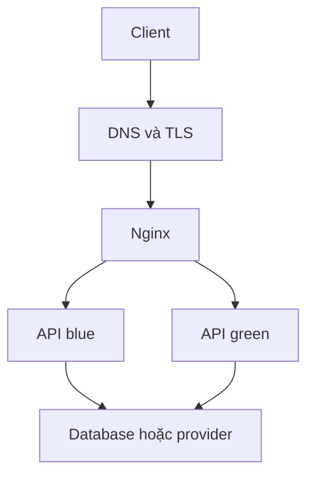

# 02 — Nginx, HTTP và vận hành tầng reverse proxy

> **Mục tiêu:** hiểu đường đi của một request, viết cấu hình có thể giải thích, đo được hành vi, chẩn đoán sự cố và triển khai thay đổi có đường lui.
>
> **Lộ trình:** hoàn thành Docker trước; đọc Database/Redis sau. Dự kiến 25–40 giờ cho tuyến chính, 10–20 giờ thêm cho bài VPS và điều tra. Đây là ước lượng học tập, không phải lời hứa về năng lực sau một lần đọc.
>
> **Ngày biên soạn:** 17/11/2026. Baseline chủ động chọn `nginx:1.28-alpine`, `node:24-bookworm-slim`, Compose v2. Đây không phải tuyên bố các tag này là phiên bản mới nhất. Ghi digest và version thực tế khi bắt đầu.

## Cách sử dụng notebook

Mở file bằng **Runme** trong VS Code, chọn Bash. Trên Windows hãy dùng VS Code trong WSL2; đừng chạy các cell bằng PowerShell. Trên VPS dùng Remote SSH và đọc lại nhãn môi trường trước khi chạy. Các cell có `excludeFromRunAll` để bạn chạy từng bài; không bấm chạy cả tài liệu. Mỗi cell tự `cd`, không yêu cầu Runme giữ biến hay hàm của cell trước. Các file sinh ra nằm trong `${HOME}/backend-labs/nginx`; đọc cả block trước khi chạy.

- **LOCAL:** thực hành trên Docker máy cá nhân.
- **FAULT:** cố tình làm lỗi **phòng lab**, luôn kèm phục hồi.
- **VPS:** chỉ dùng máy thử nghiệm và domain thử; không chạy lên hệ thống đang phục vụ khách hàng.
- **RESET:** dừng hoặc xóa dữ liệu riêng của lab, có thao tác xác nhận khi cần.
- **Đọc:** cấu hình minh họa, chưa chạy; fence có `ignore`.

Theo [Runme cell options](https://docs.runme.dev/configuration/cell-level/) và [document options](https://docs.runme.dev/configuration/document-level/), metadata điều khiển cách thực thi cell. Kiểm tra lại setting trong phiên bản extension của bạn. Có thể copy nội dung một cell vào Bash nếu UI không nhận metadata.

**Trạng thái kiểm chứng:** notebook đã được rà soát nguồn và kiểm tra tĩnh ở mức được ghi trong file `00`; chưa được chạy end-to-end bằng Docker, Runme GUI hay VPS thật trong môi trường biên soạn. Các kết quả bên dưới là **tiêu chí bạn phải đo**, không phải số liệu được bịa như đã đo.

## Bản đồ chương

| Phần | Bạn cần trả lời được | Bài thực hành |
|---|---|---|
| 1–2 | Request đi qua những đâu? Nginx giải quyết gì? | Dựng app, phân tách từng hop |
| 3–5 | Location, URI, host và IP có thực sự là điều bạn nghĩ? | Routing, slash, spoofed headers |
| 6–8 | LB, DNS, timeout, retry thay đổi tính đúng thế nào? | Backend chết, DNS đổi, POST timeout |
| 9–12 | Cache, rate limit, streaming và upload có tradeoff gì? | Hai user, 429, SSE, WebSocket, 413 |
| 13–15 | TLS, logs, capacity nói gì về production? | SAN, curl timing, correlation, tải có giới hạn |
| 16–18 | Deploy/rollback trên VPS như thế nào? | Blue/green, ACME, sự cố, capstone |

---

## 1. Bản chất: một request có nhiều giao dịch mạng

Bạn mở `https://api.example.test/orders/42`. Browser trước hết cần tìm địa chỉ qua DNS, thiết lập TCP (hoặc QUIC nếu dùng HTTP/3), thương lượng TLS, rồi gửi HTTP. Reverse proxy nhận HTTP và tạo một giao dịch khác đến backend. Backend có thể tiếp tục đến database, Redis, nhà cung cấp. Không có một “kết nối xuyên suốt” tự động mang nguyên trạng mọi header, timeout và danh tính qua các tầng.



**Reverse proxy** nhận request thay cho origin. **Forward proxy** đại diện client khi client ra ngoài. **Load balancer** phân phối request hoặc connection. **API gateway** thường thêm quản lý API, auth policy, quota, routing. Một sản phẩm có thể kiêm nhiều vai trò, nhưng cài Nginx không tự tạo ra đầy đủ các năng lực ấy.

Node có thể phục vụ HTTP trực tiếp trong một kiến trúc phù hợp. Nginx hữu ích khi bạn cần điểm vào chung, TLS, static assets, proxy policy, routing, rate limit hoặc buffering. Managed ingress/load balancer có thể đảm nhiệm vai trò này. Đừng thêm một tầng chỉ vì “hệ thống chuyên nghiệp phải có”; mỗi tầng thêm timeout, cấu hình, log và khả năng hỏng.

### 1.1. Tư duy process, connection và request

Master quản lý cấu hình/workers; workers xử lý nhiều connection bằng event loop. Một worker không phải một request. Một client có thể giữ connection lâu, tái dùng cho nhiều request; HTTP/2 multiplex nhiều stream trên connection. Khi proxy, bạn còn có upstream connection. Vì vậy `worker_connections × workers` không phải số request/giây hay số user bảo đảm.

Tài nguyên hữu hạn gồm CPU, file descriptors, RAM buffer, network, đĩa tạm, upstream connections và database pool. App chậm không biến thành app nhanh chỉ vì proxy có event loop. Nếu mỗi request giữ một DB connection 2 giây, ingress nhận thêm tải có thể chỉ làm hàng đợi dài hơn.

**Bài suy nghĩ:** 200 request/giây, thời gian trong hệ thống trung bình 0,5 giây → khoảng 100 request đồng thời trong trạng thái ổn định theo Little’s Law. Đây là ước lượng để bắt đầu đo, không phải cấu hình pool 100 mặc định; p99, burst và giới hạn phụ thuộc phải được xét riêng.

Nguồn mô hình xử lý: [Nginx architecture](https://nginx.org/en/docs/), [connection processing](https://nginx.org/en/docs/http/connection_processing.html), [HTTP request processing](https://nginx.org/en/docs/http/request_processing.html).

---

## 2. LOCAL — Dựng phòng lab có thể kiểm chứng

### 2.1. Điều kiện

Cần Docker Engine hoặc Desktop, Compose v2, Bash, curl, Python 3 và khoảng 2 GiB RAM khả dụng. Chỉ một notebook chạy tại một thời điểm trên VPS nhỏ. Dành khoảng 2–4 GiB đĩa cho image/build và theo dõi thực tế. Không có thao tác tự cài daemon hay thay firewall trong cell này.

Port host: `127.0.0.1:18080` HTTP, `127.0.0.1:18443` HTTPS. API chỉ có mạng nội bộ, không publish port. Hai container API cùng máy **không** tạo HA chống mất VPS. Project `be-nginx` và thư mục riêng giúp giới hạn phạm vi; vẫn dùng CPU, RAM, đĩa và kernel của host.

```bash {"name":"nginx-00-preflight","excludeFromRunAll":"true"}
set -euo pipefail
mkdir -p "${HOME}/backend-labs/nginx"
cd "${HOME}/backend-labs/nginx"
command -v docker
command -v curl
command -v python3
docker version
docker compose version
docker context show
docker info --format 'Memory={{.MemTotal}} CPUs={{.NCPU}} Root={{.DockerRootDir}}'
df -h .
```

**Quan sát:** server Docker phải phản hồi, không chỉ client. Docker context phải là máy lab bạn muốn; nếu đang trỏ remote production, dừng và chuyển context. “Permission denied” không được xử lý bằng `chmod 777 /var/run/docker.sock`.

### 2.2. Tạo backend nhỏ nhưng đúng giao thức

Ứng dụng dùng Node HTTP và thư viện `ws`; không gọi nó là NestJS. Mục tiêu quan sát giao thức nên tránh ẩn hành vi sau framework. Bạn sẽ ánh xạ phần readiness/graceful/logging vào NestJS ở cuối.

Các endpoint cố ý dành cho lab như `/admin/drain`, `/charge` **không được triển khai công khai**. `charge` chỉ tăng biến đếm RAM, tuyệt đối không giao dịch tiền; ta dùng nó để quan sát “server đã làm nhưng client không nhận response”.

```bash {"name":"nginx-01-generate-lab","excludeFromRunAll":"true"}
set -euo pipefail
mkdir -p "${HOME}/backend-labs/nginx"
cd "${HOME}/backend-labs/nginx"
if [ -e compose.yaml ]; then
  echo "Lab đã có. Không ghi đè. Dùng các cell tiếp theo hoặc sao lưu thư mục trước."
  exit 1
fi
mkdir -p app config scenarios html/assets html/uploads evidence certs
printf '%s\n' 'be-nginx-course-v1' > .course-id
cat > app/package.json <<'JSON'
{
  "name": "backend-nginx-lab",
  "private": true,
  "type": "module",
  "dependencies": { "ws": "8.18.3" }
}
JSON
cat > app/server.mjs <<'JS'
import http from 'node:http';
import { WebSocketServer } from 'ws';

const identity = process.env.SERVER_NAME ?? 'blue';
const version = process.env.APP_VERSION ?? 'v1';
let ready = true;
let charges = 0;
let pending = 0;
const sockets = new Set();
const send = (res, code, body, headers = {}) => {
  if (res.destroyed) return;
  res.writeHead(code, { 'content-type': 'application/json', ...headers });
  res.end(JSON.stringify(body));
};
const delay = ms => new Promise(resolve => setTimeout(resolve, ms));
const server = http.createServer(async (req, res) => {
  const start = performance.now();
  const url = new URL(req.url, 'http://lab');
  pending++;
  res.once('close', () => {
    pending--;
    console.log(JSON.stringify({
      kind: 'access', server: identity, method: req.method, path: url.pathname,
      status: res.statusCode, duration_ms: +(performance.now() - start).toFixed(2),
      request_id: req.headers['x-request-id'] ?? null
    }));
  });
  try {
    if (url.pathname === '/health') return send(res, 200, { alive: true, identity });
    if (url.pathname === '/ready') return send(res, ready ? 200 : 503, { ready, identity });
    if (url.pathname === '/admin/drain' && req.method === 'POST') {
      ready = false;
      return send(res, 200, { ready });
    }
    if (url.pathname === '/admin/resume' && req.method === 'POST') {
      ready = true;
      return send(res, 200, { ready });
    }
    if (!ready) return send(res, 503, { error: 'draining', identity });
    if (url.pathname === '/charge' && req.method === 'POST') {
      charges++;
      await delay(Math.min(Number(url.searchParams.get('delay') ?? 0) || 0, 5000));
      return send(res, 201, { charges, identity, note: 'memory-only demo' });
    }
    if (url.pathname === '/charges') return send(res, 200, { charges, identity });
    if (url.pathname === '/slow') {
      const ms = Math.max(0, Math.min(Number(url.searchParams.get('ms') ?? 500) || 0, 10000));
      await delay(ms);
      return send(res, 200, { identity, waited_ms: ms, version });
    }
    if (url.pathname === '/public/products') {
      await delay(150);
      return send(res, 200, {
        identity, generated_at: Date.now(),
        items: Array.from({ length: 40 }, (_, i) => ({ id: i, name: 'product-' + i }))
      }, { 'cache-control': 'public, max-age=3' });
    }
    if (url.pathname === '/profile') {
      return send(res, 200, {
        demo_user: req.headers['x-demo-user'] ?? 'anonymous', identity
      }, { 'cache-control': 'private, no-store' });
    }
    if (url.pathname === '/events') {
      res.writeHead(200, {
        'content-type': 'text/event-stream',
        'cache-control': 'no-cache',
        'x-accel-buffering': 'no'
      });
      let i = 0;
      res.write(': connected\n\n');
      const timer = setInterval(() => {
        res.write('id: ' + (++i) + '\ndata: ' + JSON.stringify({ i, identity }) + '\n\n');
        if (i >= 4) { clearInterval(timer); res.end(); }
      }, 250);
      res.once('close', () => clearInterval(timer));
      return;
    }
    if (url.pathname === '/upload') {
      let bytes = 0;
      for await (const chunk of req) {
        bytes += chunk.length;
        if (bytes > 2 * 1024 * 1024) {
          send(res, 413, { error: 'app-limit' });
          req.destroy();
          return;
        }
      }
      return send(res, 200, { bytes, identity });
    }
    if (url.pathname === '/status') {
      const code = Number(url.searchParams.get('code') ?? 200);
      return send(res, [200, 400, 401, 403, 404, 429, 500, 503].includes(code) ? code : 400,
        { identity, requested: code });
    }
    send(res, 200, {
      identity, version, method: req.method, received_url: req.url,
      direct_peer: req.socket.remoteAddress,
      forwarded: {
        host: req.headers.host,
        xff: req.headers['x-forwarded-for'],
        proto: req.headers['x-forwarded-proto'],
        request_id: req.headers['x-request-id']
      }
    });
  } catch (error) {
    console.error(JSON.stringify({ kind: 'error', name: error.name, message: error.message }));
    if (!res.headersSent) send(res, 500, { error: 'internal' });
    else res.destroy();
  }
});
server.on('connection', socket => {
  sockets.add(socket);
  socket.once('close', () => sockets.delete(socket));
});
const wss = new WebSocketServer({ noServer: true, maxPayload: 64 * 1024 });
server.on('upgrade', (req, socket, head) => {
  if (new URL(req.url, 'http://lab').pathname !== '/ws' || !ready) {
    socket.end('HTTP/1.1 404 Not Found\r\nConnection: close\r\n\r\n');
    return;
  }
  wss.handleUpgrade(req, socket, head, ws => wss.emit('connection', ws, req));
});
wss.on('connection', ws => {
  ws.on('error', error => console.error(error.message));
  ws.on('message', data => ws.send(JSON.stringify({ echo: data.toString(), identity })));
});
server.listen(3000, '0.0.0.0');
function shutdown() {
  ready = false;
  console.log(JSON.stringify({ kind: 'shutdown', pending, identity }));
  for (const ws of wss.clients) ws.close(1012, 'service restarting');
  server.close(() => process.exit(0));
  server.closeIdleConnections();
  setTimeout(() => {
    for (const socket of sockets) socket.destroy();
    process.exit(1);
  }, 8000).unref();
}
process.once('SIGTERM', shutdown);
process.once('SIGINT', shutdown);
JS
cat > app/probe.mjs <<'JS'
import assert from 'node:assert/strict';
const target = process.argv[2] ?? 'http://nginx/';
const response = await fetch(target, { signal: AbortSignal.timeout(5000) });
assert.equal(response.status, Number(process.argv[3] ?? 200));
console.log(response.status, await response.text());
JS
cat > app/ws-client.mjs <<'JS'
import assert from 'node:assert/strict';
const ws = new WebSocket(process.argv[2] ?? 'ws://nginx/ws');
const timer = setTimeout(() => { console.error('WebSocket timed out'); process.exit(1); }, 5000);
ws.addEventListener('open', () => ws.send('hello-backend'));
ws.addEventListener('error', () => { clearTimeout(timer); console.error('WebSocket error'); process.exit(1); });
ws.addEventListener('message', event => {
  const data = JSON.parse(event.data);
  assert.equal(data.echo, 'hello-backend');
  console.log('FRAME_OK', data);
  ws.close();
  clearTimeout(timer);
});
JS
cat > app/Dockerfile <<'DOCKER'
FROM node:24-bookworm-slim
WORKDIR /app
COPY package.json package-lock.json ./
RUN npm ci --omit=dev
COPY server.mjs probe.mjs ws-client.mjs ./
USER node
CMD ["node", "server.mjs"]
DOCKER
cat > app/.dockerignore <<'TXT'
node_modules
.env
npm-debug.log
TXT
cat > compose.yaml <<'YAML'
name: be-nginx
x-api: &api
  build: ./app
  init: true
  restart: "no"
  mem_limit: 192m
  cpus: 0.50
  read_only: true
  tmpfs: ["/tmp"]
  cap_drop: ["ALL"]
  security_opt: ["no-new-privileges:true"]
  stop_grace_period: 12s
  healthcheck:
    test: ["CMD", "node", "-e", "fetch('http://127.0.0.1:3000/ready').then(r=>process.exit(r.ok?0:1)).catch(()=>process.exit(1))"]
    interval: 2s
    timeout: 2s
    retries: 20
  logging:
    driver: json-file
    options: { max-size: "5m", max-file: "2" }
services:
  api1:
    <<: *api
    environment: { SERVER_NAME: "blue", APP_VERSION: "v1" }
  api2:
    <<: *api
    environment: { SERVER_NAME: "green", APP_VERSION: "v2" }
  nginx:
    image: nginx:1.28-alpine
    ports: ["127.0.0.1:18080:80", "127.0.0.1:18443:443"]
    volumes:
      - ./config:/etc/nginx/lab:ro
      - ./config/nginx.conf:/etc/nginx/nginx.conf:ro
      - ./html:/usr/share/nginx/html:ro
      - ./certs:/etc/nginx/certs:ro
    read_only: true
    tmpfs: ["/var/cache/nginx", "/var/run", "/tmp"]
    mem_limit: 192m
    cpus: 0.50
    stop_signal: SIGQUIT
    stop_grace_period: 15s
    depends_on:
      api1: { condition: service_healthy }
      api2: { condition: service_healthy }
    logging:
      driver: json-file
      options: { max-size: "5m", max-file: "2" }
YAML
cat > config/nginx.conf <<'NGINX'
user nginx;
worker_processes 1;
pid /var/run/nginx.pid;
error_log /dev/stderr notice;
events { worker_connections 1024; }
http {
    include /etc/nginx/mime.types;
    default_type application/octet-stream;
    log_format lab escape=json
        '{"ts":"$time_iso8601","rid":"$request_id","method":"$request_method",'
        '"path":"$uri","status":$status,"bytes":$body_bytes_sent,'
        '"rt":"$request_time","uct":"$upstream_connect_time",'
        '"uht":"$upstream_header_time","urt":"$upstream_response_time",'
        '"upstream":"$upstream_addr","upstatus":"$upstream_status",'
        '"cache":"$upstream_cache_status"}';
    access_log /dev/stdout lab;
    sendfile on;
    server_tokens off;
    client_body_temp_path /tmp/client_body;
    proxy_temp_path /tmp/proxy_temp;
    include /etc/nginx/lab/common-http.conf;
    include /etc/nginx/lab/generation.conf;
    server {
        listen 127.0.0.1:19090;
        server_name localhost;
        location = /__generation {
            default_type text/plain;
            access_log off;
            return 200 "$lab_generation\n";
        }
        location / { return 404; }
    }
    include /etc/nginx/lab/active.conf;
}
NGINX
cat > config/generation.conf <<'NGINX'
map $request_uri $lab_generation { default "bootstrap"; }
NGINX
cat > config/common-http.conf <<'NGINX'
resolver 127.0.0.11 valid=2s ipv6=off;
resolver_timeout 1s;
upstream app {
    zone app 64k;
    server api1:3000 resolve max_fails=1 fail_timeout=3s;
    server api2:3000 resolve max_fails=1 fail_timeout=3s;
    keepalive 16;
}
map $http_upgrade $connection_upgrade { default upgrade; '' ''; }
map $http_authorization $has_auth { default 1; '' 0; }
map $http_cookie $has_cookie { default 1; '' 0; }
limit_req_zone $binary_remote_addr zone=per_ip:1m rate=2r/s;
proxy_cache_path /var/cache/nginx/lab levels=1:2 keys_zone=products:1m
                 max_size=32m inactive=2m use_temp_path=off;
NGINX
cat > config/proxy.conf <<'NGINX'
proxy_http_version 1.1;
proxy_set_header Connection "";
proxy_set_header Host $host;
proxy_set_header X-Real-IP $remote_addr;
proxy_set_header X-Forwarded-For $remote_addr;
proxy_set_header X-Forwarded-Proto $scheme;
proxy_set_header X-Request-ID $request_id;
proxy_connect_timeout 1s;
proxy_send_timeout 3s;
proxy_read_timeout 3s;
NGINX
cat > config/security.conf <<'NGINX'
add_header X-Request-ID $request_id always;
add_header X-Content-Type-Options nosniff always;
add_header Referrer-Policy no-referrer always;
NGINX
cat > config/lab-health.conf <<'NGINX'
location = /__lab { default_type text/plain; return 200 "lab-ready\n"; }
NGINX
cat > scenarios/00-base.conf <<'NGINX'
server {
    listen 80 default_server;
    server_name localhost;
    include /etc/nginx/lab/lab-health.conf;
    include /etc/nginx/lab/security.conf;
    location / {
        include /etc/nginx/lab/proxy.conf;
        proxy_pass http://app;
    }
}
NGINX
cp scenarios/00-base.conf config/active.conf
cat > activate.sh <<'SH'
#!/usr/bin/env bash
set -euo pipefail
cd "$(dirname "$0")"
test "$(cat .course-id)" = be-nginx-course-v1
test "$#" -eq 1
test -f "$1"
wait_generation() {
  local expected="$1" observed=''
  for attempt in $(seq 1 60); do
    observed=$(docker compose -p be-nginx exec -T nginx \
      wget -q -O - -T 1 http://127.0.0.1:19090/__generation 2>/dev/null) || observed=''
    [ "$observed" != "$expected" ] || return 0
    sleep 0.1
  done
  return 1
}
previous_generation=$(sed -n 's/.*default "\([A-Za-z0-9_-]*\)".*/\1/p' config/generation.conf)
test -n "$previous_generation"
if ! wait_generation "$previous_generation"; then
  echo "Chưa xác nhận config hiện tại đang phục vụ; không ghi candidate. Xem logs/config/marker." >&2
  exit 1
fi
cp config/active.conf evidence/pre-change.conf
cp config/generation.conf evidence/pre-generation.conf
restore_previous() {
  cp evidence/pre-change.conf config/active.conf &&
  cp evidence/pre-generation.conf config/generation.conf &&
  docker compose -p be-nginx exec -T nginx nginx -t &&
  docker compose -p be-nginx exec -T nginx nginx -s reload &&
  wait_generation "$previous_generation"
}
generation=$(python3 -c 'import uuid; print(uuid.uuid4().hex)')
cp "$1" config/active.conf
printf 'map $request_uri $lab_generation { default "%s"; }\n' "$generation" > config/generation.conf
if ! docker compose -p be-nginx exec -T nginx nginx -t; then
  if ! restore_previous; then
    echo "Candidate lỗi, khôi phục chưa được xác nhận; giữ evidence và điều tra." >&2
    exit 1
  fi
  echo "Cấu hình lỗi; đã khôi phục và kiểm tra generation cũ."
  exit 1
fi
if ! docker compose -p be-nginx exec -T nginx nginx -s reload || ! wait_generation "$generation"; then
  if ! restore_previous; then
    echo "Reload/khôi phục chưa được xác nhận; giữ evidence và điều tra." >&2
    exit 1
  fi
  echo "Candidate chưa phục vụ đúng generation; đã quay lại generation cũ." >&2
  exit 1
fi
printf 'Active generation: %s\n' "$generation"
SH
chmod +x activate.sh
printf '<!doctype html><title>SPA lab</title><h1>SPA shell</h1>\n' > html/index.html
printf 'asset-v1\n' > html/assets/main.v1.txt
printf 'upload-guide\n' > html/uploads/guide.txt
```

Helper `activate.sh` đợi một marker generation do cấu hình mới phục vụ, không chỉ dựa exit code của lệnh gửi HUP. Endpoint marker chỉ nghe `127.0.0.1:19090` trong network namespace Nginx, không publish ra host; probe dùng `wget` của image Alpine. Config và marker được mount qua cả thư mục để các lần cập nhật file có hiệu lực. Marker xác nhận worker mới đã nạp cấu hình, chưa chứng minh API contract hoặc mọi request cũ đã kết thúc. Chạy các lần activate/renew nối tiếp; production cần khóa thao tác deployment và probe nghiệp vụ riêng.

### 2.3. Khóa dependency, build, chờ readiness

`package-lock.json` được tạo một lần bằng chính Node container; lưu lại để lần build sau dùng `npm ci`. Baseline `ws` đã ghi rõ, nhưng bản vá bảo mật tương lai vẫn cần review. Nếu làm production, pin cả image bằng digest đã duyệt và quét dependency; đừng giữ mãi một patch cũ chỉ để notebook không đổi.

```bash {"name":"nginx-02-start-and-record","excludeFromRunAll":"true"}
set -euo pipefail
cd "${HOME}/backend-labs/nginx"
docker run --rm --user "$(id -u):$(id -g)" \
  -e npm_config_cache=/tmp/npm \
  -v "$PWD/app:/app" -w /app node:24-bookworm-slim \
  npm install --package-lock-only --ignore-scripts --no-audit --no-fund
docker compose -p be-nginx config -q
docker compose -p be-nginx up -d --build
ready=0
for i in $(seq 1 60); do
  if curl -fsS --max-time 1 http://127.0.0.1:18080/__lab >/dev/null; then ready=1; break; fi
  sleep 0.5
done
test "$ready" = 1
docker compose -p be-nginx ps
docker compose -p be-nginx exec -T nginx nginx -v 2>&1 | tee evidence/nginx-version.txt
docker compose -p be-nginx exec -T api1 node --version | tee evidence/node-version.txt
docker image inspect nginx:1.28-alpine --format '{{json .RepoDigests}}' | tee evidence/nginx-digest.txt
docker compose -p be-nginx run --rm --no-deps api1 node probe.mjs http://nginx/
```

**Đạt:** hai API healthy, Nginx Up, `/__lab` 200; probe trả `identity` blue hoặc green. Không dựa `sleep 2` rồi in “sẵn sàng”. Nếu `unhealthy`: xem `docker compose logs --tail 50 api1`, kiểm tra bind address `0.0.0.0`, app dependency và RAM. Nếu `nginx -t` báo unknown `resolve`, image đang quá cũ hoặc không đúng baseline.

### 2.4. Lab — đi từng hop

```bash {"name":"nginx-03-hop-by-hop","excludeFromRunAll":"true"}
set -euo pipefail
cd "${HOME}/backend-labs/nginx"
curl -fsS --max-time 5 http://127.0.0.1:18080/echo
docker compose -p be-nginx run --rm --no-deps api1 node probe.mjs http://api2:3000/echo
docker compose -p be-nginx exec -T nginx sh -c 'cat /etc/resolv.conf; nginx -T' \
  > evidence/resolver-and-config.txt 2>&1
docker compose -p be-nginx port nginx 80
```

**Giải thích:** hostname `api2` có nghĩa trong Docker network; trên host nó không tự có DNS tương ứng. `localhost` trong Nginx là container Nginx, không phải API. Bảng chẩn đoán bắt đầu từ: client→host publish, Nginx→DNS/service, service→listener, listener→app. Không sửa đồng thời bốn lớp khi chưa biết hop nào hỏng.

---

## 3. Cấu hình, reload và thứ tự chọn route

### 3.1. Lab — syntax validation thực sự bảo vệ điều gì?

`nginx -t` kiểm tra cú pháp và một số tài nguyên tham chiếu. Nó không chứng minh response đúng contract, không phát hiện cache lộ user hay backend trả sai body. HUP tạo worker mới và cho worker cũ xử lý tiếp connection đang có; graceful không đồng nghĩa thời gian bằng 0 hay mọi kết nối sống mãi. Xem [controlling Nginx](https://nginx.org/en/docs/control.html).

```bash {"name":"nginx-04-invalid-config-and-rollback","excludeFromRunAll":"true"}
set -euo pipefail
cd "${HOME}/backend-labs/nginx"
cat > scenarios/01-invalid.conf <<'NGINX'
server {
  listen 80
  server_name localhost;
}
NGINX
if ./activate.sh scenarios/01-invalid.conf; then
  echo "LỖI: cấu hình thiếu semicolon lại được chấp nhận"; exit 1
fi
curl -fsS --max-time 3 http://127.0.0.1:18080/__lab
docker compose -p be-nginx exec -T nginx nginx -t
docker compose -p be-nginx top nginx
```

**Đạt:** activate exit khác 0; HTTP đang chạy vẫn 200; file active và generation được khôi phục, `nginx -t` thành công và marker cũ được phục vụ. Đừng để config lỗi nằm trên đĩa vì “worker cũ vẫn chạy”: lần reboot sẽ thất bại. `pre-change.conf` cùng `pre-generation.conf` chỉ là checkpoint gần nhất, chưa phải lịch sử release đầy đủ.

### 3.2. Location: thuật toán trước, khẩu quyết sau

Trong cấu hình phẳng thường gặp: tìm exact match trước; nếu không có, nhớ prefix dài nhất; nếu prefix đó có `^~`, bỏ regex; còn lại xét regex theo thứ tự và dùng regex đầu tiên phù hợp; nếu không có regex phù hợp, dùng prefix đã nhớ. **Không phải cứ có bất kỳ `^~` nào khớp là thắng mọi prefix dài hơn.** Nested locations, internal redirects và regex captures cần xét thêm; giữ cấu hình đơn giản trước khi tối ưu.

`root` nối URI với thư mục gốc. `alias` thay phần location khớp bằng đường dẫn được chỉ định; với directory prefix, dấu `/` hai phía cần nhất quán. Route API không nên rơi vào SPA fallback: API 404 phải là API 404, không phải HTML 200.

Nguồn: [core module: location, alias, root, try_files](https://nginx.org/en/docs/http/ngx_http_core_module.html).

```bash {"name":"nginx-05-routing-spa-assets","excludeFromRunAll":"true"}
set -euo pipefail
cd "${HOME}/backend-labs/nginx"
cat > scenarios/02-routing.conf <<'NGINX'
server {
    listen 80;
    server_name localhost;
    root /usr/share/nginx/html;
    include /etc/nginx/lab/security.conf;
    include /etc/nginx/lab/lab-health.conf;
    location = /exact { default_type text/plain; return 200 "EXACT\n"; }
    location ^~ /files/ { alias /usr/share/nginx/html/uploads/; }
    location ^~ /assets/ { try_files $uri =404; }
    location ~ \.txt$ { default_type text/plain; return 200 "REGEX\n"; }
    location ^~ /api/ { default_type application/json; return 404 '{"error":"not_found"}'; }
    location / { try_files $uri $uri/ /index.html; }
}
NGINX
./activate.sh scenarios/02-routing.conf
curl -fsS http://127.0.0.1:18080/exact
curl -fsS http://127.0.0.1:18080/readme.txt
curl -fsS http://127.0.0.1:18080/files/guide.txt
curl -fsS http://127.0.0.1:18080/dashboard/orders
test "$(curl -sS -o /dev/null -w '%{http_code}' http://127.0.0.1:18080/assets/missing.js)" = 404
test "$(curl -sS -o /dev/null -w '%{http_code}' http://127.0.0.1:18080/api/missing)" = 404
test "$(curl -sS -o /dev/null -w '%{http_code}' http://127.0.0.1:18080/api/missing.txt)" = 404
```

**Đạt:** EXACT, REGEX, upload-guide, SPA shell; asset và API thiếu đều 404, kể cả `/api/missing.txt`: `^~ /api/` ngăn regex `.txt` giành route API. Bài thêm: bỏ `^~` khỏi `/files/`, dự đoán `/files/guide.txt` trước khi chạy. Nếu response là REGEX, bạn vừa thấy một thay đổi route có thể làm hỏng file service mà cú pháp vẫn hợp lệ.

**Case production:** release frontend đổi tên asset nhưng CDN còn HTML cũ → browser tải bundle cũ bị 404. Giữ asset theo content hash qua khoảng chuyển tiếp; HTML cache ngắn/revalidate, hashed assets cache dài/immutable. Đừng fallback file JavaScript không tồn tại thành HTML, vì lúc đó browser báo lỗi MIME khiến bạn tìm sai tầng.

---

## 4. Proxy URI, query, method và timeout của client

### 4.1. Lab — nhìn URI thực sự backend nhận

```bash {"name":"nginx-06-proxy-uri","excludeFromRunAll":"true"}
set -euo pipefail
cd "${HOME}/backend-labs/nginx"
cat > scenarios/03-uri.conf <<'NGINX'
server {
    listen 80;
    server_name localhost;
    include /etc/nginx/lab/lab-health.conf;
    include /etc/nginx/lab/security.conf;
    location /keep/ {
        include /etc/nginx/lab/proxy.conf;
        proxy_pass http://app;
    }
    location /strip/ {
        include /etc/nginx/lab/proxy.conf;
        proxy_pass http://app/;
    }
    location / { return 404; }
}
NGINX
./activate.sh scenarios/03-uri.conf
curl -fsS 'http://127.0.0.1:18080/keep/orders/42?currency=VND'
curl -fsS 'http://127.0.0.1:18080/strip/orders/42?currency=VND'
curl -fsS -X POST -H 'Content-Type: application/json' \
  --data '{"name":"Tuan"}' 'http://127.0.0.1:18080/strip/echo'
```

**Đạt:** `/keep/orders/42?...` và `/orders/42?...`; request cuối method POST. Với regex location hoặc rewrite/variable trong `proxy_pass`, quy tắc URI không còn giản lược giống hai dòng này. Dùng endpoint echo + test để bảo vệ contract. Không thêm slash như một cách “thử cho hết 404” trên production.

Nguồn hành vi: [proxy_pass](https://nginx.org/en/docs/http/ngx_http_proxy_module.html#proxy_pass).

### 4.2. Case encoding và ký request webhook

Webhook provider có thể ký **raw body** và URL theo định dạng riêng. Middleware parse rồi serialize JSON có thể đổi khoảng trắng/thứ tự/trường số. Proxy rewrite đổi path cũng có thể làm verifier kiểm tra sai dữ liệu. Cần biết provider ký raw bytes, normalized URL hay canonical request nào; không suy từ tên header. Lab nâng cao: lưu hash SHA-256 raw body trước parse, gửi payload có khoảng trắng, đối chiếu với sender. Đừng log payload có PII để điều tra chữ ký.

---

## 5. Trust boundary — Host, X-Forwarded-For và request ID

`X-Forwarded-For` là chuỗi header, không phải bằng chứng danh tính. Client có thể tự gửi nó. Trong lab, Nginx là edge duy nhất nên **ghi đè** XFF bằng peer address. Nếu có CDN/load balancer phía trước, chỉ nhận real IP từ CIDR proxy được tin và chặn đường đi trực tiếp bỏ qua proxy đó; đừng đặt `set_real_ip_from 0.0.0.0/0`.

Nginx nhìn thấy peer nào phụ thuộc Docker/NAT/Desktop; số IP cụ thể không phải điều kiện đạt. Điều cần chứng minh là client không tự chọn được “IP thật” của mình. `Host` cũng không đáng tin để sinh password reset URL; origin cần allowlist host/domain ứng dụng.

Nguồn: [real IP module](https://nginx.org/en/docs/http/ngx_http_realip_module.html).

```bash {"name":"nginx-07-header-spoof","excludeFromRunAll":"true"}
set -euo pipefail
cd "${HOME}/backend-labs/nginx"
./activate.sh scenarios/00-base.conf
curl -fsS -D evidence/headers.txt \
  -H 'X-Forwarded-For: 203.0.113.99' \
  -H 'X-Request-ID: attacker-picked-id' \
  http://127.0.0.1:18080/echo | tee evidence/echo.json
python3 - <<'PY'
import json
from pathlib import Path
d=json.loads(Path('evidence/echo.json').read_text())
assert d['forwarded']['xff'] != '203.0.113.99'
assert d['forwarded']['request_id'] != 'attacker-picked-id'
assert len(d['forwarded']['request_id']) == 32
print('PASS: edge generated trusted hop metadata')
PY
```

**Từ Node thuần sang Express/NestJS:** cấu hình `trust proxy` theo topology thật; `true` không an toàn nếu client có đường vào thẳng app. IP rate limit cho user sau NAT có thể phạt cả văn phòng; quota nghiệp vụ nên gắn identity đã xác thực, không lấy user ID do client tự khai.

**Request ID và trace:** ID giúp tìm logs liên quan. Distributed tracing còn cần trace/span, parent-child, context propagation, sampling và exporter. Header `X-Request-ID` chưa phải hệ thống tracing hoàn chỉnh. Không log Authorization, cookie, token query, số thẻ hay payload giao dịch chỉ để “dễ debug”.

---

## 6. Load balancing, readiness và connection reuse

Round-robin là một lựa chọn phân tải; `least_conn` dựa số connection đang hoạt động, không biết DB query nào tốn CPU hơn. Weight là tỷ lệ định hướng, không bảo đảm từng nhóm 4 request đều có đúng 3:1, vì nhiều worker, keepalive và retry ảnh hưởng quan sát.

`keepalive 16` là cache **idle upstream connections mỗi worker**, không phải giới hạn tổng connection đến backend. Readiness là app có sẵn sàng nhận traffic; liveness là process còn chạy. Nginx OSS không tự đọc Docker health state. Một API `unhealthy` vẫn có thể còn trong upstream và nhận traffic.

### 6.1. Lab — quan sát phân tải

```bash {"name":"nginx-08-observe-balancing","excludeFromRunAll":"true"}
set -euo pipefail
cd "${HOME}/backend-labs/nginx"
./activate.sh scenarios/00-base.conf
: > evidence/balancing.jsonl
for i in $(seq 1 20); do
  curl -fsS --max-time 3 http://127.0.0.1:18080/echo >> evidence/balancing.jsonl
  printf '\n' >> evidence/balancing.jsonl
done
python3 - <<'PY'
import collections,json
from pathlib import Path
counts=collections.Counter(json.loads(s)['identity'] for s in Path('evidence/balancing.jsonl').read_text().splitlines())
print(counts)
assert set(counts)=={'blue','green'}, counts
PY
```

**Đạt:** cả hai identity xuất hiện; không đòi đúng 10–10 như một định luật. Nếu chỉ một identity, xem `nginx -T`, logs lỗi DNS, `fail_timeout`, trạng thái backend, số lượng mẫu.

### 6.2. FAULT — readiness fail không đồng nghĩa traffic đã rút

```bash {"name":"nginx-09-readiness-is-not-routing","excludeFromRunAll":"true"}
set -euo pipefail
cd "${HOME}/backend-labs/nginx"
./activate.sh scenarios/00-base.conf
blue_id=$(docker compose -p be-nginx ps -q api1)
test -n "$blue_id"
resume_api() {
  docker compose -p be-nginx exec -T api1 node -e \
    "fetch('http://127.0.0.1:3000/admin/resume',{method:'POST',signal:AbortSignal.timeout(2000)}).then(r=>process.exit(r.ok?0:1)).catch(()=>process.exit(1))"
}
trap 'rc=$?; resume_api || rc=1; exit "$rc"' EXIT
resume_api
docker compose -p be-nginx exec -T api2 node probe.mjs http://127.0.0.1:3000/ready
started_at=$(docker inspect --format '{{.State.StartedAt}}' "$blue_id")
docker compose -p be-nginx exec -T api1 node -e \
  "fetch('http://127.0.0.1:3000/admin/drain',{method:'POST',signal:AbortSignal.timeout(2000)}).then(r=>process.exit(r.ok?0:1)).catch(()=>process.exit(1))"
health=''
for i in $(seq 1 100); do
  health=$(docker inspect --format '{{.State.Health.Status}}' "$blue_id")
  [ "$health" = unhealthy ] && break
  sleep 0.5
done
test "$health" = unhealthy
test "$(docker inspect --format '{{.State.Running}}' "$blue_id")" = true
test "$(docker inspect --format '{{.State.StartedAt}}' "$blue_id")" = "$started_at"
docker inspect "$blue_id" --format '{{json .State.Health}}' > evidence/readiness-health.json
: > evidence/readiness-statuses.txt
for i in $(seq 1 10); do
  curl -sS --max-time 4 -o /dev/null -w '%{http_code}\n' http://127.0.0.1:18080/echo | tee -a evidence/readiness-statuses.txt
done
python3 - <<'PYREADINESS'
from pathlib import Path
codes=Path('evidence/readiness-statuses.txt').read_text().splitlines()
assert '503' in codes and '200' in codes, codes
assert set(codes)<={'200','503'}, codes
PYREADINESS
resume_api
trap - EXIT
for i in $(seq 1 30); do
  [ "$(docker inspect --format '{{.State.Health.Status}}' "$blue_id")" = healthy ] && break
  sleep 0.5
done
test "$(docker inspect --format '{{.State.Health.Status}}' "$blue_id")" = healthy
```

**Quan sát:** chờ khoảng 40 giây theo `interval: 2s` và `retries: 20`, rồi xác nhận Docker đã đánh dấu unhealthy nhưng process không restart. Cấu hình base không retry HTTP 503; evidence phải có cả 503 từ blue và 200 từ green. Trap cố resume khi cell lỗi; sau bước phục hồi còn kiểm tra healthy. Nếu phiên shell bị kill không chạy được trap, gọi lại `/admin/resume` bằng command trong `resume_api` trước khi sang bài khác.

### 6.3. FAULT — backend tắt, GET có retry giới hạn

```bash {"name":"nginx-10-passive-failover","excludeFromRunAll":"true"}
set -euo pipefail
cd "${HOME}/backend-labs/nginx"
cat > scenarios/04-retry-get.conf <<'NGINX'
server {
    listen 80;
    include /etc/nginx/lab/lab-health.conf;
    include /etc/nginx/lab/security.conf;
    location / {
        include /etc/nginx/lab/proxy.conf;
        proxy_next_upstream error timeout http_502 http_503 http_504;
        proxy_next_upstream_tries 2;
        proxy_next_upstream_timeout 2s;
        proxy_pass http://app;
    }
}
NGINX
./activate.sh scenarios/04-retry-get.conf
trap 'docker compose -p be-nginx start api1 >/dev/null' EXIT
docker compose -p be-nginx stop -t 10 api1
for i in $(seq 1 10); do
  curl -sS --max-time 4 -o /dev/null -w '%{http_code} %{time_total}\n' http://127.0.0.1:18080/echo
done
docker compose -p be-nginx logs --tail 30 nginx
docker compose -p be-nginx start api1
trap - EXIT
```

**Đọc evidence:** upstream log có thể chứa nhiều địa chỉ/status cho cùng một request. Thời gian tăng là chi phí của thử rồi chuyển. Không kết luận “mọi lỗi đều được che” vì retry chỉ làm được khi còn cơ hội và chưa gửi response xuống client; cả hai backend hỏng thì vẫn lỗi. Không dùng `non_idempotent` để ép retry POST chuyển tiền nhằm “hết 502”.

Nguồn: [upstream server/failures/keepalive](https://nginx.org/en/docs/http/ngx_http_upstream_module.html), [retry policy](https://nginx.org/en/docs/http/ngx_http_proxy_module.html#proxy_next_upstream).


---

## 7. DNS động — sửa đúng nguyên nhân khi container đổi IP

Tên service ổn định không có nghĩa địa chỉ IP ổn định. Cấu hình tĩnh resolve lúc tải config có thể giữ địa chỉ cũ. Trong baseline Nginx 1.28, `server ... resolve` trong shared upstream `zone` và `resolver` cho phép theo dõi DNS. Tính năng `resolve` có trong bản OSS từ 1.27.3; không còn đúng nếu nói chỉ có biến `$backend` mới giải quyết được.

`resolver 127.0.0.11` là embedded DNS trong Docker user-defined network ở lab này; không copy lên Nginx chạy trực tiếp trên host và mong nó hoạt động. `valid=2s` là cache validity, không bảo đảm mỗi đúng 2 giây mọi connection đang mở đều chuyển server. Request đang dùng connection cũ và grace period vẫn cần xét.

Nguồn: [upstream resolve](https://nginx.org/en/docs/http/ngx_http_upstream_module.html#server), [Docker DNS](https://docs.docker.com/engine/network/#dns-services).

### Lab — thay đích DNS thật, giữ hostname

Bài này tạo thêm đúng một network mang nhãn lab. `rotating-api` ban đầu trỏ blue, sau đó green. Hai container đã có IP khác nhau nên phép thử có ý nghĩa hơn recreate rồi giả định IP chắc chắn thay đổi.

```bash {"name":"nginx-11-dns-switch","excludeFromRunAll":"true"}
set -euo pipefail
cd "${HOME}/backend-labs/nginx"
if docker network inspect be-nginx-dns-probe >/dev/null 2>&1; then
  echo "Network probe đã có. Hoàn tất cleanup bài trước rồi chạy lại."; exit 1
fi
nginx_id=$(docker compose -p be-nginx ps -q nginx)
blue_id=$(docker compose -p be-nginx ps -q api1)
green_id=$(docker compose -p be-nginx ps -q api2)
test -n "$nginx_id" && test -n "$blue_id" && test -n "$green_id"
docker network create --label course=be-nginx be-nginx-dns-probe >/dev/null
cleanup_dns() {
  if ! ./activate.sh scenarios/00-base.conf; then
    echo "Không khôi phục được base; giữ network probe để điều tra, không xóa alias đang được tham chiếu." >&2
    return 1
  fi
  local seen_blue=0 seen_green=0 identity=''
  for i in $(seq 1 40); do
    if identity=$(curl -fsS --max-time 2 http://127.0.0.1:18080/echo |
      python3 -c 'import json,sys; print(json.load(sys.stdin).get("identity",""))'); then
      [ "$identity" != blue ] || seen_blue=1
      [ "$identity" != green ] || seen_green=1
      [ "$seen_blue" != 1 ] || [ "$seen_green" != 1 ] || break
    fi
    sleep 0.2
  done
  if [ "$seen_blue" != 1 ] || [ "$seen_green" != 1 ]; then
    echo "Chưa chứng minh base đang phục vụ cả blue/green; giữ network để điều tra." >&2
    return 1
  fi
  docker network disconnect be-nginx-dns-probe "$nginx_id" >/dev/null 2>&1 || true
  docker network disconnect be-nginx-dns-probe "$blue_id" >/dev/null 2>&1 || true
  docker network disconnect be-nginx-dns-probe "$green_id" >/dev/null 2>&1 || true
  if ! docker network rm be-nginx-dns-probe >/dev/null; then
    echo "Network vẫn có endpoint hoặc không xóa được; kiểm tra trước khi dọn tiếp." >&2
    return 1
  fi
}
trap 'rc=$?; cleanup_dns || rc=1; exit "$rc"' EXIT
docker network connect be-nginx-dns-probe "$nginx_id"
docker network connect --alias rotating-api be-nginx-dns-probe "$blue_id"
cat > scenarios/05-dns.conf <<'NGINX'
upstream changing {
    zone changing 64k;
    server rotating-api:3000 resolve;
}
server {
    listen 80;
    include /etc/nginx/lab/lab-health.conf;
    location / {
        include /etc/nginx/lab/proxy.conf;
        proxy_pass http://changing;
    }
}
NGINX
./activate.sh scenarios/05-dns.conf
for i in $(seq 1 30); do
  if curl -fsS --max-time 2 http://127.0.0.1:18080/echo > evidence/dns-blue.json &&
     python3 -c 'import json; assert json.load(open("evidence/dns-blue.json"))["identity"]=="blue"' 2>/dev/null; then break; fi
  sleep 0.5
done
python3 -c 'import json; assert json.load(open("evidence/dns-blue.json"))["identity"]=="blue"'
docker network disconnect be-nginx-dns-probe "$blue_id"
docker network connect --alias rotating-api be-nginx-dns-probe "$green_id"
for i in $(seq 1 30); do
  if curl -fsS --max-time 2 http://127.0.0.1:18080/echo > evidence/dns-green.json &&
     python3 -c 'import json; assert json.load(open("evidence/dns-green.json"))["identity"]=="green"' 2>/dev/null; then break; fi
  sleep 0.5
done
python3 -c 'import json; assert json.load(open("evidence/dns-green.json"))["identity"]=="green"'
cleanup_dns
trap - EXIT
```

**Đạt:** hostname không đổi, body đổi blue→green; không reload trong đoạn chuyển alias. Có thể có lỗi tạm trong cửa sổ disconnect/DNS refresh — hãy ghi số lỗi, đừng giấu bằng dòng chữ “100% thành công”.

**Khôi phục khi cell bị ngắt:** trap thử activate base và đợi cả blue/green xuất hiện trước khi gỡ network; nếu restore thất bại nó giữ network để điều tra. Với shell bị kill không chạy được trap, activate base trước, xem `docker network inspect be-nginx-dns-probe`, disconnect chỉ các ID của `be-nginx`, rồi remove network đó. Nếu lab giữ DNS tới alias đã mất, bản active cần được khôi phục trước reboot.

---

## 8. Timeout, retry và điều không biết khi response mất

Một HTTP 504 chỉ nói proxy không nhận được phần response cần thiết trong giới hạn. Nó không chứng minh backend chưa commit transaction. Client tự timeout cũng không tự rollback công việc đang chạy ở DB/provider.

| Timeout | Đo giai đoạn nào? | Chẩn đoán |
|---|---|---|
| DNS | Tìm địa chỉ | resolver, NXDOMAIN, mạng DNS |
| Connect | Thiết lập upstream connection | listener, SYN, routing, saturation |
| Send/read | Khoảng chờ giữa các thao tác I/O theo directive | backend không đọc/không gửi tiếp |
| Application deadline | Ngân sách xử lý nghiệp vụ | DB, provider, queue, cancellation |
| Client total | Client sẵn lòng đợi tổng bao lâu | UX, retry, kết nối mobile |

`proxy_read_timeout` không phải timer tổng cho toàn bộ response nếu backend tiếp tục gửi dữ liệu. Tổng deadline cần thiết kế ở application/client; proxy timeout là một lớp bảo vệ. Sắp ngân sách từ ngoài vào trong có khoảng đệm: client > proxy > application > dependency trong một request thông thường, nhưng stream dài cần policy khác.

### 8.1. Tạo snippet headers riêng để đổi timeout không bị duplicate directive

```bash {"name":"nginx-12-timeout-setup","excludeFromRunAll":"true"}
set -euo pipefail
cd "${HOME}/backend-labs/nginx"
cat > config/proxy-headers.conf <<'NGINX'
proxy_http_version 1.1;
proxy_set_header Connection "";
proxy_set_header Host $host;
proxy_set_header X-Real-IP $remote_addr;
proxy_set_header X-Forwarded-For $remote_addr;
proxy_set_header X-Forwarded-Proto $scheme;
proxy_set_header X-Request-ID $request_id;
NGINX
cat > scenarios/06-timeout.conf <<'NGINX'
server {
    listen 80;
    include /etc/nginx/lab/lab-health.conf;
    include /etc/nginx/lab/security.conf;
    location / {
        include /etc/nginx/lab/proxy-headers.conf;
        proxy_connect_timeout 1s;
        proxy_read_timeout 200ms;
        proxy_next_upstream off;
        proxy_pass http://api1:3000;
    }
}
NGINX
./activate.sh scenarios/06-timeout.conf
test "$(curl -sS --max-time 3 -o evidence/timeout-body.txt -w '%{http_code}' \
 'http://127.0.0.1:18080/slow?ms=1000')" = 504
docker compose -p be-nginx logs --tail 20 nginx
```

**Đạt:** 504 và error log về upstream timeout. Đừng chữa bằng tăng timeout 60s→600s trước khi biết vì sao API chậm; khi overload, tăng thời gian giữ tài nguyên có thể làm tình hình nặng thêm.

### 8.2. FAULT — POST timeout nhưng tác dụng đã xảy ra

```bash {"name":"nginx-13-post-ambiguous-result","excludeFromRunAll":"true"}
set -euo pipefail
cd "${HOME}/backend-labs/nginx"
./activate.sh scenarios/06-timeout.conf
before=$(curl -fsS http://127.0.0.1:18080/charges | python3 -c 'import json,sys;print(json.load(sys.stdin)["charges"])')
code=$(curl -sS --max-time 3 -o evidence/charge-timeout.txt -w '%{http_code}' \
  -X POST 'http://127.0.0.1:18080/charge?delay=1000')
test "$code" = 504
after=$(curl -fsS http://127.0.0.1:18080/charges | python3 -c 'import json,sys;print(json.load(sys.stdin)["charges"])')
test "$after" -eq "$((before + 1))"
curl -fsS -X POST 'http://127.0.0.1:18080/charge?delay=0'
printf '\nBefore=%s After_timeout=%s\n' "$before" "$after"
./activate.sh scenarios/00-base.conf
```

**Giải thích:** `charges++` trước khi delay trả response. Nếu client lặp POST vì 504, counter lại tăng. Cách xử lý nghiệp vụ cần idempotency key, trạng thái operation bền vững, request hash và API truy vấn trạng thái; provider bên ngoài cũng cần idempotency/reconciliation. Redis lock ngắn hạn hay retry của Nginx chưa đủ. Xem notebook Database và Message Queue để thực hành transaction/outbox/inbox.

**Bài thêm:** giữ `proxy_next_upstream off` cho endpoint ghi nhạy cảm, gửi timeout từ client bằng `--max-time 0.05`, rồi đọc `/charges`. Phân biệt HTTP lỗi từ proxy với `curl` exit 28 không có HTTP response. Không log lỗi timeout thành “giao dịch thất bại chắc chắn”.

---

## 9. Cache HTTP — tăng tốc phải giữ đúng dữ liệu

Cache là một bản sao có policy. Bạn cần trả lời **dữ liệu của ai**, **key gồm gì**, **được cũ bao lâu**, **làm sao invalidation**, **lúc origin chết có được trả stale không**. Danh sách sản phẩm công khai và số dư ví có cùng kiểu JSON nhưng không có cùng policy.

Một cache key bỏ tenant, locale, query hoặc phân quyền có thể trả dữ liệu người này cho người khác. Cache private response sai là lỗi tính đúng và riêng tư, không chỉ hiệu năng. Vì vậy lab chỉ cache endpoint public có contract rõ, bypass khi có Cookie/Authorization, không cache profile.

### 9.1. Lab — MISS/HIT/BYPASS và hai người dùng

```bash {"name":"nginx-14-safe-public-cache","excludeFromRunAll":"true"}
set -euo pipefail
cd "${HOME}/backend-labs/nginx"
cat > scenarios/07-cache.conf <<'NGINX'
server {
    listen 80;
    include /etc/nginx/lab/lab-health.conf;
    include /etc/nginx/lab/security.conf;
    gzip on;
    gzip_vary on;
    gzip_min_length 256;
    gzip_types application/json text/css application/javascript;
    location = /public/products {
        include /etc/nginx/lab/proxy.conf;
        include /etc/nginx/lab/security.conf;
        proxy_cache products;
        proxy_cache_key "$scheme|$host|$request_uri";
        proxy_cache_methods GET HEAD;
        proxy_cache_valid 200 3s;
        proxy_cache_lock on;
        proxy_cache_lock_timeout 1s;
        proxy_cache_bypass $has_auth $has_cookie;
        proxy_no_cache $has_auth $has_cookie $upstream_http_set_cookie;
        add_header X-Lab-Cache $upstream_cache_status always;
        proxy_pass http://app;
    }
    location / {
        include /etc/nginx/lab/proxy.conf;
        proxy_cache off;
        proxy_pass http://app;
    }
}
NGINX
./activate.sh scenarios/07-cache.conf
nonce=$(python3 -c 'import uuid;print(uuid.uuid4())')
url="http://127.0.0.1:18080/public/products?probe=$nonce"
curl -fsS -D evidence/cache-1.headers "$url" -o evidence/cache-1.json
curl -fsS -D evidence/cache-2.headers "$url" -o evidence/cache-2.json
curl -fsS -D evidence/cache-auth.headers -H 'Authorization: Bearer demo-only' \
 "$url" -o /dev/null
curl -fsS -H 'X-Demo-User: alice' http://127.0.0.1:18080/profile -o evidence/alice.json
curl -fsS -H 'X-Demo-User: bob' http://127.0.0.1:18080/profile -o evidence/bob.json
python3 - <<'PY'
import json
from pathlib import Path
h1=Path('evidence/cache-1.headers').read_text().lower()
h2=Path('evidence/cache-2.headers').read_text().lower()
ha=Path('evidence/cache-auth.headers').read_text().lower()
assert 'x-lab-cache: miss' in h1, h1
assert 'x-lab-cache: hit' in h2, h2
assert 'x-lab-cache: bypass' in ha, ha
assert Path('evidence/cache-1.json').read_bytes()==Path('evidence/cache-2.json').read_bytes()
assert json.loads(Path('evidence/alice.json').read_text())['demo_user']=='alice'
assert json.loads(Path('evidence/bob.json').read_text())['demo_user']=='bob'
print('PASS: cache public, bypass auth, private users stay separate')
PY
```

Nếu máy rất chậm khiến hơn 3 giây trôi giữa hai request, TTL hết thì second MISS là hợp lý; xem timing rồi tăng TTL lab có chủ đích. Đừng đổi assertion thành “MISS hoặc HIT đều pass” vì như vậy bỏ mất điều đang kiểm chứng.

`X-Demo-User` chỉ mô phỏng hai người dùng, không phải authentication. Application thật xác minh identity rồi tự sinh response phù hợp.

### 9.2. Lab — đo latency và gzip

```bash {"name":"nginx-15-cache-compression-observe","excludeFromRunAll":"true"}
set -euo pipefail
cd "${HOME}/backend-labs/nginx"
nonce=$(python3 -c 'import uuid;print(uuid.uuid4())')
for i in 1 2 3; do
  curl -fsS --compressed -D "evidence/gzip-$i.headers" -o /dev/null \
    -w 'total=%{time_total} downloaded=%{size_download} status=%{http_code}\n' \
    "http://127.0.0.1:18080/public/products?gzip=$nonce"
done
python3 - <<'PY'
from pathlib import Path
print(Path('evidence/gzip-2.headers').read_text())
PY
```

**Đọc kết quả:** kỳ vọng có `Content-Encoding: gzip` và `Vary: Accept-Encoding` khi client hỗ trợ; đo chính máy mình, không gán trước “nhanh hơn 50 lần”. Backend delay 150ms chỉ mô phỏng chờ, không đại diện workload thật.

**Những case cần phân tích:**

| Tình huống | Thiết kế cần có |
|---|---|
| Một key hot vừa hết hạn | Cache lock + timeout chờ + giới hạn origin; lock không cam kết đúng một fetch trong mọi lỗi |
| Redis/DB chậm, public catalog cần còn xem được | Stale có giới hạn và tuổi dữ liệu hiển thị; không mở stale cho balance |
| Response có `Set-Cookie` | Không tùy tiện ignore header rồi cache chung |
| Query chứa nhiều tham số thứ tự khác nhau | Canonicalization phải giữ semantics; chống key explosion |
| Public endpoint có kết quả theo tenant | Đưa tenant đã xác minh vào routing/key, kiểm thử chéo tenant |
| Error response bị cache lâu | Policy riêng cho negative cache; phân biệt 404 ổn định với 500 tạm thời |
| Đổi schema response v1→v2 | Version path/cache namespace và khoảng tương thích |
| Gzip cho nội dung chứa secret + phản chiếu input | Đánh giá side channel, không bật theo khẩu hiệu |

Nguồn cấu hình: [Nginx caching guide](https://docs.nginx.com/nginx/admin-guide/content-cache/content-caching/), [gzip module](https://nginx.org/en/docs/http/ngx_http_gzip_module.html). Không dùng `proxy_ignore_headers Cache-Control Set-Cookie` để làm test HIT cho bằng được.

---

## 10. Rate limit, giới hạn kích thước và backpressure

Nginx rate limit bảo vệ phần app ở sau trong giới hạn hạ tầng của bạn. Khi đường truyền VPS đã bị saturate, một directive trong Nginx không trả lại bandwidth bị chiếm. Đừng mô tả nó như giải pháp đầy đủ cho DDoS.

Per-IP limiter phạt chung người dùng sau NAT; per-user limiter cần identity đáng tin. `burst` cho phép lượng vượt tạm; `nodelay` quyết định không xếp chờ lượng burst được chấp nhận, không tăng tốc độ bền vững. 429 hữu ích hơn 503 khi chủ đích nói client giảm nhịp; client phải backoff chứ không retry tức thời.

### 10.1. Lab — tạo burst nhỏ có giới hạn

```bash {"name":"nginx-16-rate-limit-burst","excludeFromRunAll":"true"}
set -euo pipefail
cd "${HOME}/backend-labs/nginx"
cat > scenarios/08-limits.conf <<'NGINX'
server {
    listen 80;
    include /etc/nginx/lab/lab-health.conf;
    include /etc/nginx/lab/security.conf;
    client_max_body_size 512k;
    location = /login {
        limit_req zone=per_ip burst=2 nodelay;
        limit_req_status 429;
        include /etc/nginx/lab/proxy.conf;
        proxy_pass http://app;
    }
    location / {
        include /etc/nginx/lab/proxy.conf;
        proxy_pass http://app;
    }
}
NGINX
./activate.sh scenarios/08-limits.conf
python3 - <<'PY'
import concurrent.futures,urllib.request,urllib.error
def request(_):
    try:
        with urllib.request.urlopen('http://127.0.0.1:18080/login',timeout=3) as r:
            return r.status
    except urllib.error.HTTPError as e:
        return e.code
with concurrent.futures.ThreadPoolExecutor(max_workers=12) as pool:
    codes=list(pool.map(request,range(12)))
print(codes)
assert 429 in codes, 'No 429: inspect active config and test duration'
assert all(c in (200,429) for c in codes), codes
PY
```

**Đạt:** có 429, không cần cố định đúng “3 được, 9 chặn” vì thời gian chạy có thể khác. Trước production nên dùng dry-run, đo ai sẽ bị chặn, rồi bật enforcement. Xem [limit_req](https://nginx.org/en/docs/http/ngx_http_limit_req_module.html).

### 10.2. Lab — 413 đến từ Nginx hay app?

```bash {"name":"nginx-17-upload-limits","excludeFromRunAll":"true"}
set -euo pipefail
cd "${HOME}/backend-labs/nginx"
python3 - <<'PY'
from pathlib import Path
Path('evidence/small.bin').write_bytes(b'a'*1024)
Path('evidence/large.bin').write_bytes(b'a'*(1024*1024))
PY
curl -fsS -X POST --data-binary @evidence/small.bin http://127.0.0.1:18080/upload
test "$(curl -sS --max-time 5 -o evidence/upload-error.txt -w '%{http_code}' \
 -X POST --data-binary @evidence/large.bin http://127.0.0.1:18080/upload)" = 413
docker compose -p be-nginx logs --tail 20 nginx
```

**Đạt:** body small báo 1024 bytes, large nhận 413 trước app. Nâng `client_max_body_size` phải đồng bộ app parser, upstream provider, antivirus/content validation, storage và timeout. Với file lớn, cân nhắc presigned object-storage upload, checksum, giới hạn dung lượng và lifecycle cleanup.

`proxy_request_buffering on` giữ request body trước khi gửi upstream, có thể dùng đĩa tạm. Tắt buffering giúp stream nhưng upstream chịu slow client, và khả năng retry request đã gửi body bị hạn chế. `client_body_buffer_size` không phải max body size. Đĩa tạm đầy có thể tạo lỗi dù RAM còn thừa; thêm disk/inode monitoring.

---

## 11. Streaming — SSE và WebSocket khác nhau

SSE là response HTTP mở, server gửi event dạng text; browser tự reconnect theo protocol nhưng application vẫn cần event ID/replay nếu yêu cầu không mất dữ liệu. WebSocket là kết nối hai chiều sau handshake, rồi trao đổi frames; HTTP 101 một mình không chứng minh hệ thống hoạt động. Socket.IO có thêm protocol riêng, fallback polling và yêu cầu scale riêng, không đồng nhất với plain WebSocket.

### 11.1. Lab — SSE không bị gom thành một cục

```bash {"name":"nginx-18-streaming-config","excludeFromRunAll":"true"}
set -euo pipefail
cd "${HOME}/backend-labs/nginx"
cat > scenarios/09-streams.conf <<'NGINX'
server {
    listen 80;
    include /etc/nginx/lab/lab-health.conf;
    include /etc/nginx/lab/security.conf;
    location = /events {
        include /etc/nginx/lab/proxy-headers.conf;
        proxy_buffering off;
        proxy_cache off;
        proxy_read_timeout 5s;
        proxy_pass http://app;
    }
    location = /ws {
        proxy_http_version 1.1;
        proxy_set_header Upgrade $http_upgrade;
        proxy_set_header Connection $connection_upgrade;
        proxy_set_header Host $host;
        proxy_set_header X-Request-ID $request_id;
        proxy_read_timeout 5s;
        proxy_pass http://app;
    }
    location / {
        include /etc/nginx/lab/proxy.conf;
        proxy_pass http://app;
    }
}
NGINX
./activate.sh scenarios/09-streams.conf
curl -fsS -N --max-time 3 http://127.0.0.1:18080/events
```

**Đạt:** thấy bốn event đến theo thời gian khoảng 250ms, không chỉ body sau cùng. Muốn chứng minh bằng số: gắn timestamp vào từng lần đọc dòng của client, không dùng thời gian hoàn thành toàn response. Header `X-Accel-Buffering: no` từ app cũng là một công cụ; đừng quy toàn bộ kết quả cho một directive khi hai cơ chế đều bật.

**Case production:** load balancer/cloud proxy phía trước còn có idle timeout riêng; heartbeat phải ngắn hơn khoảng idle nhỏ nhất của toàn đường đi. Reconnect có jitter; nếu hàng vạn client đồng thời reconnect sau deploy, origin có thể sập lần hai.

### 11.2. Lab — WebSocket phải gửi và nhận frame

```bash {"name":"nginx-19-websocket-real-echo","excludeFromRunAll":"true"}
set -euo pipefail
cd "${HOME}/backend-labs/nginx"
docker compose -p be-nginx run --rm --no-deps api1 \
  node ws-client.mjs ws://nginx/ws
```

**Đạt:** `FRAME_OK` với echo chính xác `hello-backend`, sau đó client tự đóng. Khi bỏ Upgrade/Connection trong scenario, client phải thất bại; phục hồi scenario sau bài thử. Không dùng curl chờ vô hạn.

**Vận hành:** mỗi socket dài giữ tài nguyên. Cần số connection đang mở, tuổi connection, message rate, output buffer, max payload, auth khi handshake và policy refresh token. Gửi close 1012 khi restart giúp client biết reconnect, nhưng không bảo đảm frame cuối đã xử lý. Giao thức nghiệp vụ cần sequence/ack/replay khi yêu cầu ấy tồn tại.

Nguồn: [WebSocket proxying](https://nginx.org/en/docs/http/websocket.html), [ws project](https://github.com/websockets/ws), [Node WebSocket client](https://nodejs.org/api/globals.html#class-websocket).

---

## 12. TLS — mã hóa, xác minh tên và renew

TLS giải quyết nhiều thứ: mã hóa, toàn vẹn và xác thực đầu bên kia theo trust chain + hostname. `curl -k` bỏ kiểm tra chứng chỉ, vì vậy chỉ chứng minh kết nối mã hóa được thiết lập, không chứng minh danh tính server đúng. Lab dùng SAN và `--cacert`; không import CA thử vào trust store hệ điều hành.

TLS termination ở Nginx giúp tập trung quản lý edge certificate. Đường Nginx→backend dùng HTTP trong lab chỉ là lựa chọn demo; mạng nội bộ có thể vẫn cần TLS/mTLS theo threat model. Nginx không làm dữ liệu “an toàn tuyệt đối” chỉ nhờ HTTPS.

### 12.1. Lab — chứng chỉ local có SAN và kiểm tra có xác minh

```bash {"name":"nginx-20-local-tls","excludeFromRunAll":"true"}
set -euo pipefail
cd "${HOME}/backend-labs/nginx"
command -v openssl
umask 077
openssl req -x509 -newkey rsa:2048 -sha256 -nodes -days 7 \
  -keyout certs/lab.key -out certs/lab.crt \
  -subj '/CN=localhost' -addext 'subjectAltName=DNS:localhost,IP:127.0.0.1'
cat > scenarios/10-tls.conf <<'NGINX'
server {
    listen 80;
    server_name localhost;
    location = /__lab { return 200 "lab-ready\n"; }
    location / { return 308 https://localhost:18443$request_uri; }
}
server {
    listen 443 ssl;
    http2 on;
    server_name localhost;
    ssl_certificate /etc/nginx/certs/lab.crt;
    ssl_certificate_key /etc/nginx/certs/lab.key;
    ssl_protocols TLSv1.2 TLSv1.3;
    include /etc/nginx/lab/security.conf;
    location / {
        include /etc/nginx/lab/proxy.conf;
        proxy_pass http://app;
    }
}
NGINX
./activate.sh scenarios/10-tls.conf
tls_ready=0
for i in $(seq 1 30); do
  if curl -fsS --max-time 2 --cacert certs/lab.crt https://localhost:18443/echo > evidence/local-tls.json; then
    tls_ready=1; break
  fi
  sleep 0.2
done
test "$tls_ready" = 1
python3 -c 'import json; assert json.load(open("evidence/local-tls.json"))["forwarded"]["proto"]=="https"'
redirect_ready=0
for i in $(seq 1 30); do
  code=$(curl -sS --max-time 3 -D evidence/local-tls-redirect.txt -o /dev/null -w '%{http_code}' http://127.0.0.1:18080/echo)
  if [ "$code" = 308 ]; then redirect_ready=1; break; fi
  sleep 0.1
done
test "$redirect_ready" = 1
python3 - <<'PYTLS'
from pathlib import Path
headers=Path('evidence/local-tls-redirect.txt').read_text().lower()
assert 'location: https://localhost:18443/echo' in headers, headers
PYTLS
cat evidence/local-tls.json
openssl x509 -in certs/lab.crt -noout -dates -ext subjectAltName
```

**Đạt:** redirect 308 tới lab port đúng; TLS verified không dùng `-k`; backend thấy proto https. Nếu key 0600 khiến Nginx không đọc được trong rootless/user mapping, xem UID mount và cấp quyền tối thiểu cho service phù hợp; không chữa bằng 777.

### 12.2. Những lựa chọn phải hiểu

| Lựa chọn | Ý nghĩa và điều kiện |
|---|---|
| 301/302 vs 307/308 | Khi yêu cầu giữ method/body, 307/308 diễn đạt rõ hơn; test client của bạn |
| HTTP/2 client side | Không tự làm hop Nginx→Node thành HTTP/2 |
| HSTS | Chỉ bật khi HTTPS và renew đã ổn; tăng max-age dần, cân nhắc toàn bộ subdomain trước includeSubDomains |
| SNI/server_name | Chọn virtual host/certificate; IP đúng nhưng tên sai vẫn lỗi TLS |
| `proxy_ssl_verify` | Nếu proxy HTTPS tới origin, cần trust và verify riêng, đừng coi TLS upstream mặc nhiên xác minh đúng |
| Certificate renewal | File mới chưa đủ; Nginx cần reload thành công và phải probe certificate đang được phục vụ |

Nguồn: [HTTPS servers](https://nginx.org/en/docs/http/configuring_https_servers.html), [HTTP/2 module](https://nginx.org/en/docs/http/ngx_http_v2_module.html), [TLS certificate lifetime](https://letsencrypt.org/docs/).

---

## 13. Quan sát — một 502 có thể có nhiều nguyên nhân

### 13.1. Lab — đo các pha của request

```bash {"name":"nginx-21-curl-timing-and-logs","excludeFromRunAll":"true"}
set -euo pipefail
cd "${HOME}/backend-labs/nginx"
./activate.sh scenarios/00-base.conf
curl -fsS -D evidence/request.headers -o evidence/request.json \
 -w 'dns=%{time_namelookup} connect=%{time_connect} ttfb=%{time_starttransfer} total=%{time_total}\n' \
 'http://127.0.0.1:18080/slow?ms=250'
docker compose -p be-nginx logs --no-color --tail 100 nginx > evidence/nginx.log
docker compose -p be-nginx logs --no-color --tail 100 api1 api2 > evidence/api.log
python3 - <<'PY'
import re
from pathlib import Path
headers=Path('evidence/request.headers').read_text()
rid=re.search(r'^X-Request-ID:\s*(\S+)',headers,re.I|re.M).group(1)
print('request_id:',rid)
for name in ['nginx.log','api.log']:
    matches=[line for line in Path('evidence',name).read_text().splitlines() if rid in line]
    print(name, *matches, sep='\n')
    assert matches, f'Missing correlation in {name}'
PY
```

Nếu logs vừa chưa flush, đọc lại một lần sau khi request kết thúc; thiếu log vẫn là thông tin cần điều tra. Không biến `assert` thành `|| true`.

**Tách thời gian:** `$request_time` nhìn từ Nginx có thể gồm client upload/download; `$upstream_response_time` có thể là nhiều giá trị khi retry. Trường được log dạng string để `-` và danh sách không phá JSON. Request ID được ghi edge và backend. Không ghi `$request_uri` khi query có token; lab log `$uri`. Trong hệ thống thực, path vẫn có thể chứa PII, cần route template/redaction và retention.

### 13.2. Bảng điều tra 12 lỗi thường gặp

| Triệu chứng | Bằng chứng nên lấy trước | Cách xử lý có cơ sở |
|---|---|---|
| 502 connection refused | upstream address, listener, container state | sửa port/bind/startup, không chỉ restart proxy |
| 502 host not found | resolver và DNS trả gì | service name/network/resolve policy |
| 504 read timeout | upstream timing, DB/provider latency | giới hạn concurrency, query/dependency fix, deadline |
| 499 | client đã đóng kết nối | xem timeout mobile/CDN, không coi 499 là lỗi app chắc chắn |
| 413 | error log và app có nhận request không | thống nhất body limit, kiến trúc upload |
| 404 API trả HTML | content type và route match | tách API khỏi SPA fallback |
| 400/431 header lớn | cookie/header size | giảm cookie, không tăng buffer vô hạn |
| Auth redirect loop | proto/Host/trust chain | trusted forwarded proto, canonical origin |
| WebSocket ngắt đều một khoảng | idle timeout từng hop, heartbeat | cấu hình deadline và reconnect |
| IP limiter chặn cả công ty | NAT/proxy IP, real-IP trust | policy per identity, đúng trust CIDR |
| Cache trả dữ liệu người khác | cache key/hit header/user context | tắt cache route đó, purge đúng phạm vi, sửa key/policy |
| Disk full | `df -h`, `df -i`, log/temp/cache usage | giảm tải, bảo toàn evidence, rotation/retention |

**Nguyên tắc incident:** xác định phạm vi tác động, giữ timeline, chọn mitigation có thể đảo lại, rồi mới tối ưu lâu dài. Restart nhiều thành phần có thể mất evidence và tạo reconnect storm.

Nguồn biến log: [Nginx log module](https://nginx.org/en/docs/http/ngx_http_log_module.html), [upstream timing variables](https://nginx.org/en/docs/http/ngx_http_upstream_module.html#variables).


---

## 14. Capacity lab — đo vừa đủ để biết nút thắt

Benchmark không có giới hạn có thể trở thành sự cố của chính VPS. Bắt đầu 4 client, giới hạn duration, timeout và endpoint chỉ đọc. Tách **offered load**, **throughput hoàn thành**, **error rate**, **latency percentile**. Trung bình thấp vẫn có thể che p99 rất xấu. Closed-loop client sẽ tự giảm nhịp khi server chậm nên có thể che backlog ngoài thực tế.

### Lab — so sánh có kiểm soát

```bash {"name":"nginx-22-bounded-load","excludeFromRunAll":"true"}
set -euo pipefail
cd "${HOME}/backend-labs/nginx"
./activate.sh scenarios/00-base.conf
python3 - <<'PY'
import concurrent.futures,json,time,urllib.request,urllib.error,statistics
from pathlib import Path
def one(_):
    start=time.perf_counter()
    try:
        with urllib.request.urlopen('http://127.0.0.1:18080/slow?ms=80',timeout=3) as r:
            r.read(); code=r.status
    except urllib.error.HTTPError as e:
        code=e.code
    except Exception:
        code=0
    return {'ms':(time.perf_counter()-start)*1000,'status':code}
start=time.perf_counter()
with concurrent.futures.ThreadPoolExecutor(max_workers=4) as pool:
    rows=list(pool.map(one,range(100)))
duration=time.perf_counter()-start
values=sorted(x['ms'] for x in rows)
def percentile(p): return values[min(len(values)-1,int((len(values)-1)*p))]
summary={'requests':len(rows),'duration_s':duration,'completed_rps':len(rows)/duration,
         'errors':sum(x['status']!=200 for x in rows),
         'p50_ms':percentile(.50),'p95_ms':percentile(.95),'p99_ms':percentile(.99)}
Path('evidence/load.json').write_text(json.dumps({'summary':summary,'samples':rows},indent=2))
print(json.dumps(summary,indent=2))
assert summary['errors']==0, 'Investigate before increasing load'
PY
docker compose -p be-nginx stats --no-stream
```

**Bài so sánh:** làm một lần với 1, 4, 8 worker client, không vượt 8 trên VPS nhỏ. Ghi CPU, memory, upstream time và error trước khi kết luận. Delay timer ít CPU không đại diện JSON serialization nặng hoặc database query. Không copy `worker_connections 65535` hay ulimit lớn như thuốc chữa mọi bệnh.

**Case connection exhaustion:** nhiều replica app mỗi cái 20 pool connection, tăng replicas từ 3→20 khiến DB budget 60→400 dù Nginx vẫn khỏe. Bài database sẽ tính tổng budget cả migration, admin, workers và autoscale. Rate/concurrency admission ở ingress hoặc app cần gắn khả năng thực tế của downstream.

---

## 15. Lab triển khai blue/green — đo trong lúc chuyển, có rollback

Blue/green giữ hai phiên bản, kiểm tra green rồi đổi routing. Bạn cần tương thích schema, session state và API contract trong khoảng cả hai phiên bản tồn tại. Chỉ đổi environment `APP_VERSION` mô phỏng version trong bài này; release thật dùng image digest khác và giữ artifact cũ.

Không xóa container trước rồi mới nghĩ về drain. Không chỉ gửi curl sau deploy và gọi đó là phép thử availability. Lab sẽ có client chạy **trước, trong và sau** reload. Kết quả 0 lỗi của 200 request chỉ là bằng chứng cho thử nghiệm đó, không bảo đảm “zero downtime” với mọi tải, WebSocket hay provider side effect.

### 15.1. Tạo hai cấu hình và script đo

```bash {"name":"nginx-23-blue-green-measured","excludeFromRunAll":"true"}
set -euo pipefail
cd "${HOME}/backend-labs/nginx"
for color in blue green; do
  if [ "$color" = blue ]; then upstream=api1; else upstream=api2; fi
  cat > "scenarios/11-$color.conf" <<EOF
upstream release {
    zone release 64k;
    server $upstream:3000 resolve;
    keepalive 8;
}
server {
    listen 80;
    include /etc/nginx/lab/lab-health.conf;
    include /etc/nginx/lab/security.conf;
    location / {
        include /etc/nginx/lab/proxy.conf;
        proxy_pass http://release;
    }
}
EOF
done
docker compose -p be-nginx run --rm --no-deps api1 node probe.mjs http://api2:3000/ready
./activate.sh scenarios/11-blue.conf
blue_ready=0
for i in $(seq 1 30); do
  if curl -fsS --max-time 2 http://127.0.0.1:18080/echo > evidence/blue-before-cutover.json &&
     python3 -c 'import json; assert json.load(open("evidence/blue-before-cutover.json"))["version"]=="v1"' 2>/dev/null; then
    blue_ready=1; break
  fi
  sleep 0.1
done
test "$blue_ready" = 1
cat > deploy-observe.py <<'PY'
import concurrent.futures,json,subprocess,time,threading,urllib.request,urllib.error
from pathlib import Path
stop=threading.Event()
samples=[]
lock=threading.Lock()
changed_at=None
switch_error=None
def worker():
    while not stop.is_set():
        t=time.perf_counter()
        try:
            with urllib.request.urlopen('http://127.0.0.1:18080/slow?ms=80',timeout=3) as r:
                data=json.loads(r.read())
                row={'status':r.status,'version':data.get('version'),'at':time.time()}
        except urllib.error.HTTPError as e:
            row={'status':e.code,'at':time.time()}
        except Exception as e:
            row={'status':0,'error':type(e).__name__,'at':time.time()}
        row['ms']=(time.perf_counter()-t)*1000
        with lock: samples.append(row)
        time.sleep(.03)
with concurrent.futures.ThreadPoolExecutor(max_workers=4) as pool:
    jobs=[pool.submit(worker) for _ in range(4)]
    try:
        time.sleep(.7)
        changed_at=time.time()
        subprocess.run(['./activate.sh','scenarios/11-green.conf'],check=True)
        deadline=time.monotonic()+5
        while time.monotonic()<deadline:
            with lock: green=any(x.get('version')=='v2' for x in samples)
            if green: break
            time.sleep(.1)
        time.sleep(.7)
    except Exception as error:
        switch_error=repr(error)
    finally:
        stop.set()
        for job in jobs: job.result()
        Path('evidence/deploy.json').write_text(json.dumps({
            'changed_at':changed_at,'switch_error':switch_error,'samples':samples
        },indent=2))
versions={x.get('version') for x in samples if x['status']==200}
errors=[x for x in samples if x['status']!=200]
print({'requests':len(samples),'versions':sorted(str(v) for v in versions),'errors':len(errors)})
assert switch_error is None, switch_error
assert changed_at is not None
assert any(x.get('version')=='v1' and x['at']<changed_at for x in samples), 'Need blue before switch'
assert any(x.get('version')=='v2' and x['at']>=changed_at for x in samples), 'Need green after switch'
assert not errors, errors[:5]
PY
python3 deploy-observe.py
```

**Đạt:** thấy cả v1/v2, không lỗi trong phạm vi mẫu, evidence có timestamps. Script ghi evidence trong `finally`, kể cả khi lệnh activate thất bại; `switch_error` giữ lỗi chuyển cấu hình. Nếu lỗi, giữ file và điều tra: readiness thực, reload time, keepalive, app graceful, DNS. Không xóa các mẫu lỗi khỏi báo cáo.

### 15.2. Lab rollback

```bash {"name":"nginx-24-rollback","excludeFromRunAll":"true"}
set -euo pipefail
cd "${HOME}/backend-labs/nginx"
docker compose -p be-nginx run --rm --no-deps api1 node probe.mjs http://api1:3000/ready
./activate.sh scenarios/11-blue.conf
ok=0
for i in $(seq 1 30); do
  if curl -fsS http://127.0.0.1:18080/echo > evidence/rollback.json &&
     python3 -c 'import json; assert json.load(open("evidence/rollback.json"))["version"]=="v1"' 2>/dev/null; then
    ok=1; break
  fi
  sleep .1
done
test "$ok" = 1
```

**Rollback của code không đảo ngược DB migration hoặc giao dịch đã xảy ra.** Chọn expand-contract cho schema, version event tương thích, giữ backward compatibility đến hết rollback window. Một external charge đã commit cần compensation/reconciliation, không dùng `git revert` để “hoàn tiền”.

**Checklist trước cutover:** green đúng image/digest, readiness thực, migration tương thích, synthetic request qua đúng domain/TLS, logs/metrics nhìn thấy version, dung lượng đủ cả blue+green, rollback artifact còn, người vận hành biết điểm dừng.

---

## 16. VPS — từ tunnel riêng tới domain HTTPS

Không cần VPS để học phần lớn notebook. VPS hữu ích cho DNS public, ACME, SSH/firewall, latency từ máy khác, deploy và vận hành dài ngày. Không dùng VPS đang chứa dịch vụ công việc để thử OOM/disk full/network partition.

### 16.1. Tuyến A: tunnel, chưa mở thêm public port

1. Tạo user vận hành và SSH key theo chính sách VPS; kiểm tra fingerprint host qua control panel/kênh độc lập lần đầu.
2. Cài Docker theo notebook 01 và tài liệu distro; đọc kỹ ảnh hưởng Docker tới firewall.
3. Mở VS Code Remote SSH trên VPS, chạy lại setup trong thư mục lab của user đó.
4. Trên laptop dùng SSH alias đã xác minh `backend-training` để tunnel.

```bash {"name":"nginx-25-vps-tunnel","interactive":"true","excludeFromRunAll":"true"}
set -euo pipefail
cd "${HOME}/backend-labs/nginx"
ssh -o ExitOnForwardFailure=yes \
  -L 18080:127.0.0.1:18080 -L 18443:127.0.0.1:18443 \
  -N backend-training
```

Cell này **chạy lâu** khi tunnel đang sống; dừng bằng Ctrl+C sau khi học. Nếu laptop cũng đang chạy lab cùng port, dừng lab local hoặc đổi phía trái tunnel thành 28080/28443 và truy cập port tương ứng. Không thêm `StrictHostKeyChecking=no`.

**Kiểm tra trên VPS trước public:**

```bash {"name":"nginx-26-vps-readonly-preflight","excludeFromRunAll":"true"}
set -euo pipefail
cd "${HOME}/backend-labs/nginx"
hostname
id
uname -a
df -h
df -i
free -m
ss -lnt
docker context show
docker compose version
```

Nếu cổng 80/443 đã được dùng, **không stop service ấy**; dùng domain/path qua ingress hiện có với cấu hình được review, hoặc dùng VPS lab khác. Giữ phiên SSH hiện tại mở khi đổi networking; không disable UFW/SSH để giải quyết nhanh.

### 16.2. Tuyến B: domain thử và ACME

Yêu cầu: domain bạn kiểm soát, bản ghi A trỏ đúng VPS, cổng 80/443 được mở có chủ đích ở security group/host cho lab, không có service khác chiếm. Cấu hình bên dưới cố ý publish IPv4 bằng `0.0.0.0`; domain lab không được giữ AAAA trừ khi bạn đã cấu hình và kiểm thử riêng đường IPv6 đến cùng challenge. Xóa AAAA không dùng trên domain thử hoặc hoàn thiện tuyến IPv6 trước; đừng suy từ IPv4 thành công rằng ACME qua IPv6 cũng thành công.

Docker published ports có thể đi theo luồng firewall khác UFW INPUT; cần kiểm tra từ máy ngoài. Tham khảo [Docker packet filtering](https://docs.docker.com/engine/network/packet-filtering-firewalls/) và chính sách cloud firewall của VPS. Chỉ app Nginx public; database, Redis, broker và dashboard giữ private.

Đoạn sau dùng `!override`, cần Compose **2.24.4+**; xem [merge rules](https://docs.docker.com/reference/compose-file/merge/). Trước `up`, luôn đọc `docker compose ... config` để đảm bảo đúng port.

```bash {"name":"nginx-27-vps-public-prepare","interactive":"true","excludeFromRunAll":"true"}
set -euo pipefail
cd "${HOME}/backend-labs/nginx"
read -r -p "Domain lab thực sự bạn sở hữu (vd lab.tenmien.vn): " LAB_DOMAIN
export LAB_DOMAIN
python3 - <<'PY'
import os,re
from pathlib import Path
d=os.environ['LAB_DOMAIN']
assert re.fullmatch(r'[a-z0-9](?:[a-z0-9.-]*[a-z0-9])?',d)
assert '.' in d and not d.endswith(('.example','.test','.invalid'))
Path('domain.txt').write_text(d+'\n')
Path('scenarios/12-acme.conf').write_text('''
server {
    listen 80;
    server_name DOMAIN;
    location ^~ /.well-known/acme-challenge/ {
        root /var/www/acme;
        default_type text/plain;
        try_files $uri =404;
    }
    location / { return 404; }
}
'''.replace('DOMAIN',d))
PY
mkdir -p acme/.well-known/acme-challenge letsencrypt certbot-work
chmod 700 letsencrypt certbot-work
printf 'training-acme-probe\n' > acme/.well-known/acme-challenge/probe.txt
cat > compose.public.yaml <<'YAML'
services:
  nginx:
    ports: !override ["0.0.0.0:80:80", "0.0.0.0:443:443"]
    volumes:
      - ./acme:/var/www/acme:ro
      - ./letsencrypt:/etc/letsencrypt:ro
YAML
cp config/active.conf evidence/pre-public.conf
cp scenarios/12-acme.conf config/active.conf
docker compose -p be-nginx -f compose.yaml -f compose.public.yaml config -q
docker compose -p be-nginx -f compose.yaml -f compose.public.yaml config
read -r -p "Chỉ trên VPS lab riêng, cổng đã kiểm tra. Gõ PUBLIC-LAB để tiếp tục: " answer
test "$answer" = PUBLIC-LAB
docker compose -p be-nginx -f compose.yaml -f compose.public.yaml up -d nginx
docker compose -p be-nginx -f compose.yaml -f compose.public.yaml exec -T nginx nginx -t
```

Từ **máy khác**, mở `http://DOMAIN/.well-known/acme-challenge/probe.txt`, phải nhận `training-acme-probe`. Endpoint khác phải 404. Chưa phát hành certificate nếu challenge chưa tới đúng máy.

### 16.3. Cấp certificate và cấu hình HTTPS

Certbot container chỉ lấy cert bằng webroot, không tự sửa Nginx trong container khác. Baseline CLI chọn dòng 5; khi chạy lấy một tag có trên [image chính thức](https://hub.docker.com/r/certbot/certbot/tags), ghi digest và giữ cho lần renew. Không dùng một chuỗi tag chưa pull được.

```bash {"name":"nginx-28-vps-acme-certificate","interactive":"true","excludeFromRunAll":"true"}
set -euo pipefail
cd "${HOME}/backend-labs/nginx"
LAB_DOMAIN=$(cat domain.txt)
read -r -p "Certbot image tag đã chọn ở trang official (vd certbot/certbot:v5.10.0): " CERTBOT_IMAGE
case "$CERTBOT_IMAGE" in certbot/certbot:*) ;; *) echo "Dùng official certbot image"; exit 1;; esac
docker pull "$CERTBOT_IMAGE"
docker image inspect "$CERTBOT_IMAGE" --format '{{index .RepoDigests 0}}' > certbot-image.txt
read -r -p "Email nhận thông báo certificate: " LAB_EMAIL
docker run --rm \
  -v "$PWD/acme:/var/www/acme" \
  -v "$PWD/letsencrypt:/etc/letsencrypt" \
  -v "$PWD/certbot-work:/var/lib/letsencrypt" \
  "$(cat certbot-image.txt)" certonly --webroot -w /var/www/acme \
  -d "$LAB_DOMAIN" --email "$LAB_EMAIL" --agree-tos --non-interactive
export LAB_DOMAIN
python3 - <<'PY'
import os
from pathlib import Path
d=os.environ['LAB_DOMAIN']
template='''
server {
    listen 80;
    server_name DOMAIN;
    location ^~ /.well-known/acme-challenge/ {
        root /var/www/acme;
        try_files $uri =404;
    }
    location / { return 308 https://DOMAIN$request_uri; }
}
server {
    listen 443 ssl;
    http2 on;
    server_name DOMAIN;
    ssl_certificate /etc/letsencrypt/live/DOMAIN/fullchain.pem;
    ssl_certificate_key /etc/letsencrypt/live/DOMAIN/privkey.pem;
    ssl_protocols TLSv1.2 TLSv1.3;
    include /etc/nginx/lab/security.conf;
    location = /healthz {
        include /etc/nginx/lab/proxy.conf;
        proxy_pass http://app/ready;
    }
    location = /public/products {
        include /etc/nginx/lab/proxy.conf;
        proxy_pass http://app;
    }
    location / { return 404; }
}
'''
Path('scenarios/13-public-tls.conf').write_text(template.replace('DOMAIN',d))
PY
./activate.sh scenarios/13-public-tls.conf
public_ready=0
for i in $(seq 1 30); do
  if curl -fsS --max-time 3 --resolve "$LAB_DOMAIN:443:127.0.0.1" \
      "https://$LAB_DOMAIN/healthz" > evidence/public-tls-health.json; then
    public_ready=1; break
  fi
  sleep 0.2
done
test "$public_ready" = 1
cat evidence/public-tls-health.json
test "$(curl -sS --max-time 3 --resolve "$LAB_DOMAIN:443:127.0.0.1" -o /dev/null -w '%{http_code}' \
  -X POST "https://$LAB_DOMAIN/admin/drain")" = 404
test "$(curl -sS --max-time 3 --resolve "$LAB_DOMAIN:443:127.0.0.1" -o /dev/null -w '%{http_code}' \
  -X POST "https://$LAB_DOMAIN/charge")" = 404
```

**Đạt:** HTTPS xác minh bằng trust store thông thường, không `-k`; `--resolve` chỉ chọn loopback cho probe từ VPS và vẫn xác minh đúng hostname/certificate. Nó tránh phụ thuộc hairpin/public routing nhưng chưa chứng minh DNS/firewall bên ngoài. Public route chỉ health/products; endpoint admin/charge trả 404. Kiểm tra lại URL domain bình thường từ điện thoại hoặc máy ở mạng khác, không dùng `--resolve` cho phép kiểm tra bên ngoài. Không mở cả playground Node ra Internet.

`certbot-image.txt` giữ digest; review và nâng phiên bản chủ động theo lịch vá. Vì certbot có thể tạo tên cert `domain-0001` nếu đã tồn tại lineage khác, bài này yêu cầu thư mục cert sạch của lab; nếu khác, dùng `certbot certificates` và cấu hình đúng đường dẫn server trả ra, không đoán.

### 16.4. Renew rehearsal, automation và kiểm tra từ ngoài

```bash {"name":"nginx-29-vps-renew-dry-run","excludeFromRunAll":"true"}
set -euo pipefail
cd "${HOME}/backend-labs/nginx"
docker run --rm \
  -v "$PWD/acme:/var/www/acme" \
  -v "$PWD/letsencrypt:/etc/letsencrypt" \
  -v "$PWD/certbot-work:/var/lib/letsencrypt" \
  "$(cat certbot-image.txt)" renew --dry-run
docker compose -p be-nginx exec -T nginx nginx -t
```

Tạo wrapper dưới đây; lịch tự động gọi wrapper ở **host**, không nhét Docker socket vào certbot để container tự reload service khác.

```bash {"name":"nginx-30-vps-renew-wrapper","excludeFromRunAll":"true"}
set -euo pipefail
cd "${HOME}/backend-labs/nginx"
cat > renew-lab.sh <<'SH'
#!/usr/bin/env bash
set -euo pipefail
cd "$(dirname "$0")"
test "$(cat .course-id)" = be-nginx-course-v1
docker run --rm \
  -v "$PWD/acme:/var/www/acme" \
  -v "$PWD/letsencrypt:/etc/letsencrypt" \
  -v "$PWD/certbot-work:/var/lib/letsencrypt" \
  "$(cat certbot-image.txt)" renew --quiet
docker compose -p be-nginx exec -T nginx nginx -t
docker compose -p be-nginx exec -T nginx nginx -s reload
domain=$(cat domain.txt)
ready=0
for i in $(seq 1 30); do
  if curl -fsS --max-time 3 --resolve "$domain:443:127.0.0.1" "https://$domain/healthz" >/dev/null; then
    ready=1; break
  fi
  sleep 0.2
done
test "$ready" = 1
SH
chmod +x renew-lab.sh
printf 'Wrapper ready: %s/renew-lab.sh\n' "$PWD"
```

Chọn systemd timer hoặc cron của tài khoản có quyền Docker, dùng **đường dẫn tuyệt đối wrapper vừa in**, lịch hai lần mỗi ngày với jitter nếu hỗ trợ. Tự mở `crontab -e` để thêm, không ghi đè crontab có sẵn. Thêm monitor hạn chứng chỉ đang được phục vụ từ ngoài, alert sớm theo chính sách của bạn. Job exit 0 không đủ nếu không ai quan sát lần chạy bị bỏ lỡ.

Giữ backup của thư mục certificate/account ở nơi có bảo vệ phù hợp; không commit private key. Sau khi kết thúc khóa học, gỡ lịch renew của lab trước khi xóa thư mục. Nguồn: [Certbot Docker installation](https://eff-certbot.readthedocs.io/en/stable/install.html#alternative-1-docker), [renewal guide](https://eff-certbot.readthedocs.io/en/stable/using.html#renewing-certificates).

---

## 17. Bài tập incident — tự điều tra trước khi mở lời giải

Mỗi bài ghi lại: triệu chứng, giả thuyết, lệnh kiểm tra, evidence, mitigation, permanent fix, regression check. Không bắt đầu bằng “restart hết”.

### Case A — deploy xong 502 theo từng đợt

**Đề:** service name đúng, app healthy; Nginx còn gọi IP cũ.

**Gợi ý:** so `$upstream_addr`, Docker network inspect và DNS từ container; kiểm tra `resolve`, `zone`, resolver; Nginx binary version có hỗ trợ không; upstream keepalive cũ chưa hết hạn không.

**Đáp án trọng tâm:** cập nhật DNS policy hoặc reload có kiểm soát, validate end-to-end; không pin IP container thủ công làm giải pháp dài hạn. Regression: đổi đích hostname như Lab 11 và đo lỗi trong khoảng chuyển.

### Case B — khách gửi tiền, thấy timeout, tài khoản vẫn bị trừ

**Đề:** Nginx 504, database có record completed.

**Gợi ý:** response path thất bại không chứng minh transaction rollback.

**Đáp án trọng tâm:** ngừng retry mù; trả/tra operation ID và trạng thái; idempotency cùng transaction nơi có thể; provider reconciliation cho trạng thái unknown. Thay đổi proxy timeout không tự giải quyết duplicate charge. Regression: chặn response sau commit rồi retry cùng key, kiểm tra chỉ một business effect.

### Case C — API trả dữ liệu user khác

**Đề:** profile nhanh bất thường, header cache HIT.

**Gợi ý:** cache key có danh tính nào, Cookie/Authorization bypass chưa, upstream private/no-store bị ignore không.

**Đáp án trọng tâm:** tắt cache route đó ngay, giới hạn phạm vi purge và điều tra exposure; sửa contract và test chéo hai identity/tenant. Không thêm user ID do client tự truyền vào key như bằng chứng auth.

### Case D — upload 20MB làm đĩa đầy dù RAM ổn

**Đề:** proxy buffering dùng temp files; logs tăng nhanh.

**Đáp án trọng tâm:** xác nhận bằng df/inodes/temp path, limit body/concurrency, storage policy, upload trực tiếp object storage nếu phù hợp; preserve evidence. Không chạy `docker system prune -af --volumes` trên VPS để chữa khẩn cấp.

### Case E — chỉ trên production bị redirect loop

**Đề:** TLS kết thúc ở load balancer, hop tới Nginx là HTTP.

**Đáp án trọng tâm:** trust forwarded proto chỉ từ load balancer đã xác minh; tạo URL theo canonical public origin; không dùng `$scheme` của hop nội bộ để suy giao thức client một cách mù quáng. Test cả đường qua LB và chặn đường bypass.

### Case F — reload thành công nhưng request cũ còn ở version cũ

**Đáp án trọng tâm:** graceful workers/keepalive/long streams là trạng thái chuyển tiếp có thật. Xác định drain deadline, restart signal, client reconnect và schema compatibility. Không coi log có v1 vài giây sau cutover là bằng chứng config không load nếu request đã bắt đầu trước đó.

---

## 18. Capstone và thước đo năng lực

### Capstone: API catalog trên VPS với deployment có evidence

Tự triển khai domain thử chỉ có public catalog, health và route cần thiết. Hai image blue/green khác digest; app có liveness/readiness, shutdown; proxy có structured log, timeout, trusted headers và public-only cache. Có script cutover/rollback, load có giới hạn đang chạy trong lúc đổi phiên bản, certificate renew dry-run và backup config.

**Bằng chứng cần nộp cho chính mình:**

1. Sơ đồ trust boundary, bảng port public/private và giải thích từng port.
2. Active config đã `nginx -t`, image digest/version, config hash.
3. Request ID nối edge/app logs; response không lộ secret.
4. Cache MISS/HIT/BYPASS, hai identity không lẫn dữ liệu.
5. Số request/error và latency trước/trong/sau cutover; nêu giới hạn phép thử.
6. Rollback về version trước được đo, schema vẫn tương thích.
7. VPS probe ngoài máy, TLS xác minh thành công và renew dry-run.
8. Một incident report tự gây lỗi trong lab rồi phục hồi.

### Rubric tự đánh giá

| Cấp | Điều kiện |
|---|---|
| Hiểu | Vẽ được request path và giải thích URI/headers/timeout không mở tài liệu |
| Làm được | Dựng lab từ thư mục sạch, đo output đúng và sửa lỗi setup |
| Điều tra được | Tách 502/504/499/413; xác định fault bằng evidence |
| Thiết kế được | Chọn cache/retry/trust/deploy theo tính đúng nghiệp vụ |
| Chuyển giao được | Người khác dùng runbook của bạn tái hiện và rollback thành công |

### 12 câu tự kiểm tra và đáp án ngắn

1. **Có Nginx thì Node không còn bị overload?** Không; downstream vẫn hữu hạn, cần admission và đo.
2. **`localhost` trong Nginx là host?** Là network namespace của Nginx.
3. **Readiness fail có tự rút khỏi Nginx OSS?** Không tự động từ Docker health.
4. **504 có nghĩa DB chưa commit?** Không; kết quả có thể unknown.
5. **Nên bật retry mọi POST?** Chỉ khi hiểu semantics/idempotency; mặc định tránh ép retry ghi nhạy cảm.
6. **XFF do ai gửi cũng tin được?** Không; trust chain theo proxy đã xác minh.
7. **`keepalive 16` giới hạn toàn bộ connections?** Không; idle pool mỗi worker.
8. **Cache HIT đúng nghĩa là response đúng user?** Không; key/policy mới quyết định correctness.
9. **101 chứng minh WebSocket?** Cần trao đổi frame và kiểm tra close/reconnect.
10. **`curl -k` chứng minh certificate đúng?** Không; bỏ xác minh trust/name.
11. **`nginx -t` pass thì deploy an toàn?** Chỉ qua một gate cú pháp/tài nguyên; cần contract và runtime probes.
12. **Một VPS với 3 container là HA?** Không chống failure của VPS/đĩa/network cùng miền lỗi.

### Áp dụng vào backend Clean Architecture

Controller đọc request và validate; application/use case giữ nghiệp vụ; reverse proxy xử lý routing/edge policy. Nginx không nên quyết định số dư, quyền transfer theo domain hay trạng thái top-up. Rate limit app theo tài khoản và quota nghiệp vụ vẫn thuộc lớp có identity đúng. Correlation ID có thể đi theo request context qua use case → provider/queue, tránh import Nginx-specific headers xuống domain entities.

---

## 19. RESET — dừng đúng phạm vi

**Giữ evidence và dữ liệu học:** cell dưới dừng project, giữ source/certificate/config. Nếu đã chạy public override, dùng đúng bộ file.

```bash {"name":"nginx-31-stop-lab","excludeFromRunAll":"true"}
set -euo pipefail
cd "${HOME}/backend-labs/nginx"
test "$(cat .course-id)" = be-nginx-course-v1
if [ -f compose.public.yaml ]; then
  docker compose -p be-nginx -f compose.yaml -f compose.public.yaml down
else
  docker compose -p be-nginx down
fi
```

Sau đó tự sao lưu `evidence`, config và bài ghi chép; có thể archive toàn thư mục. Không có cell `rm -rf $HOME`, prune toàn Docker hoặc xóa container tên chung. Nếu còn network `be-nginx-dns-probe`, kiểm tra nhãn và endpoints trước khi dọn. Certificate/account key cần xử lý như secret, không đưa vào file ZIP chia sẻ.

## Tài liệu chính thức để học tiếp

Đã đối chiếu các cơ chế chính ngày 17/11/2026; docs online có thể mô tả phiên bản mới hơn baseline của lab.

- [Nginx documentation](https://nginx.org/en/docs/) — tra theo directive và version.
- [Request processing](https://nginx.org/en/docs/http/request_processing.html), [core module](https://nginx.org/en/docs/http/ngx_http_core_module.html).
- [Proxy module](https://nginx.org/en/docs/http/ngx_http_proxy_module.html), [upstream module](https://nginx.org/en/docs/http/ngx_http_upstream_module.html).
- [Real IP](https://nginx.org/en/docs/http/ngx_http_realip_module.html), [rate limit](https://nginx.org/en/docs/http/ngx_http_limit_req_module.html).
- [Headers/inheritance](https://nginx.org/en/docs/http/ngx_http_headers_module.html) — baseline 1.28 chưa có `add_header_inherit` của 1.29.3.
- [WebSocket](https://nginx.org/en/docs/http/websocket.html), [logging](https://nginx.org/en/docs/http/ngx_http_log_module.html), [reload/signals](https://nginx.org/en/docs/control.html).
- [HTTPS](https://nginx.org/en/docs/http/configuring_https_servers.html), [Certbot guide](https://eff-certbot.readthedocs.io/en/stable/using.html).
- [Docker Compose merge](https://docs.docker.com/reference/compose-file/merge/), [Docker firewall](https://docs.docker.com/engine/network/packet-filtering-firewalls/).
- [Runme cell metadata](https://docs.runme.dev/configuration/cell-level/), [Node HTTP](https://nodejs.org/api/http.html), [ws](https://github.com/websockets/ws).


